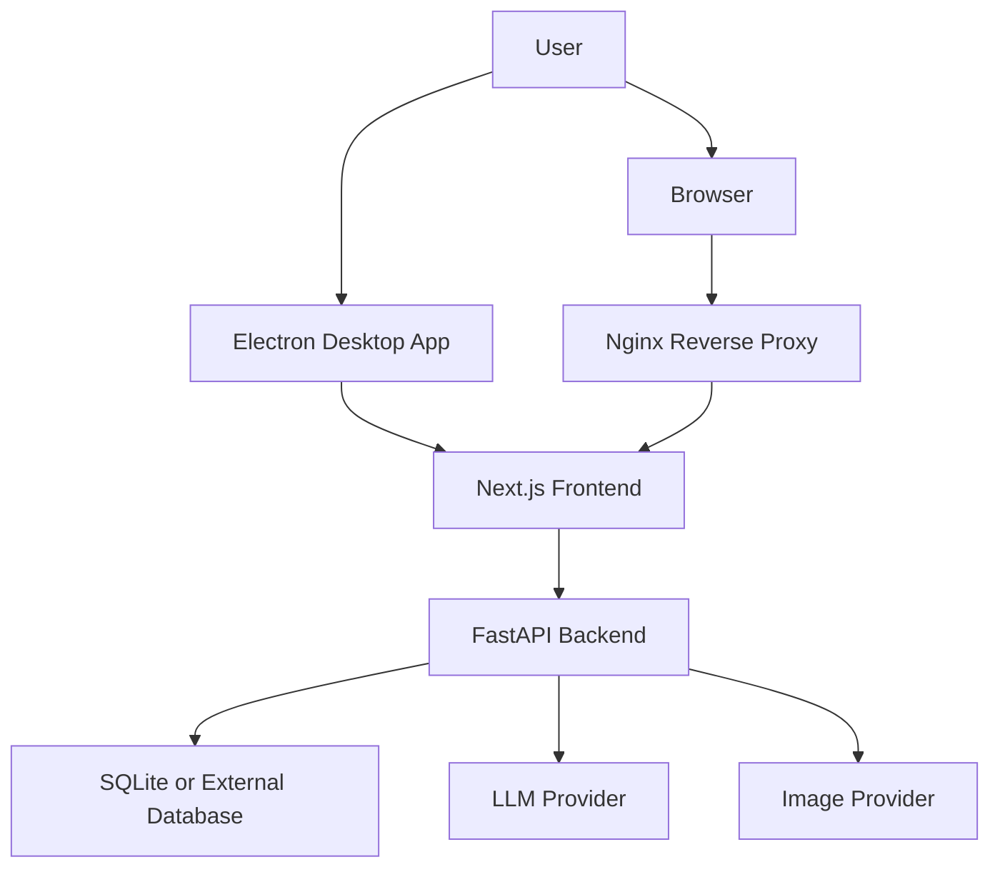
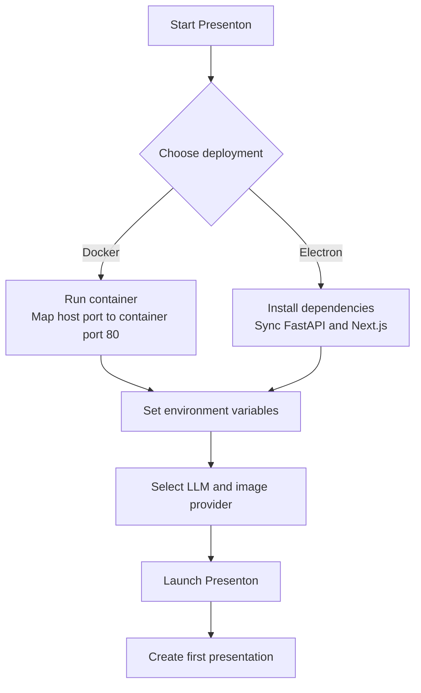
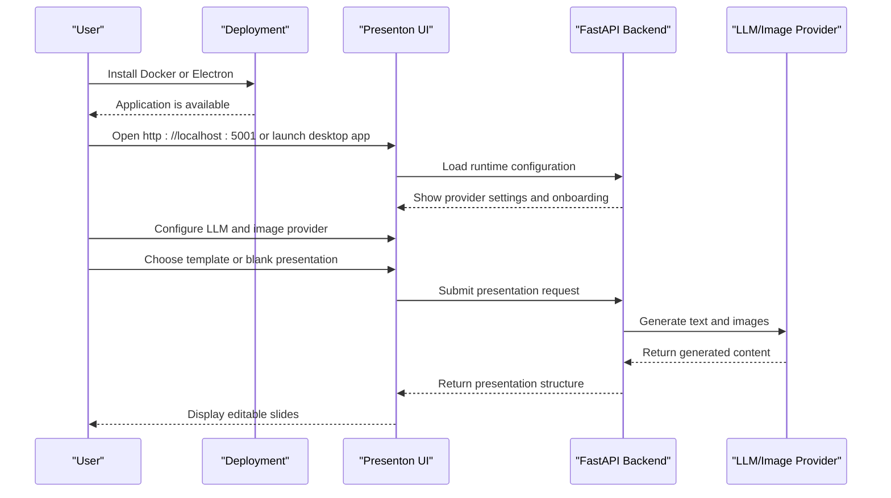
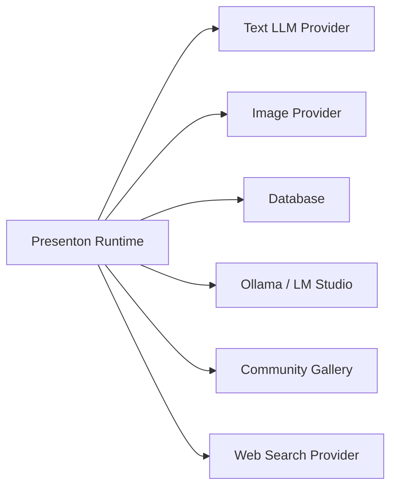

# Getting Started

<cite>
**Referenced Files in This Document**
- [README.md](file://README.md)
- [Dockerfile](file://Dockerfile)
- [docker-compose.yml](file://docker-compose.yml)
- [electron/package.json](file://electron/package.json)
- [servers/fastapi/utils/get_env.py](file://servers/fastapi/utils/get_env.py)
- [servers/fastapi/utils/user_config.py](file://servers/fastapi/utils/user_config.py)
- [servers/nextjs/app/(presentation-generator)/services/api/presentation-generation.ts](file://servers/nextjs/app/(presentation-generator)/services/api/presentation-generation.ts)
</cite>

## Table of Contents
1. [Introduction](#introduction)
2. [Project Structure](#project-structure)
3. [Core Components](#core-components)
4. [Architecture Overview](#architecture-overview)
5. [Detailed Component Analysis](#detailed-component-analysis)
6. [Dependency Analysis](#dependency-analysis)
7. [Performance Considerations](#performance-considerations)
8. [Troubleshooting Guide](#troubleshooting-guide)
9. [Conclusion](#conclusion)

## Introduction
Presenton is an open-source AI presentation generator that lets you create, edit, and export professional presentations from prompts or uploaded documents. It is positioned as a self-hosted alternative to commercial tools such as Gamma, Canva, Beautiful AI, Decktopus, and Presentations AI.

Key benefits include:
- Full control over models and data
- No SaaS lock-in or forced subscriptions
- Self-hosted web deployment through Docker
- Native desktop experience through the Electron app
- Support for many LLM providers, including local Ollama and OpenAI-compatible endpoints
- Flexible image generation with stock libraries, Gemini, GPT Image, ComfyUI, Open WebUI, and OpenAI-compatible image endpoints
- Editable PowerPoint (PPTX) and PDF export
- Multi-user workspaces, API access, and MCP integration

The repository provides both a containerized runtime and a desktop application, sharing the same FastAPI backend and Next.js frontend.

**Section sources**
- [README.md:23-42](file://README.md#L23-L42)
- [README.md:220-239](file://README.md#L220-L239)

## Project Structure
At a high level, Presenton consists of:
- A Python FastAPI backend under `servers/fastapi`
- A Next.js frontend under `servers/nextjs`
- An Electron desktop wrapper under `electron`
- Docker build and compose configuration at the repository root
- Presentation templates under `templates`
- Documentation and scripts under `docs` and `scripts`

**Diagram sources**
- [Dockerfile:69-145](file://Dockerfile#L69-L145)
- [docker-compose.yml:1-129](file://docker-compose.yml#L1-L129)
- [electron/package.json:11-38](file://electron/package.json#L11-L38)

**Section sources**
- [Dockerfile:69-145](file://Dockerfile#L69-L145)
- [docker-compose.yml:1-129](file://docker-compose.yml#L1-L129)
- [electron/package.json:1-38](file://electron/package.json#L1-L38)

## Core Components
Presenton’s core runtime includes:
- **FastAPI backend**: Handles authentication, provider configuration, presentation creation, slide editing, async tasks, exports, and API/MCP endpoints.
- **Next.js frontend**: Provides the slide editor, template browser, onboarding, settings, and presentation generation UI.
- **Electron desktop app**: Bundles the backend and frontend into a native application for Windows, macOS, and Linux.
- **Docker image**: Runs Nginx, Node.js, Chromium, Tesseract OCR, fonts, and the Python backend in one container.
- **Environment configuration**: Controls LLM providers, image providers, database, community features, telemetry, memory, document parsing, and authentication.

For first-time users, the most important components are:
- The deployment method (Docker or Electron)
- The selected LLM provider
- The selected image provider
- The public URL and port mapping
- The persistent `app_data` directory

**Section sources**
- [README.md:267-347](file://README.md#L267-L347)
- [Dockerfile:77-145](file://Dockerfile#L77-L145)
- [docker-compose.yml:16-129](file://docker-compose.yml#L16-L129)

## Architecture Overview
Presenton supports two main deployment modes:

| Deployment mode | Best for | How it runs | Where configuration happens |
|---|---|---|---|
| Docker | Quick setup, server hosting, shared access | Container exposes HTTP on port 80; mapped to host port 5001 by default | Environment variables via `.env`, `docker run -e`, or `docker-compose.yml` |
| Electron desktop app | Native experience, offline-friendly development, local model usage | Node.js + Electron starts bundled backend and frontend inside the app window | Same environment variables as Docker can be used when running the bundled backend |

**Diagram sources**
- [README.md:276-347](file://README.md#L276-L347)
- [docker-compose.yml:8-15](file://docker-compose.yml#L8-L15)
- [electron/package.json:32-38](file://electron/package.json#L32-L38)

**Section sources**
- [README.md:267-347](file://README.md#L267-L347)
- [docker-compose.yml:1-15](file://docker-compose.yml#L1-L15)
- [electron/package.json:32-38](file://electron/package.json#L32-L38)

## Detailed Component Analysis

### What Presenton Is and Why It Matters
Presenton is designed for users who want AI-assisted presentation creation without vendor lock-in. You can use your own API keys, run local models through Ollama or LM Studio, connect OpenAI-compatible endpoints, and keep generated content and user data under your control.

It also supports:
- Prompt-based generation
- Document-based generation
- Template selection
- Slide editing
- PPTX and PDF export
- API and MCP access for automation

**Section sources**
- [README.md:23-42](file://README.md#L23-L42)
- [README.md:220-239](file://README.md#L220-L239)

### Docker Deployment

#### Prerequisites
- Docker installed and running
- Access to a terminal or command prompt
- Optional: NVIDIA Container Toolkit if you plan to use GPU acceleration with local models

#### Step-by-step installation
1. Run the official image and map port 5001 to the container’s port 80.
2. Persist application data by mounting `./app_data:/app_data`.
3. Open the application in your browser at `http://localhost:5001`.

Example commands:
- Linux/macOS shell:
  - `docker run -it --name presenton -p 5001:80 -v "./app_data:/app_data" ghcr.io/presenton/presenton:latest`
- Windows PowerShell:
  - `docker run -it --name presenton -p 5001:80 -v "${PWD}\app_data:/app_data" ghcr.io/presenton/presenton:latest`

Verification steps:
- Check that the container is running.
- Visit `http://localhost:5001`.
- If you see the Presenton interface, the deployment is successful.

If you need a different host port, set `PRESENTON_HTTP_HOST_PORT` or pass `-e PRESENTON_PUBLIC_URL=http://your-host:port`.

**Section sources**
- [README.md:319-341](file://README.md#L319-L341)
- [docker-compose.yml:8-15](file://docker-compose.yml#L8-L15)
- [Dockerfile:144-145](file://Dockerfile#L144-L145)

### Electron Desktop App

#### Prerequisites
- Node.js LTS
- npm
- Python 3.11
- uv for the FastAPI backend

#### Step-by-step installation
1. Enter the Electron directory:
   - `cd electron`
2. Run the initial setup:
   - `npm run setup:env`
3. Start the development desktop app:
   - `npm run dev`

What the setup does:
- Installs Node dependencies
- Runs `uv sync` in the FastAPI backend
- Installs Next.js dependencies
- Prepares export runtime and optional desktop assets

Verification steps:
- Confirm that the Electron window opens.
- Confirm that the backend and frontend start locally inside the desktop window.
- Try creating a blank presentation or using a built-in template.

Optional distribution builds:
- Build all artifacts: `npm run build:all`
- Distribute installers: `npm run dist`

**Section sources**
- [README.md:276-317](file://README.md#L276-L317)
- [electron/package.json:32-38](file://electron/package.json#L32-L38)

### Initial Configuration: LLM Providers
Presenton supports many text LLM providers. At minimum, you must select a provider and provide its required credentials.

Common provider variables include:
- `LLM`: Text provider name
- `OPENAI_API_KEY` / `OPENAI_MODEL`
- `GOOGLE_API_KEY` / `GOOGLE_MODEL`
- `ANTHROPIC_API_KEY` / `ANTHROPIC_MODEL`
- `AZURE_OPENAI_*` variables
- `BEDROCK_*` variables
- `OLLAMA_URL` / `OLLAMA_MODEL`
- `LMSTUDIO_BASE_URL` / `LMSTUDIO_MODEL`
- `CUSTOM_LLM_URL` / `CUSTOM_LLM_API_KEY` / `CUSTOM_MODEL`

You can configure these through:
- `.env` next to `docker-compose.yml`
- `docker run -e` flags
- Environment variables passed to the Electron backend

The backend reads these values through dedicated environment getters, and the UI merges existing user configuration with environment defaults.

**Section sources**
- [README.md:366-447](file://README.md#L366-L447)
- [docker-compose.yml:23-75](file://docker-compose.yml#L23-L75)
- [servers/fastapi/utils/get_env.py:88-309](file://servers/fastapi/utils/get_env.py#L88-L309)
- [servers/fastapi/utils/user_config.py:286-307](file://servers/fastapi/utils/user_config.py#L286-L307)

### Initial Configuration: Image Generation Services
Image generation is separate from text generation. Set `IMAGE_PROVIDER` to choose the backend, then supply the required credentials.

Supported image backends include:
- Stock images: `pexels`, `pixabay`
- Model-based images: `gemini_flash`, `gpt-image-2`, `gpt-image-1.5`
- Custom workflows: `comfyui`, `open_webui`
- Generic gateway: `openai_compatible`

Important variables:
- `DISABLE_IMAGE_GENERATION`
- `ENABLE_PARALLEL_IMAGE_GENERATION`
- `PEXELS_API_KEY`
- `PIXABAY_API_KEY`
- `GPT_IMAGE_2_QUALITY`
- `GPT_IMAGE_1_5_QUALITY`
- `COMFYUI_URL` / `COMFYUI_WORKFLOW`
- `OPEN_WEBUI_IMAGE_URL` / `OPEN_WEBUI_IMAGE_API_KEY`
- `OPENAI_COMPAT_IMAGE_BASE_URL` / `OPENAI_COMPAT_IMAGE_API_KEY` / `OPENAI_COMPAT_IMAGE_MODEL`

Parallel image generation applies to initial generation, slide editing, direct image requests, and assistant image tools.

**Section sources**
- [README.md:493-513](file://README.md#L493-L513)
- [docker-compose.yml:76-82](file://docker-compose.yml#L76-L82)
- [servers/fastapi/utils/get_env.py:312-334](file://servers/fastapi/utils/get_env.py#L312-L334)
- [servers/fastapi/utils/get_env.py:320-330](file://servers/fastapi/utils/get_env.py#L320-L330)

### Basic Environment Variables
Beyond providers, consider these foundational variables:

| Variable | Purpose |
|---|---|
| `PRESENTON_PUBLIC_URL` | Browser-reachable origin for generated links |
| `DATABASE_URL` | Optional external database URL; otherwise SQLite under app data |
| `MIGRATE_DATABASE_ON_STARTUP` | Runs migrations automatically unless disabled |
| `PRESENTATION_GENERATION_MODE` | Restricts UI to `standard`, `smart`, or both |
| `PRESENTON_COMMUNITY_ENABLED` | Enables or disables cloud-backed Community gallery |
| `DISABLE_ANONYMOUS_TRACKING` | Disables anonymous telemetry |
| `AUTH_USERNAME` / `AUTH_PASSWORD` | Creates or rotates the primary administrator account |

**Section sources**
- [README.md:345-364](file://README.md#L345-L364)
- [README.md:486-519](file://README.md#L486-L519)
- [README.md:520-603](file://README.md#L520-L603)
- [docker-compose.yml:16-22](file://docker-compose.yml#L16-L22)
- [servers/fastapi/utils/get_env.py:17-45](file://servers/fastapi/utils/get_env.py#L17-L45)

### First-Time User Workflow
This workflow takes you from installation to creating your first presentation.

**Diagram sources**
- [README.md:319-347](file://README.md#L319-L347)
- [servers/nextjs/app/(presentation-generator)/services/api/presentation-generation.ts:94-141](file://servers/nextjs/app/(presentation-generator)/services/api/presentation-generation.ts#L94-L141)

Step-by-step flow:
1. Install Presenton using Docker or Electron.
2. Open the application.
3. Configure at least one LLM provider.
4. Optionally configure an image provider.
5. Choose a template or start from a blank presentation.
6. Provide a prompt or upload a document.
7. Generate the presentation.
8. Edit slides in the drag-and-drop editor.
9. Export to PPTX or PDF.

**Section sources**
- [README.md:319-347](file://README.md#L319-L347)
- [servers/nextjs/app/(presentation-generator)/services/api/presentation-generation.ts:94-141](file://servers/nextjs/app/(presentation-generator)/services/api/presentation-generation.ts#L94-L141)

### Common Setup Issues and Troubleshooting

| Symptom | Likely cause | Resolution |
|---|---|---|
| Browser cannot reach Presenton | Port not mapped or wrong host port | Map container port 80 to a host port and verify `http://localhost:5001` |
| Generated links use wrong origin | `PRESENTON_PUBLIC_URL` missing or incorrect | Set `PRESENTON_PUBLIC_URL` to the browser-reachable base URL |
| Database errors on startup | Missing or invalid `DATABASE_URL` | Use SQLite by leaving `DATABASE_URL` unset, or provide a valid SQLAlchemy URL |
| Migrations fail | External migration management conflicts | Keep `MIGRATE_DATABASE_ON_STARTUP=true` unless managing migrations externally |
| LLM calls fail | Missing or incorrect provider key/model | Verify `LLM` and the corresponding API key and model variables |
| Image generation fails | Missing image provider credentials or disabled feature | Set `IMAGE_PROVIDER` and required keys, or disable image generation temporarily |
| Community gallery unavailable in air-gapped environments | Community feature enabled by default | Set `PRESENTON_COMMUNITY_ENABLED=false` |
| Electron app does not start | Missing Node, Python, or uv dependencies | Run `npm run setup:env` from the `electron` directory |
| Local model connection issues | Wrong Ollama/LM Studio URL or model name | Verify `OLLAMA_URL`/`LMSTUDIO_BASE_URL` and model names |
| Authentication problems | Primary admin credentials not set or rotated incorrectly | Use `AUTH_USERNAME`, `AUTH_PASSWORD`, `AUTH_OVERRIDE_FROM_ENV`, or `RESET_AUTH` as documented |

Additional notes:
- For air-gapped deployments, disable the Community gallery to prevent outbound requests.
- For multi-user setups, create the primary administrator through the UI or environment variables.
- For API and MCP clients, use administrator-provisioned API keys; browser JWT cookies are not accepted by MCP.

**Section sources**
- [README.md:351-364](file://README.md#L351-L364)
- [README.md:486-519](file://README.md#L486-L519)
- [README.md:520-603](file://README.md#L520-L603)
- [README.md:605-660](file://README.md#L605-L660)
- [servers/fastapi/utils/get_env.py:17-45](file://servers/fastapi/utils/get_env.py#L17-L45)

## Dependency Analysis
Presenton’s runtime depends on several external services and system components:

Key dependency categories:
- **Text LLMs**: OpenAI, Google, Vertex, Azure, Bedrock, Anthropic, Fireworks, Together, Cerebras, DeepSeek, OpenRouter, LiteLLM, LM Studio, Ollama, custom OpenAI-compatible endpoints, Codex.
- **Image providers**: Pexels, Pixabay, Gemini Flash, GPT Image 2/1.5, ComfyUI, Open WebUI, OpenAI-compatible image endpoints.
- **Data storage**: SQLite by default, or an external database via `DATABASE_URL`.
- **Local model servers**: Ollama and LM Studio for local inference.
- **Optional services**: Community gallery, web search providers, Mem0 presentation memory, LiteParse document parsing.

**Diagram sources**
- [README.md:366-513](file://README.md#L366-L513)
- [docker-compose.yml:23-124](file://docker-compose.yml#L23-L124)

**Section sources**
- [README.md:366-513](file://README.md#L366-L513)
- [docker-compose.yml:23-124](file://docker-compose.yml#L23-L124)

## Performance Considerations
- Use `ENABLE_PARALLEL_IMAGE_GENERATION=false` if your image provider has strict rate limits.
- Tune `MAX_OUTLINE_WORDS` to control outline length and token usage.
- Adjust `LLM_GENERATION_PROFILE` and reasoning-related variables to balance speed and depth.
- For local models, ensure sufficient CPU/GPU resources and correct Ollama/LM Studio connectivity.
- In Docker, persist `app_data` so databases, templates, images, and exports survive container restarts.
- Disable unnecessary features like Community or image generation if they are not needed.

[No sources needed since this section provides general guidance]

## Troubleshooting Guide
Use this checklist when something goes wrong during setup or first use:

1. **Verify deployment**
   - Docker: confirm the container is running and port 80 is mapped.
   - Electron: confirm dependencies were installed with `npm run setup:env`.

2. **Check environment variables**
   - Ensure `LLM` matches the intended provider.
   - Ensure required API keys and model names are set.
   - Ensure `IMAGE_PROVIDER` and related keys are configured if images are needed.

3. **Check persistence**
   - Confirm `./app_data` is mounted or stored where expected.
   - Do not manually delete `userConfig.json` to reset authentication; use the documented recovery variables.

4. **Test basic generation**
   - Start with a simple prompt and a known-working provider.
   - Disable image generation temporarily to isolate text-only generation.

5. **Review logs**
   - For Docker, inspect container logs.
   - For Electron, check the desktop app console and backend logs.

6. **Recover authentication**
   - Use `AUTH_USERNAME`, `AUTH_PASSWORD`, `AUTH_OVERRIDE_FROM_ENV`, or `RESET_AUTH` as documented.
   - Remember that API keys and MCP credentials are separate from browser login.

**Section sources**
- [README.md:319-347](file://README.md#L319-L347)
- [README.md:520-603](file://README.md#L520-L603)
- [README.md:605-660](file://README.md#L605-L660)

## Conclusion
Presenton gives you a complete, self-hosted AI presentation workflow. Whether you prefer Docker for quick server deployment or the Electron desktop app for a native experience, you retain full control over models, data, and output. Start with a minimal LLM configuration, add image generation as needed, and move from prompt or document to editable slides and professional exports. When issues arise, focus on provider credentials, environment variables, persistence, and authentication recovery before changing deeper configuration.

[No sources needed since this section summarizes without analyzing specific files]