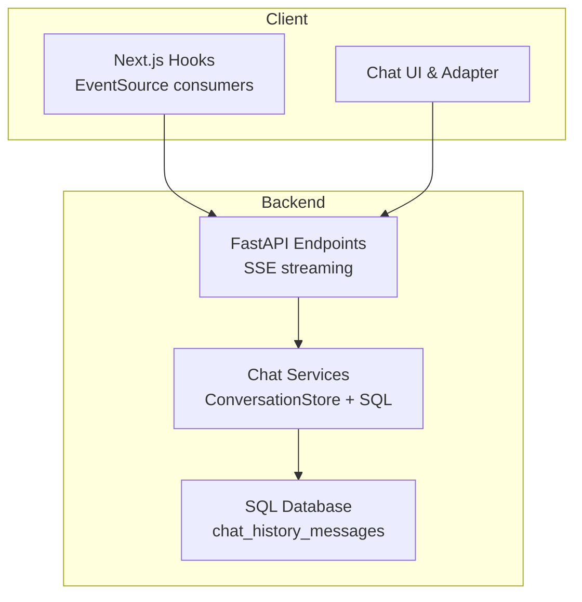
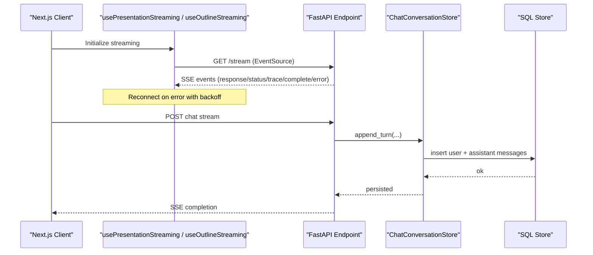
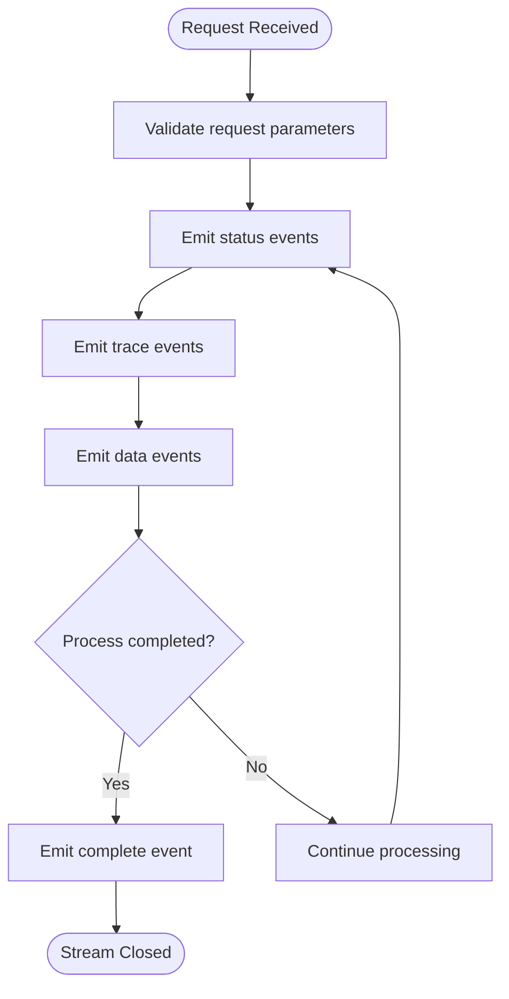
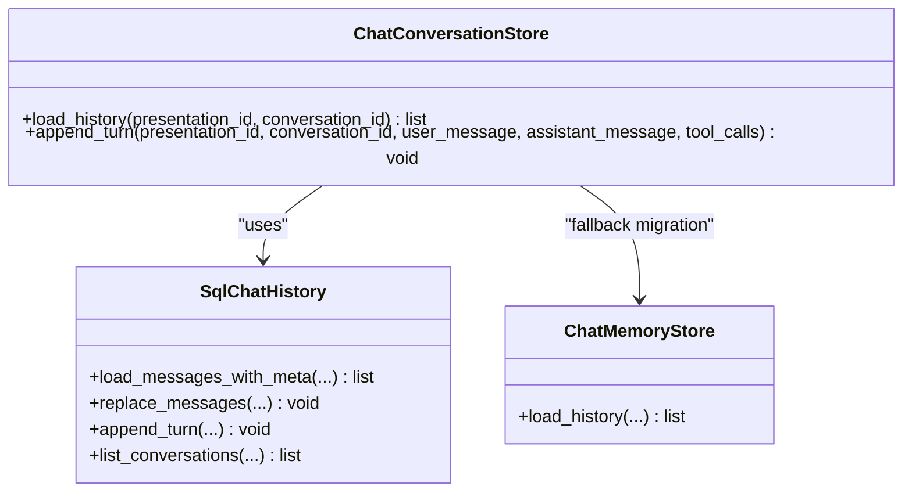
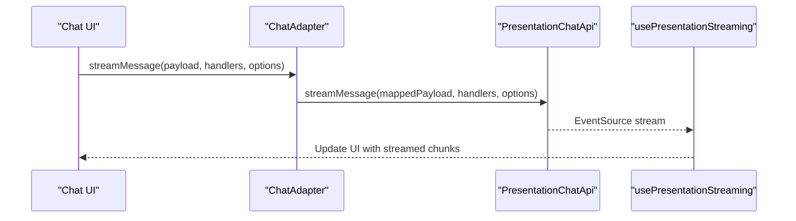
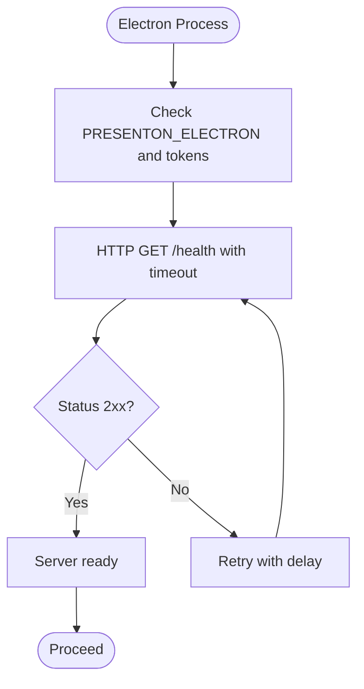
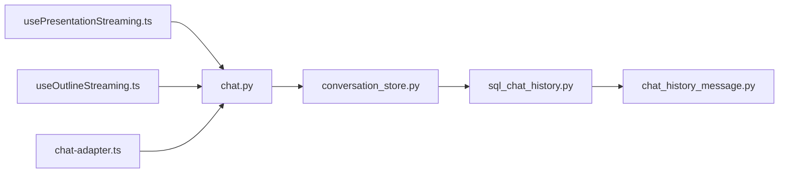

# Real-Time Collaboration

<cite>
**Referenced Files in This Document**
- [chat.py](file://servers/fastapi/api/v1/ppt/endpoints/chat.py)
- [sse_response.py](file://servers/fastapi/models/sse_response.py)
- [conversation_store.py](file://servers/fastapi/services/chat/conversation_store.py)
- [sql_chat_history.py](file://servers/fastapi/services/chat/sql_chat_history.py)
- [chat_memory_store.py](file://servers/fastapi/services/chat/chat_memory_store.py)
- [chat_history_message.py](file://servers/fastapi/models/sql/chat_history_message.py)
- [c7b70d0f31b1_added_chat_history_messages_table.py](file://servers/fastapi/alembic/versions/c7b70d0f31b1_added_chat_history_messages_table.py)
- [chat-adapter.ts](file://servers/nextjs/app/(presentation-generator)/presentation/components/chat/chat-adapter.ts)
- [Chat.tsx](file://servers/nextjs/app/(presentation-generator)/presentation/components/Chat.tsx)
- [usePresentationStreaming.ts](file://servers/nextjs/app/(presentation-generator)/presentation/hooks/usePresentationStreaming.ts)
- [useOutlineStreaming.ts](file://servers/nextjs/app/(presentation-generator)/outline/hooks/useOutlineStreaming.ts)
- [desktop-auth.ts](file://servers/nextjs/lib/desktop-auth.ts)
- [servers.ts](file://electron/app/utils/servers.ts)
</cite>

## Table of Contents
1. [Introduction](#introduction)
2. [Project Structure](#project-structure)
3. [Core Components](#core-components)
4. [Architecture Overview](#architecture-overview)
5. [Detailed Component Analysis](#detailed-component-analysis)
6. [Dependency Analysis](#dependency-analysis)
7. [Performance Considerations](#performance-considerations)
8. [Troubleshooting Guide](#troubleshooting-guide)
9. [Conclusion](#conclusion)

## Introduction
This document explains Presenton’s real-time collaboration features with a focus on:
- Streaming-based communication for live updates (Server-Sent Events and EventSource).
- Chat system integration, conversation persistence, and message history management.
- Client-side synchronization patterns for streaming data.
- Scalability considerations for concurrent users and connection management.
- Debugging tools and monitoring guidance for real-time features.

Note: The repository implements streaming via Server-Sent Events (SSE) rather than WebSockets. There is no WebSocket server implementation present in the codebase.

## Project Structure
The real-time collaboration surface spans:
- Backend FastAPI endpoints that stream responses using SSE models.
- Chat services that persist conversations and messages to SQL and provide migration from legacy memory storage.
- Next.js client hooks that consume streams via EventSource and manage retry logic.
- Electron utilities for local server health checks and desktop authentication.

**Diagram sources**
- [usePresentationStreaming.ts:298-308](file://servers/nextjs/app/(presentation-generator)/presentation/hooks/usePresentationStreaming.ts#L298-L308)
- [useOutlineStreaming.ts:225-243](file://servers/nextjs/app/(presentation-generator)/outline/hooks/useOutlineStreaming.ts#L225-L243)
- [chat.py:49-75](file://servers/fastapi/api/v1/ppt/endpoints/chat.py#L49-L75)
- [conversation_store.py:13-47](file://servers/fastapi/services/chat/conversation_store.py#L13-L47)
- [sql_chat_history.py:161-248](file://servers/fastapi/services/chat/sql_chat_history.py#L161-L248)

**Section sources**
- [usePresentationStreaming.ts:121-308](file://servers/nextjs/app/(presentation-generator)/presentation/hooks/usePresentationStreaming.ts#L121-L308)
- [useOutlineStreaming.ts:225-264](file://servers/nextjs/app/(presentation-generator)/outline/hooks/useOutlineStreaming.ts#L225-L264)
- [chat.py:49-75](file://servers/fastapi/api/v1/ppt/endpoints/chat.py#L49-L75)
- [conversation_store.py:1-47](file://servers/fastapi/services/chat/conversation_store.py#L1-L47)
- [sql_chat_history.py:161-248](file://servers/fastapi/services/chat/sql_chat_history.py#L161-L248)

## Core Components
- Streaming endpoints (FastAPI): Provide SSE-based event streams for presentation generation and chat interactions.
- Chat persistence layer: Manages conversation metadata, message ordering, and migration from in-memory storage to SQL.
- Client streaming hooks: Consume SSE streams, handle reconnection, and update UI state.
- Desktop auth helpers: Secure local-to-server communication and token validation.

Key responsibilities:
- Backend: Stream structured events, persist chat turns, and serve conversation history.
- Frontend: Open EventSource connections, parse typed events, and reconcile UI state.
- Data layer: Ensure ordered message storage and consistent retrieval across sessions.

**Section sources**
- [chat.py:49-75](file://servers/fastapi/api/v1/ppt/endpoints/chat.py#L49-L75)
- [sse_response.py:6-23](file://servers/fastapi/models/sse_response.py#L6-L23)
- [conversation_store.py:13-47](file://servers/fastapi/services/chat/conversation_store.py#L13-L47)
- [sql_chat_history.py:190-248](file://servers/fastapi/services/chat/sql_chat_history.py#L190-L248)
- [usePresentationStreaming.ts:298-308](file://servers/nextjs/app/(presentation-generator)/presentation/hooks/usePresentationStreaming.ts#L298-L308)
- [useOutlineStreaming.ts:225-243](file://servers/nextjs/app/(presentation-generator)/outline/hooks/useOutlineStreaming.ts#L225-L243)

## Architecture Overview
The collaboration architecture uses SSE for real-time updates:
- Clients open an EventSource to backend endpoints.
- Backend emits typed SSE events (data, status, trace, complete, error).
- Chat service persists user and assistant turns with stable ordering.
- Legacy in-memory chat history is migrated to SQL on demand.

**Diagram sources**
- [usePresentationStreaming.ts:298-308](file://servers/nextjs/app/(presentation-generator)/presentation/hooks/usePresentationStreaming.ts#L298-L308)
- [useOutlineStreaming.ts:225-243](file://servers/nextjs/app/(presentation-generator)/outline/hooks/useOutlineStreaming.ts#L225-L243)
- [chat.py:49-75](file://servers/fastapi/api/v1/ppt/endpoints/chat.py#L49-L75)
- [conversation_store.py:39-47](file://servers/fastapi/services/chat/conversation_store.py#L39-L47)
- [sql_chat_history.py:190-248](file://servers/fastapi/services/chat/sql_chat_history.py#L190-L248)

## Detailed Component Analysis

### Streaming Endpoints and SSE Models
- Endpoints emit structured SSE events for streaming responses, including data payloads, status updates, traces, completion markers, and errors.
- SSE response models define the shape of each event type.

**Diagram sources**
- [chat.py:143-163](file://servers/fastapi/api/v1/ppt/endpoints/chat.py#L143-L163)
- [sse_response.py:6-23](file://servers/fastapi/models/sse_response.py#L6-L23)

**Section sources**
- [chat.py:49-75](file://servers/fastapi/api/v1/ppt/endpoints/chat.py#L49-L75)
- [sse_response.py:6-23](file://servers/fastapi/models/sse_response.py#L6-L23)

### Chat Conversation Persistence and History Management
- Conversation store loads history from SQL; if none exists, it falls back to legacy in-memory store and migrates it to SQL.
- Append turn writes both user and assistant messages with deterministic ordering using position counters.
- Message table includes indexes for efficient queries by conversation and presentation scope.

**Diagram sources**
- [conversation_store.py:13-47](file://servers/fastapi/services/chat/conversation_store.py#L13-L47)
- [sql_chat_history.py:161-248](file://servers/fastapi/services/chat/sql_chat_history.py#L161-L248)
- [chat_memory_store.py](file://servers/fastapi/services/chat/chat_memory_store.py)

**Section sources**
- [conversation_store.py:1-47](file://servers/fastapi/services/chat/conversation_store.py#L1-L47)
- [sql_chat_history.py:161-248](file://servers/fastapi/services/chat/sql_chat_history.py#L161-L248)
- [c7b70d0f31b1_added_chat_history_messages_table.py:35-105](file://servers/fastapi/alembic/versions/c7b70d0f31b1_added_chat_history_messages_table.py#L35-L105)

### Client-Side Streaming and Synchronization
- Presentation streaming hook opens an EventSource to the backend, parses JSON events, tracks retries, and updates application state.
- Outline streaming hook similarly manages EventSource lifecycle, error handling, and retry scheduling.
- Chat adapter maps frontend calls to backend APIs and supports streaming message handlers.

**Diagram sources**
- [chat-adapter.ts:4-23](file://servers/nextjs/app/(presentation-generator)/presentation/components/chat/chat-adapter.ts#L4-L23)
- [usePresentationStreaming.ts:298-308](file://servers/nextjs/app/(presentation-generator)/presentation/hooks/usePresentationStreaming.ts#L298-L308)

**Section sources**
- [chat-adapter.ts:1-23](file://servers/nextjs/app/(presentation-generator)/presentation/components/chat/chat-adapter.ts#L1-L23)
- [Chat.tsx:1239-1283](file://servers/nextjs/app/(presentation-generator)/presentation/components/Chat.tsx#L1239-L1283)
- [usePresentationStreaming.ts:121-308](file://servers/nextjs/app/(presentation-generator)/presentation/hooks/usePresentationStreaming.ts#L121-L308)
- [useOutlineStreaming.ts:225-264](file://servers/nextjs/app/(presentation-generator)/outline/hooks/useOutlineStreaming.ts#L225-L264)

### Desktop Authentication and Local Server Health
- Desktop auth helper validates environment configuration and request origins for secure local-to-server communication.
- Electron utility performs HTTP health checks against the local server with timeouts and abort signals.

**Diagram sources**
- [desktop-auth.ts:4-31](file://servers/nextjs/lib/desktop-auth.ts#L4-L31)
- [servers.ts:375-428](file://electron/app/utils/servers.ts#L375-L428)

**Section sources**
- [desktop-auth.ts:1-31](file://servers/nextjs/lib/desktop-auth.ts#L1-L31)
- [servers.ts:375-428](file://electron/app/utils/servers.ts#L375-L428)

## Dependency Analysis
The following diagram shows key dependencies among streaming, chat persistence, and client components.

**Diagram sources**
- [usePresentationStreaming.ts:298-308](file://servers/nextjs/app/(presentation-generator)/presentation/hooks/usePresentationStreaming.ts#L298-L308)
- [useOutlineStreaming.ts:225-243](file://servers/nextjs/app/(presentation-generator)/outline/hooks/useOutlineStreaming.ts#L225-L243)
- [chat-adapter.ts:4-23](file://servers/nextjs/app/(presentation-generator)/presentation/components/chat/chat-adapter.ts#L4-L23)
- [chat.py:49-75](file://servers/fastapi/api/v1/ppt/endpoints/chat.py#L49-L75)
- [conversation_store.py:13-47](file://servers/fastapi/services/chat/conversation_store.py#L13-L47)
- [sql_chat_history.py:161-248](file://servers/fastapi/services/chat/sql_chat_history.py#L161-L248)
- [chat_history_message.py](file://servers/fastapi/models/sql/chat_history_message.py)

**Section sources**
- [chat.py:49-75](file://servers/fastapi/api/v1/ppt/endpoints/chat.py#L49-L75)
- [conversation_store.py:13-47](file://servers/fastapi/services/chat/conversation_store.py#L13-L47)
- [sql_chat_history.py:161-248](file://servers/fastapi/services/chat/sql_chat_history.py#L161-L248)

## Performance Considerations
- Streaming efficiency: Use SSE for incremental updates to minimize payload size and reduce round-trips.
- Reconnection strategy: Implement exponential backoff and bounded retries to avoid thundering herds.
- State reconciliation: Apply idempotent updates on the client side to handle duplicate or out-of-order events.
- Database indexing: Ensure proper indexes on conversation_id, presentation_id, and position fields for fast retrieval.
- Resource cleanup: Close EventSource connections promptly and clear timers to prevent memory leaks.

[No sources needed since this section provides general guidance]

## Troubleshooting Guide
Common issues and resolutions:
- Connection failures: Inspect EventSource error events and verify server availability.
- Missing chat history: Confirm SQL migration and fallback to legacy memory store behavior.
- Desktop auth errors: Validate environment variables and allowed origins/hosts.
- Streaming stalls: Check SSE event emission and ensure complete events are sent.

Actionable checks:
- Verify EventSource URL and headers.
- Review backend logs for SSE event emission and database operations.
- Confirm presence of chat_history_messages table and indexes.
- Test local server health endpoint from Electron process.

**Section sources**
- [useOutlineStreaming.ts:225-243](file://servers/nextjs/app/(presentation-generator)/outline/hooks/useOutlineStreaming.ts#L225-L243)
- [chat.py:49-75](file://servers/fastapi/api/v1/ppt/endpoints/chat.py#L49-L75)
- [c7b70d0f31b1_added_chat_history_messages_table.py:35-105](file://servers/fastapi/alembic/versions/c7b70d0f31b1_added_chat_history_messages_table.py#L35-L105)
- [desktop-auth.ts:14-31](file://servers/nextjs/lib/desktop-auth.ts#L14-L31)
- [servers.ts:375-428](file://electron/app/utils/servers.ts#L375-L428)

## Conclusion
Presenton’s real-time collaboration relies on SSE-based streaming for live updates and a robust chat persistence layer that migrates legacy in-memory data to SQL. The client-side hooks manage EventSource connections with resilient reconnection strategies. While WebSockets are not implemented in this repository, the current design provides scalable, ordered, and persistent real-time experiences suitable for collaborative editing workflows.

[No sources needed since this section summarizes without analyzing specific files]