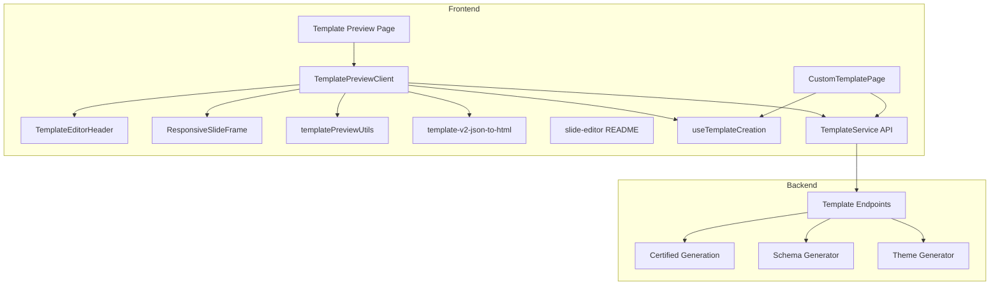
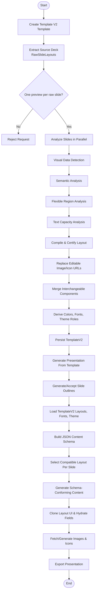
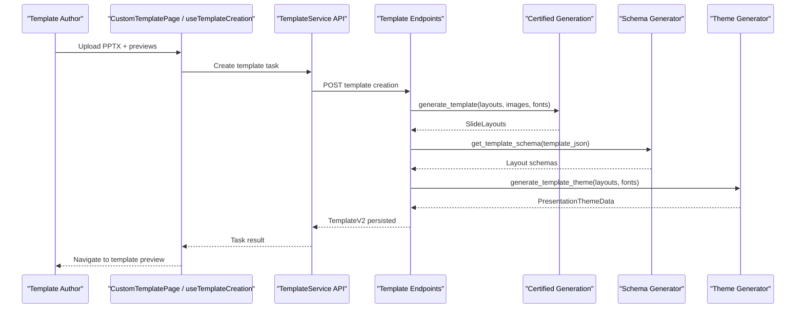
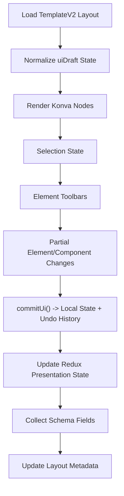
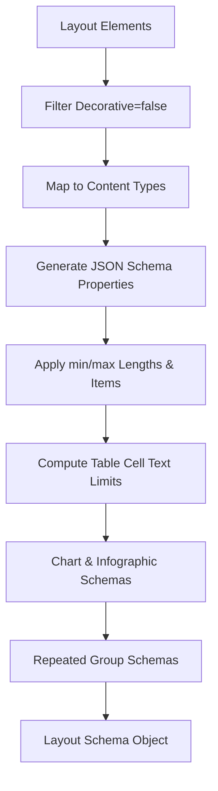
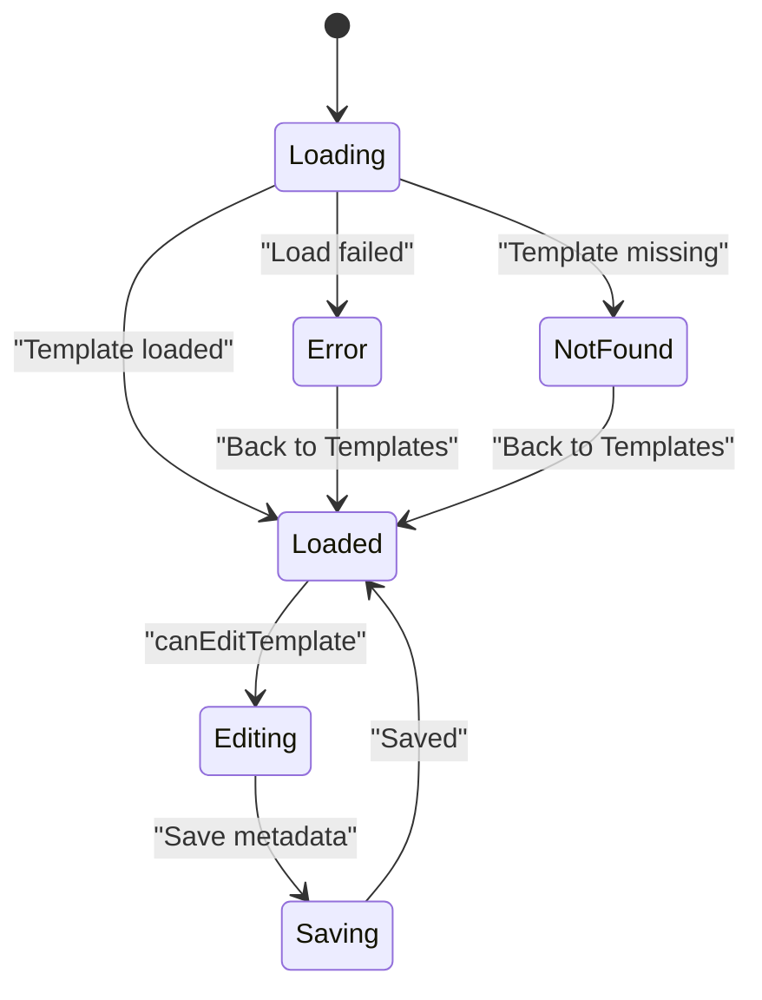
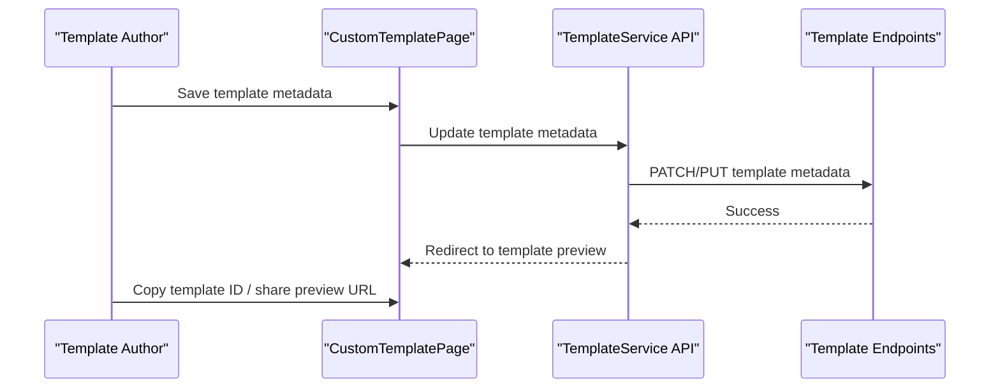
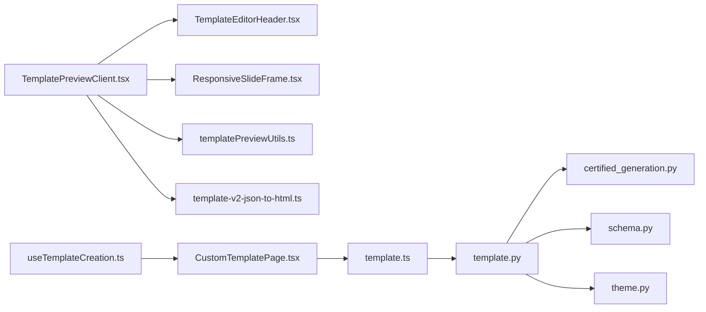

# Custom Template Creation

<cite>
**Referenced Files in This Document**
- [template-v2.md](file://docs/template-v2.md)
- [certified_generation.py](file://servers/fastapi/templates/v2/certified_generation.py)
- [schema.py](file://servers/fastapi/templates/v2/schema.py)
- [theme.py](file://servers/fastapi/templates/v2/theme.py)
- [TemplatePreviewClient.tsx](file://servers/nex tjs/app/(presentation-generator)/template-preview/components/TemplatePreviewClient.tsx)
- [TemplateEditorHeader.tsx](file://servers/nex tjs/app/(presentation-generator)/template-preview/components/editor/TemplateEditorHeader.tsx)
- [ResponsiveSlideFrame.tsx](file://servers/nex tjs/app/(presentation-generator)/template-preview/components/editor/ResponsiveSlideFrame.tsx)
- [templatePreviewUtils.ts](file://servers/nex tjs/app/(presentation-generator)/template-preview/components/editor/templatePreviewUtils.ts)
- [template-v2-json-to-html.ts](file://servers/nex tjs/lib/template-v2-json-to-html.ts)
- [slide-editor README.md](file://servers/nex tjs/components/slide-editor/README.md)
- [useTemplateCreation.ts](file://servers/nex tjs/app/(presentation-generator)/custom-template/hooks/useTemplateCreation.ts)
- [CustomTemplatePage.tsx](file://servers/nex tjs/app/(presentation-generator)/custom-template/CustomTemplatePage.tsx)
- [template.ts](file://servers/nex tjs/app/(presentation-generator)/services/api/template.ts)
- [template.py](file://servers/fastapi/api/v1/ppt/endpoints/template.py)
</cite>

## Table of Contents
1. [Introduction](#introduction)
2. [Project Structure](#project-structure)
3. [Core Components](#core-components)
4. [Architecture Overview](#architecture-overview)
5. [Detailed Component Analysis](#detailed-component-analysis)
6. [Dependency Analysis](#dependency-analysis)
7. [Performance Considerations](#performance-considerations)
8. [Troubleshooting Guide](#troubleshooting-guide)
9. [Conclusion](#conclusion)
10. [Appendices](#appendices)

## Introduction
This document explains how to create custom templates in Presenton using the built-in template editor and the Template V2 system. It covers the end-to-end workflow for designing slide layouts, defining editable components, setting up content placeholders, configuring template behavior, previewing results, validating schemas, and publishing templates for reuse.

Template V2 treats a presentation as a JSON-driven layout system. A source PowerPoint deck is converted into reusable slide layouts with semantic components, editable fields, flexible regions, and generated theme metadata. The frontend provides an interactive editor where authors can refine layouts, test content density, inspect generated schemas, and save or update templates.

## Project Structure
The template authoring experience spans both backend services and the Next.js frontend:

- Backend Template V2 pipeline:
  - Certified layout generation from PPTX slides and rendered previews.
  - Editable content schema derivation.
  - Theme profiling and role selection.
- Frontend template editor and preview:
  - Template preview page and client state.
  - Editor header, responsive slide frame, and utility functions.
  - HTML rendering path for preview/export.
  - Template creation hooks and API service calls.
  - Backend template endpoints for persistence and lifecycle management.

**Diagram sources**
- [TemplatePreviewClient.tsx](file://servers/nex tjs/app/(presentation-generator)/template-preview/components/TemplatePreviewClient.tsx)
- [TemplateEditorHeader.tsx](file://servers/nex tjs/app/(presentation-generator)/template-preview/components/editor/TemplateEditorHeader.tsx)
- [ResponsiveSlideFrame.tsx](file://servers/nex tjs/app/(presentation-generator)/template-preview/components/editor/ResponsiveSlideFrame.tsx)
- [templatePreviewUtils.ts](file://servers/nex tjs/app/(presentation-generator)/template-preview/components/editor/templatePreviewUtils.ts)
- [template-v2-json-to-html.ts](file://servers/nex tjs/lib/template-v2-json-to-html.ts)
- [slide-editor README.md](file://servers/nex tjs/components/slide-editor/README.md)
- [useTemplateCreation.ts](file://servers/nex tjs/app/(presentation-generator)/custom-template/hooks/useTemplateCreation.ts)
- [CustomTemplatePage.tsx](file://servers/nex tjs/app/(presentation-generator)/custom-template/CustomTemplatePage.tsx)
- [template.ts](file://servers/nex tjs/app/(presentation-generator)/services/api/template.ts)
- [template.py](file://servers/fastapi/api/v1/ppt/endpoints/template.py)
- [certified_generation.py](file://servers/fastapi/templates/v2/certified_generation.py)
- [schema.py](file://servers/fastapi/templates/v2/schema.py)
- [theme.py](file://servers/fastapi/templates/v2/theme.py)

**Section sources**
- [template-v2.md](file://docs/template-v2.md)
- [slide-editor README.md](file://servers/nex tjs/components/slide-editor/README.md)

## Core Components
- Template V2 architecture and flow:
  - Converts a PPTX into certified slide layouts.
  - Generates editable content schemas per layout.
  - Derives theme colors, fonts, and semantic roles.
- Backend services:
  - `certified_generation.py`: multi-pass vision analysis, validation, retries, component clustering, and merged component deduplication.
  - `schema.py`: converts layouts into JSON Schema definitions for generated content.
  - `theme.py`: profiles colors and fonts, selects semantic theme roles, and materializes theme data.
  - `template.py`: exposes template APIs, task orchestration, persistence, deletion, and response normalization.
- Frontend editor and preview:
  - `TemplatePreviewClient.tsx`: loads templates, manages layout state, handles editing permissions, density testing, analytics, and error states.
  - `TemplateEditorHeader.tsx`: provides save, copy, delete, undo/redo, and template name controls.
  - `ResponsiveSlideFrame.tsx`: renders the Konva-based slide editor at a responsive scale.
  - `templatePreviewUtils.ts`: updates layout metadata and collects schema fields for inspection.
  - `template-v2-json-to-html.ts`: converts Template V2 UI to HTML fragments for preview/export outside the editor.
  - `useTemplateCreation.ts` and `CustomTemplatePage.tsx`: drive template creation batches, processing state, saving metadata, and navigation.
  - `template.ts`: API client for template operations such as generating layouts and updating metadata.

**Section sources**
- [template-v2.md](file://docs/template-v2.md)
- [certified_generation.py](file://servers/fastapi/templates/v2/certified_generation.py)
- [schema.py](file://servers/fastapi/templates/v2/schema.py)
- [theme.py](file://servers/fastapi/templates/v2/theme.py)
- [template.py](file://servers/fastapi/api/v1/ppt/endpoints/template.py)
- [TemplatePreviewClient.tsx](file://servers/nex tjs/app/(presentation-generator)/template-preview/components/TemplatePreviewClient.tsx)
- [TemplateEditorHeader.tsx](file://servers/nex tjs/app/(presentation-generator)/template-preview/components/editor/TemplateEditorHeader.tsx)
- [ResponsiveSlideFrame.tsx](file://servers/nex tjs/app/(presentation-generator)/template-preview/components/editor/ResponsiveSlideFrame.tsx)
- [templatePreviewUtils.ts](file://servers/nex tjs/app/(presentation-generator)/template-preview/components/editor/templatePreviewUtils.ts)
- [template-v2-json-to-html.ts](file://servers/nex tjs/lib/template-v2-json-to-html.ts)
- [useTemplateCreation.ts](file://servers/nex tjs/app/(presentation-generator)/custom-template/hooks/useTemplateCreation.ts)
- [CustomTemplatePage.tsx](file://servers/nex tjs/app/(presentation-generator)/custom-template/CustomTemplatePage.tsx)
- [template.ts](file://servers/nex tjs/app/(presentation-generator)/services/api/template.ts)

## Architecture Overview
Template V2 has two primary workflows:

1. **Template creation**: Convert a source PPTX plus rendered slide previews into certified layouts, merge interchangeable components, and derive theme metadata.
2. **Presentation generation**: Use existing certified layouts to select compatible layouts, generate schema-conforming content, hydrate layouts, fetch/generate assets, and export.

**Diagram sources**
- [template-v2.md](file://docs/template-v2.md)

**Section sources**
- [template-v2.md](file://docs/template-v2.md)

## Detailed Component Analysis

### Template Creation Workflow
The creation workflow transforms a PPTX into reusable, editable slide layouts through focused, validated passes. Each slide is processed concurrently, and failures fall back to preserving source geometry when necessary.

Key steps:
- Extract raw slide layouts from the PPTX.
- Require one rendered preview image per raw slide.
- Run parallel certification passes:
  - Visual-data detection for charts, tables, lists, gauges.
  - Semantic grouping into reusable components.
  - Flexible-region planning for repeatable structures.
  - Text-capacity planning for safe growth.
  - Compilation and validation with retries.
- Replace editable image/icon URLs with placeholders.
- Cluster and de-duplicate structurally interchangeable components.
- Profile colors and fonts; select semantic theme roles.
- Persist the final `TemplateV2` record.

**Diagram sources**
- [CustomTemplatePage.tsx](file://servers/nex tjs/app/(presentation-generator)/custom-template/CustomTemplatePage.tsx)
- [useTemplateCreation.ts](file://servers/nex tjs/app/(presentation-generator)/custom-template/hooks/useTemplateCreation.ts)
- [template.ts](file://servers/nex tjs/app/(presentation-generator)/services/api/template.ts)
- [template.py](file://servers/fastapi/api/v1/ppt/endpoints/template.py)
- [certified_generation.py](file://servers/fastapi/templates/v2/certified_generation.py)
- [schema.py](file://servers/fastapi/templates/v2/schema.py)
- [theme.py](file://servers/fastapi/templates/v2/theme.py)

**Section sources**
- [template-v2.md](file://docs/template-v2.md)
- [certified_generation.py](file://servers/fastapi/templates/v2/certified_generation.py)
- [schema.py](file://servers/fastapi/templates/v2/schema.py)
- [theme.py](file://servers/fastapi/templates/v2/theme.py)
- [template.py](file://servers/fastapi/api/v1/ppt/endpoints/template.py)
- [useTemplateCreation.ts](file://servers/nex tjs/app/(presentation-generator)/custom-template/hooks/useTemplateCreation.ts)
- [CustomTemplatePage.tsx](file://servers/nex tjs/app/(presentation-generator)/custom-template/CustomTemplatePage.tsx)

### Editing Slide Layouts and Defining Editable Components
The frontend editor renders Template V2 layouts on a Konva canvas. Authors can select elements, adjust properties, group components, and define which parts are decorative versus editable.

Important behaviors:
- Editor rendering uses `TemplateV2KonvaSlide`.
- HTML rendering/export uses `template-v2-json-to-html.ts`.
- Layout metadata (id, description) can be updated during editing.
- Schema fields are collected to inspect editable content structure.

**Diagram sources**
- [slide-editor README.md](file://servers/nex tjs/components/slide-editor/README.md)
- [template-v2-json-to-html.ts](file://servers/nex tjs/lib/template-v2-json-to-html.ts)
- [templatePreviewUtils.ts](file://servers/nex tjs/app/(presentation-generator)/template-preview/components/editor/templatePreviewUtils.ts)

**Section sources**
- [slide-editor README.md](file://servers/nex tjs/components/slide-editor/README.md)
- [template-v2-json-to-html.ts](file://servers/nex tjs/lib/template-v2-json-to-html.ts)
- [templatePreviewUtils.ts](file://servers/nex tjs/app/(presentation-generator)/template-preview/components/editor/templatePreviewUtils.ts)

### Setting Up Content Placeholders and Configuring Template Behavior
Editable content is represented by JSON Schema definitions derived from layout elements. Only non-decorative elements become generated content fields. Supported content types include text, images, text lists, tables, charts, and infographics.

Behavioral configuration includes:
- Minimum/maximum lengths for text.
- Minimum/maximum items for arrays.
- Table row/column limits and cell text capacity.
- Chart and infographic data schemas.
- Repeated groups and flexible flows.

**Diagram sources**
- [schema.py](file://servers/fastapi/templates/v2/schema.py)

**Section sources**
- [schema.py](file://servers/fastapi/templates/v2/schema.py)

### Preview Capabilities and Validation Features
The template preview page loads templates, displays layouts, and allows editing only for non-default templates. It supports:
- Loading success, error, and not-found states.
- Density testing for variable content.
- Layout selection and metadata editing.
- Undo/redo history availability.
- Analytics tracking for load outcomes and changes.

Validation features include:
- Structured model validation for LLM responses during template creation.
- Retry mechanisms for invalid structured outputs.
- Deterministic fallbacks when LLM role selection fails.
- Schema generation that enforces required properties and additionalProperties constraints.

**Diagram sources**
- [TemplatePreviewClient.tsx](file://servers/nex tjs/app/(presentation-generator)/template-preview/components/TemplatePreviewClient.tsx)

**Section sources**
- [TemplatePreviewClient.tsx](file://servers/nex tjs/app/(presentation-generator)/template-preview/components/TemplatePreviewClient.tsx)
- [certified_generation.py](file://servers/fastapi/templates/v2/certified_generation.py)
- [schema.py](file://servers/fastapi/templates/v2/schema.py)

### Publishing Templates and Sharing With Other Users
Templates are persisted as `TemplateV2` records and exposed via API endpoints. Authors can:
- Create templates from PPTX uploads.
- Update template metadata (name, description).
- Delete custom templates.
- View template summaries including default and custom templates.

There is no explicit marketplace endpoint in the referenced files; distribution is handled through template listing, preview URLs, and asset references.

**Diagram sources**
- [CustomTemplatePage.tsx](file://servers/nex tjs/app/(presentation-generator)/custom-template/CustomTemplatePage.tsx)
- [template.ts](file://servers/nex tjs/app/(presentation-generator)/services/api/template.ts)
- [template.py](file://servers/fastapi/api/v1/ppt/endpoints/template.py)

**Section sources**
- [CustomTemplatePage.tsx](file://servers/nex tjs/app/(presentation-generator)/custom-template/CustomTemplatePage.tsx)
- [template.ts](file://servers/nex tjs/app/(presentation-generator)/services/api/template.ts)
- [template.py](file://servers/fastapi/api/v1/ppt/endpoints/template.py)

## Dependency Analysis
The template system exhibits clear separation between frontend editing/preview and backend certification/schema/theme generation.

**Diagram sources**
- [TemplatePreviewClient.tsx](file://servers/nex tjs/app/(presentation-generator)/template-preview/components/TemplatePreviewClient.tsx)
- [TemplateEditorHeader.tsx](file://servers/nex tjs/app/(presentation-generator)/template-preview/components/editor/TemplateEditorHeader.tsx)
- [ResponsiveSlideFrame.tsx](file://servers/nex tjs/app/(presentation-generator)/template-preview/components/editor/ResponsiveSlideFrame.tsx)
- [templatePreviewUtils.ts](file://servers/nex tjs/app/(presentation-generator)/template-preview/components/editor/templatePreviewUtils.ts)
- [template-v2-json-to-html.ts](file://servers/nex tjs/lib/template-v2-json-to-html.ts)
- [useTemplateCreation.ts](file://servers/nex tjs/app/(presentation-generator)/custom-template/hooks/useTemplateCreation.ts)
- [CustomTemplatePage.tsx](file://servers/nex tjs/app/(presentation-generator)/custom-template/CustomTemplatePage.tsx)
- [template.ts](file://servers/nex tjs/app/(presentation-generator)/services/api/template.ts)
- [template.py](file://servers/fastapi/api/v1/ppt/endpoints/template.py)
- [certified_generation.py](file://servers/fastapi/templates/v2/certified_generation.py)
- [schema.py](file://servers/fastapi/templates/v2/schema.py)
- [theme.py](file://servers/fastapi/templates/v2/theme.py)

**Section sources**
- [template-v2.md](file://docs/template-v2.md)
- [template.py](file://servers/fastapi/api/v1/ppt/endpoints/template.py)

## Performance Considerations
- Parallel slide processing:
  - Up to ten slides are analyzed concurrently during template creation.
- Token budget:
  - Template creation may request up to 16,000 completion tokens due to deeply nested components and element definitions.
- Coordinate system:
  - Layouts use a fixed 1280 x 720 coordinate space.
- Font mappings:
  - Supply font mappings for non-standard fonts to ensure consistent rendering and export.
- Preview requirements:
  - Rendered slide previews are mandatory because appearance and semantic grouping depend on actual pixels.

Best practices for large templates:
- Keep repeated collections coherent and structurally uniform to enable efficient merging and schema generation.
- Avoid excessive decorative layers that do not contribute to editable content.
- Use meaningful component ids and descriptions to improve layout selection and debugging.
- Test content density across low, medium, and high-density scenarios to prevent overflow.

**Section sources**
- [template-v2.md](file://docs/template-v2.md)
- [certified_generation.py](file://servers/fastapi/templates/v2/certified_generation.py)

## Troubleshooting Guide
Common issues and resolutions:

- Missing or mismatched slide previews:
  - Ensure exactly one rendered preview image exists for each raw slide.
- Vision-capable model requirement:
  - Template creation requires a text model that supports vision input; an image-generation model alone is insufficient.
- Invalid structured responses:
  - The backend retries and validates structured outputs; check provider rate limits and output reliability.
- Default templates are read-only:
  - Built-in templates cannot be deleted or edited; create custom templates for modifications.
- Template loading errors:
  - The preview page shows explicit error and not-found states; verify template id and access permissions.
- Density testing warnings:
  - If no variable content exists, density testing will notify that editable text or repeatable schema arrays are required.

Debugging tools:
- Use the editor’s undo/redo history to revert layout changes.
- Inspect collected schema fields to validate editable content structure.
- Track analytics events for template load outcomes and schema changes.
- Review backend logs for multi-pass generation progress and retry counts.

**Section sources**
- [template-v2.md](file://docs/template-v2.md)
- [TemplatePreviewClient.tsx](file://servers/nex tjs/app/(presentation-generator)/template-preview/components/TemplatePreviewClient.tsx)
- [template.py](file://servers/fastapi/api/v1/ppt/endpoints/template.py)
- [templatePreviewUtils.ts](file://servers/nex tjs/app/(presentation-generator)/template-preview/components/editor/templatePreviewUtils.ts)

## Conclusion
Presenton’s Template V2 system provides a robust, schema-driven approach to creating reusable presentation templates. The backend performs careful visual and semantic analysis to produce certified layouts, while the frontend offers an interactive editor for refining layouts, defining editable components, and validating generated schemas. By following the recommended workflows, best practices, and troubleshooting strategies, authors can build high-quality templates that render consistently, support dynamic content, and integrate smoothly with presentation generation.

## Appendices

### Step-by-Step Guide: Creating a Custom Template
1. Prepare a PPTX deck and rendered slide previews.
2. Open the custom template creation flow in the frontend.
3. Upload the PPTX and previews; start template creation.
4. Wait for parallel certification passes to complete.
5. Review generated layouts and edit as needed.
6. Test content density and inspect schema fields.
7. Save template metadata (name, description).
8. Share the template preview URL or template id with collaborators.

**Section sources**
- [useTemplateCreation.ts](file://servers/nex tjs/app/(presentation-generator)/custom-template/hooks/useTemplateCreation.ts)
- [CustomTemplatePage.tsx](file://servers/nex tjs/app/(presentation-generator)/custom-template/CustomTemplatePage.tsx)
- [template.ts](file://servers/nex tjs/app/(presentation-generator)/services/api/template.ts)

### Advanced Customization Techniques
- Define flexible regions for repeatable card grids, timelines, or step sequences.
- Use grouped components to preserve shared scaffolding while allowing item-level edits.
- Configure table row/column limits and cell text capacity to prevent overflow.
- Leverage chart and infographic schemas for structured data visualization.
- Apply semantic theme roles to ensure accessible color contrast and consistent typography.

**Section sources**
- [schema.py](file://servers/fastapi/templates/v2/schema.py)
- [theme.py](file://servers/fastapi/templates/v2/theme.py)