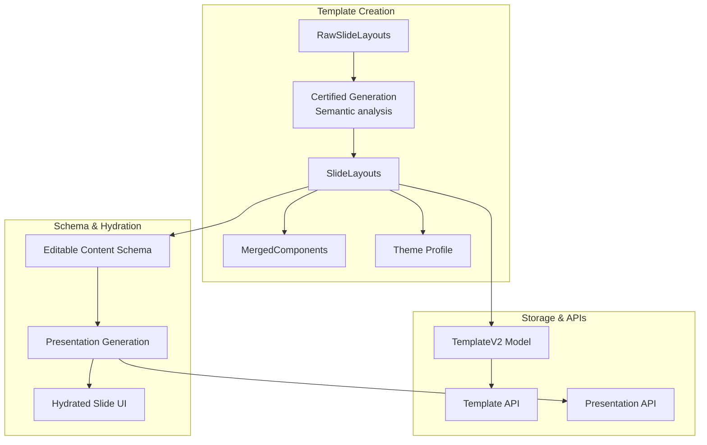
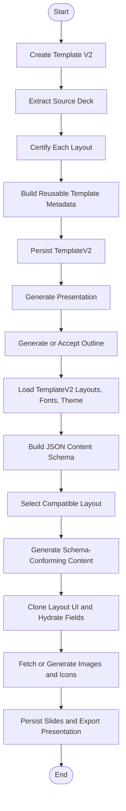
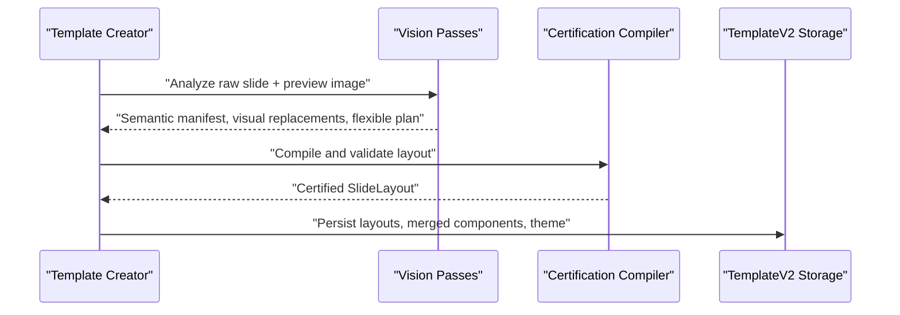
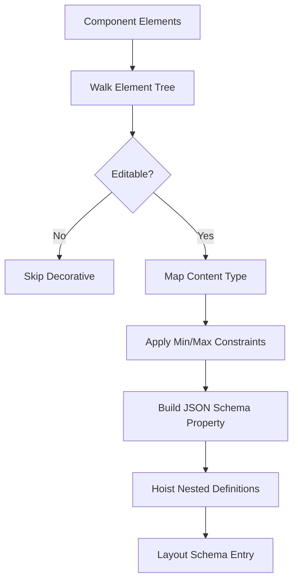
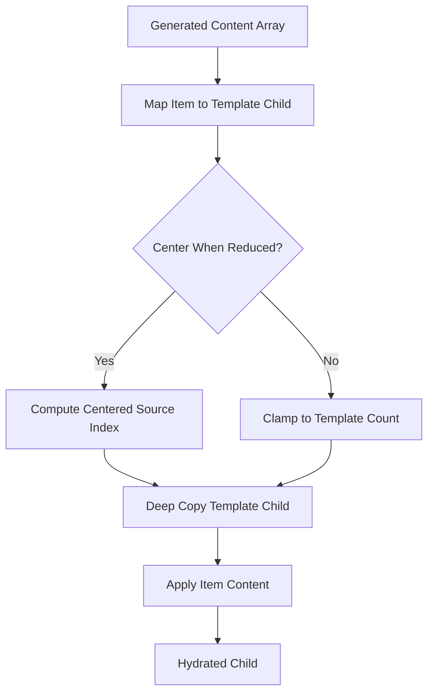
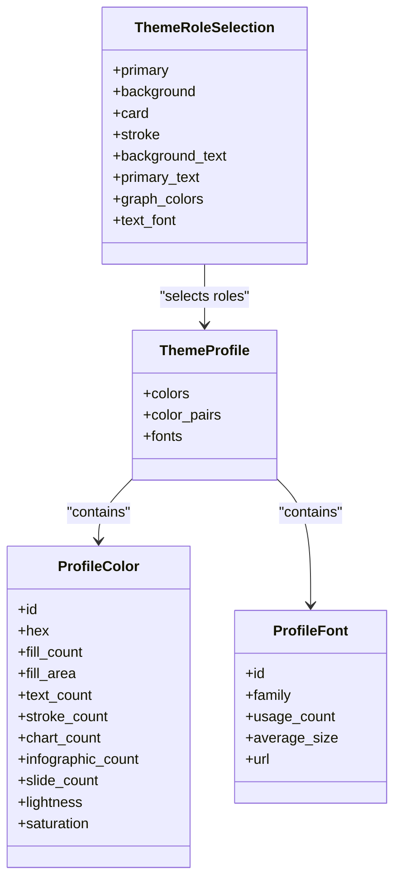
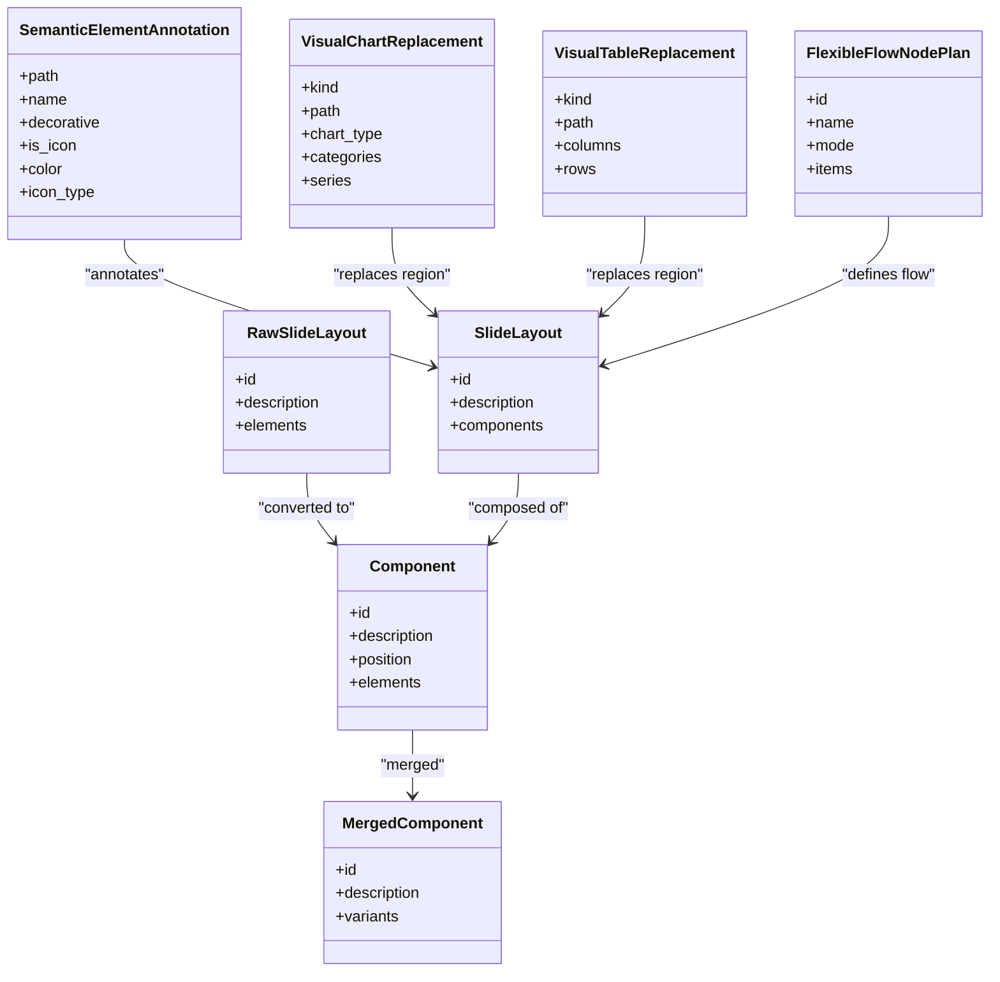
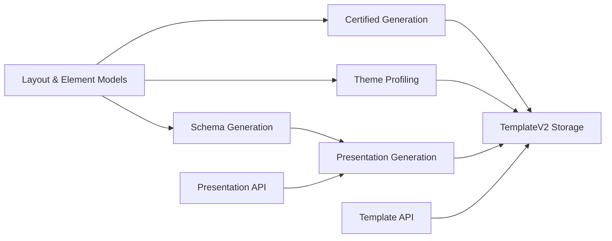

# Template Design Principles & Best Practices

<cite>
**Referenced Files in This Document**   
- [template-v2.md](file://docs/template-v2.md)
- [certified_generation.py](file://servers/fastapi/templates/v2/certified_generation.py)
- [generation.py](file://servers/fastapi/templates/v2/generation.py)
- [schema.py](file://servers/fastapi/templates/v2/schema.py)
- [content.py](file://servers/fastapi/templates/v2/content.py)
- [theme.py](file://servers/fastapi/templates/v2/theme.py)
- [layouts.py](file://servers/fastapi/templates/v2/models/layouts.py)
- [elements.py](file://servers/fastapi/templates/v2/models/elements.py)
- [template_v2.py](file://servers/fastapi/models/sql/template_v2.py)
- [presentation_layout.py](file://servers/fastapi/models/presentation_layout.py)
- [presentation.py](file://servers/fastapi/api/v1/ppt/endpoints/presentation.py)
- [template.py](file://servers/fastapi/api/v1/ppt/endpoints/template.py)
</cite>

## Table of Contents
1. [Introduction](#introduction)
2. [Project Structure](#project-structure)
3. [Core Components](#core-components)
4. [Architecture Overview](#architecture-overview)
5. [Detailed Component Analysis](#detailed-component-analysis)
6. [Dependency Analysis](#dependency-analysis)
7. [Performance Considerations](#performance-considerations)
8. [Troubleshooting Guide](#troubleshooting-guide)
9. [Conclusion](#conclusion)
10. [Appendices](#appendices)

## Introduction
This document provides comprehensive guidelines for creating effective templates in Presenton’s V2 template system. It explains how to design responsive layouts, compose reusable components, and ensure accessibility while structuring template JSON files for reliable generation. It also covers performance optimization, memory considerations, cross-platform compatibility, naming conventions, file organization, testing strategies, and design patterns for common presentation scenarios such as data visualization, storytelling layouts, and corporate branding.

The V2 system treats a template as a set of certified slide layouts with explicit editable fields, flexible flow regions, semantic theme roles, and generated content schemas. Template creation analyzes source slides visually and semantically; presentation generation selects compatible layouts, generates schema-conforming content, hydrates the layout UI, and exports the final deck.

## Project Structure
Presenton’s V2 template implementation is centered around server-side Python modules that convert raw slide structures into certified layouts, derive themes, generate content schemas, and hydrate generated content during presentation generation. The key areas are:

- Template creation and certification pipeline
- Layout and element models
- Editable content schema generation
- Content hydration helpers
- Theme profiling and role selection
- API endpoints for template retrieval and presentation generation
- Database model for persisted template metadata

**Diagram sources**
- [certified_generation.py:491-547](file://servers/fastapi/templates/v2/certified_generation.py#L491-L547)
- [schema.py:257-279](file://servers/fastapi/templates/v2/schema.py#L257-L279)
- [theme.py:246-258](file://servers/fastapi/templates/v2/theme.py#L246-L258)
- [template_v2.py:16-46](file://servers/fastapi/models/sql/template_v2.py#L16-L46)
- [presentation.py:404-443](file://servers/fastapi/api/v1/ppt/endpoints/presentation.py#L404-L443)
- [template.py:2098-2118](file://servers/fastapi/api/v1/ppt/endpoints/template.py#L2098-L2118)

**Section sources**
- [template-v2.md:1-12](file://docs/template-v2.md#L1-L12)
- [template-v2.md:14-49](file://docs/template-v2.md#L14-L49)
- [template-v2.md:51-108](file://docs/template-v2.md#L51-L108)
- [template-v2.md:109-127](file://docs/template-v2.md#L109-L127)

## Core Components
This section outlines the core components you must understand when designing V2 templates.

- Raw slide layouts: Faithful element JSON extracted from the source PPTX, including positions, sizes, styles, and assets.
- Certified slide layouts: Reusable layouts produced by multi-pass vision and semantic analysis, with editable elements marked and flexible regions defined.
- Merged components: Groups of structurally interchangeable components used for deduplication and reuse across layouts.
- Theme profile and semantic theme: Colors and fonts profiled from layouts and mapped to semantic roles like background, primary, card, stroke, text colors, and graph colors.
- Editable content schema: JSON Schema derived from component elements, describing required and optional generated content for each layout.
- Hydration helpers: Utilities that map generated content back into the layout UI, handling repeated groups and markdown normalization.

Design principles derived from these components:

- Treat decorative elements as fixed scaffolding and editable elements as replaceable content.
- Use semantic names for layouts, components, and fields rather than example content.
- Keep repeated items homogeneous in editable-field hierarchy so they can be modeled as arrays.
- Define safe text capacity growth based on visible geometry and alignment.
- Prefer existing visual structure over inventing new geometry.
- Ensure image and icon placeholders are used for replaceable media.

**Section sources**
- [template-v2.md:57-88](file://docs/template-v2.md#L57-L88)
- [template-v2.md:90-108](file://docs/template-v2.md#L90-L108)
- [schema.py:15-50](file://servers/fastapi/templates/v2/schema.py#L15-L50)
- [schema.py:183-189](file://servers/fastapi/templates/v2/schema.py#L183-L189)
- [content.py:27-40](file://servers/fastapi/templates/v2/content.py#L27-L40)
- [content.py:43-87](file://servers/fastapi/templates/v2/content.py#L43-L87)

## Architecture Overview
The V2 architecture separates template creation from presentation generation. Template creation requires a vision-capable language model to analyze rendered slide previews alongside raw element JSON. Presentation generation consumes already-certified layouts and their generated schemas.

**Diagram sources**
- [template-v2.md:14-49](file://docs/template-v2.md#L14-L49)
- [template-v2.md:109-127](file://docs/template-v2.md#L109-L127)

**Section sources**
- [template-v2.md:14-49](file://docs/template-v2.md#L14-L49)
- [template-v2.md:109-127](file://docs/template-v2.md#L109-L127)

## Detailed Component Analysis

### Template Creation and Certification
Template creation converts raw slide layouts into certified layouts through focused passes:

- Visual-data detection recognizes charts, tables, lists, progress bars, and gauges.
- Semantic analysis groups elements into reusable components and marks editable versus decorative content.
- Flexible-region analysis identifies repeatable or flow-based content.
- Text-capacity analysis calculates safe length and growth constraints.
- Compilation and certification validate decisions and apply fallbacks when needed.

Best practices for template authors:

- Provide one rendered preview image per raw slide.
- Avoid mixing unrelated visual regions into one component.
- Keep repeated items structurally identical in editable fields.
- Preserve logos, watermarks, and decorative backgrounds as decorative.
- Use placeholder URLs for replaceable images and icons.

**Diagram sources**
- [certified_generation.py:491-547](file://servers/fastapi/templates/v2/certified_generation.py#L491-L547)
- [certified_generation.py:550-597](file://servers/fastapi/templates/v2/certified_generation.py#L550-L597)
- [template-v2.md:68-88](file://docs/template-v2.md#L68-L88)

**Section sources**
- [template-v2.md:68-88](file://docs/template-v2.md#L68-L88)
- [certified_generation.py:491-547](file://servers/fastapi/templates/v2/certified_generation.py#L491-L547)
- [certified_generation.py:550-597](file://servers/fastapi/templates/v2/certified_generation.py#L550-L597)

### Editable Content Schema Generation
The schema generator walks component elements and produces JSON Schema definitions for generated content. Only elements marked `decorative=false` become generated fields. Supported content types include text, image, text-list, table, chart, and infographic.

Guidelines for schema-friendly templates:

- Name editable fields consistently across repeated items.
- Use container, flex, grid, and group elements to define repeatable structures.
- Set min/max constraints for arrays and text lengths based on visible space.
- Avoid embedding topic-specific sample content in field names.
- Strip internal metadata from component schemas when generating template schemas.

**Diagram sources**
- [schema.py:183-189](file://servers/fastapi/templates/v2/schema.py#L183-L189)
- [schema.py:310-358](file://servers/fastapi/templates/v2/schema.py#L310-L358)
- [schema.py:361-423](file://servers/fastapi/templates/v2/schema.py#L361-L423)
- [schema.py:218-248](file://servers/fastapi/templates/v2/schema.py#L218-L248)

**Section sources**
- [schema.py:15-50](file://servers/fastapi/templates/v2/schema.py#L15-L50)
- [schema.py:183-189](file://servers/fastapi/templates/v2/schema.py#L183-L189)
- [schema.py:257-279](file://servers/fastapi/templates/v2/schema.py#L257-L279)
- [schema.py:310-423](file://servers/fastapi/templates/v2/schema.py#L310-L423)
- [schema.py:585-639](file://servers/fastapi/templates/v2/schema.py#L585-L639)

### Content Hydration and Repeated Groups
During presentation generation, generated content is applied to the cloned layout UI. Hydration supports repeated top-level groups, mapping generated array items to positioned template children. Markdown inline patterns are normalized for infographic labels.

Guidelines for hydration-friendly templates:

- Use repeated child structures where content varies in count.
- Keep repeated item wrappers consistent so hydration can center or truncate safely.
- Normalize markdown in generated infographic labels to avoid rendering artifacts.
- Ensure repeated groups have matching editable-field hierarchies.

**Diagram sources**
- [content.py:43-87](file://servers/fastapi/templates/v2/content.py#L43-L87)
- [content.py:27-40](file://servers/fastapi/templates/v2/content.py#L27-L40)

**Section sources**
- [content.py:27-40](file://servers/fastapi/templates/v2/content.py#L27-L40)
- [content.py:43-87](file://servers/fastapi/templates/v2/content.py#L43-L87)

### Theme Profiling and Semantic Role Selection
The theme module profiles colors and fonts from all layouts, clusters similar colors, computes contrast pairs, and selects semantic roles either via an LLM or deterministically. It materializes a theme with primary, background, card, stroke, text colors, graph colors, and a text font.

Guidelines for accessible and brand-consistent themes:

- Prefer observed foreground/background pairs with sufficient contrast.
- Let the system select background and primary roles from usage statistics.
- Ensure graph colors are distinct and ordered meaningfully.
- Repair text colors when contrast ratios fall below accessibility thresholds.
- Supply font mappings for non-standard fonts to improve cross-platform rendering.

**Diagram sources**
- [theme.py:34-88](file://servers/fastapi/templates/v2/theme.py#L34-L88)
- [theme.py:90-130](file://servers/fastapi/templates/v2/theme.py#L90-L130)
- [theme.py:246-258](file://servers/fastapi/templates/v2/theme.py#L246-L258)
- [theme.py:357-402](file://servers/fastapi/templates/v2/theme.py#L357-L402)

**Section sources**
- [theme.py:145-243](file://servers/fastapi/templates/v2/theme.py#L145-L243)
- [theme.py:246-402](file://servers/fastapi/templates/v2/theme.py#L246-L402)
- [theme.py:431-513](file://servers/fastapi/templates/v2/theme.py#L431-L513)
- [theme.py:664-695](file://servers/fastapi/templates/v2/theme.py#L664-L695)

### Data Models and Layout Contracts
The layout models define the contract between raw slides, semantic annotations, visual replacements, flexible flows, and certified layouts. They enforce uniqueness, geometry, and structural constraints.

Key modeling rules for template authors:

- Use unique IDs for layouts, components, and flows.
- Keep component element indices partitioned and ordered.
- Represent repeated items as arrays with consistent item schemas.
- Use flow modes row, column, grid, or group according to geometry.
- Validate chart series values against categories and restrict pie/donut to one series.
- Ensure table rows match declared columns.

**Diagram sources**
- [layouts.py:44-51](file://servers/fastapi/templates/v2/models/layouts.py#L44-L51)
- [layouts.py:54-119](file://servers/fastapi/templates/v2/models/layouts.py#L54-L119)
- [layouts.py:122-148](file://servers/fastapi/templates/v2/models/layouts.py#L122-L148)
- [layouts.py:168-213](file://servers/fastapi/templates/v2/models/layouts.py#L168-L213)
- [layouts.py:416-441](file://servers/fastapi/templates/v2/models/layouts.py#L416-L441)
- [layouts.py:635-660](file://servers/fastapi/templates/v2/models/layouts.py#L635-L660)

**Section sources**
- [layouts.py:44-119](file://servers/fastapi/templates/v2/models/layouts.py#L44-L119)
- [layouts.py:122-148](file://servers/fastapi/templates/v2/models/layouts.py#L122-L148)
- [layouts.py:168-213](file://servers/fastapi/templates/v2/models/layouts.py#L168-L213)
- [layouts.py:416-441](file://servers/fastapi/templates/v2/models/layouts.py#L416-L441)
- [layouts.py:635-660](file://servers/fastapi/templates/v2/models/layouts.py#L635-L660)

### API Integration Points
The API layer exposes template retrieval and presentation generation workflows. Template retrieval may derive or return stored theme data. Presentation generation uses generated layout schemas to select layouts and hydrate content.

Guidelines for integration:

- Always provide one preview image per raw slide during template creation.
- Return valid JSON Schema for layout content selection.
- Handle invalid stored theme data gracefully by deriving it.
- Use layout descriptions and schemas for AI-assisted layout selection.

**Section sources**
- [template.py:2098-2118](file://servers/fastapi/api/v1/ppt/endpoints/template.py#L2098-L2118)
- [presentation.py:404-443](file://servers/fastapi/api/v1/ppt/endpoints/presentation.py#L404-L443)

## Dependency Analysis
The V2 template system has clear dependency boundaries:

- Certified generation depends on layout models, element models, and structured response validation.
- Schema generation depends on component elements and content type mappings.
- Theme profiling depends on layout components and available fonts.
- Presentation generation depends on generated schemas and hydration helpers.
- API endpoints depend on database models and service layers.

**Diagram sources**
- [layouts.py:44-119](file://servers/fastapi/templates/v2/models/layouts.py#L44-L119)
- [elements.py](file://servers/fastapi/templates/v2/models/elements.py)
- [certified_generation.py:491-547](file://servers/fastapi/templates/v2/certified_generation.py#L491-L547)
- [schema.py:257-279](file://servers/fastapi/templates/v2/schema.py#L257-L279)
- [theme.py:246-258](file://servers/fastapi/templates/v2/theme.py#L246-L258)
- [template_v2.py:16-46](file://servers/fastapi/models/sql/template_v2.py#L16-L46)
- [presentation.py:404-443](file://servers/fastapi/api/v1/ppt/endpoints/presentation.py#L404-L443)
- [template.py:2098-2118](file://servers/fastapi/api/v1/ppt/endpoints/template.py#L2098-L2118)

**Section sources**
- [template-v2.md:166-177](file://docs/template-v2.md#L166-L177)
- [presentation_layout.py:1-6](file://servers/fastapi/models/presentation_layout.py#L1-L6)

## Performance Considerations
Optimizing V2 templates improves both creation and generation performance:

- Limit parallel slide processing to the configured maximum.
- Avoid overly deep nested components unless necessary.
- Use repeated groups instead of duplicating identical components.
- Keep image and icon placeholders small and standardized.
- Prefer deterministic theme fallbacks when LLM calls fail.
- Reduce redundant metadata in component schemas.
- Monitor output token limits for template creation and prompted layout generation.

Memory and resource guidance:

- Avoid storing large raw assets directly in template JSON; reference external assets.
- Use merged components to reduce duplication across layouts.
- Cap repeated array sizes based on visible geometry and schema constraints.
- Stream or batch heavy operations where possible.
- Log duration and component counts for creation pipelines.

Cross-platform compatibility:

- Supply font mappings for non-standard fonts.
- Use standard placeholder URLs for replaceable images and icons.
- Keep coordinate systems within the 1280 x 720 canvas.
- Validate color hex formats and contrast ratios.
- Test layouts on multiple devices and export targets.

**Section sources**
- [template-v2.md:154-164](file://docs/template-v2.md#L154-L164)
- [certified_generation.py:59-64](file://servers/fastapi/templates/v2/certified_generation.py#L59-L64)
- [generation.py:46-50](file://servers/fastapi/templates/v2/generation.py#L46-L50)
- [theme.py:246-258](file://servers/fastapi/templates/v2/theme.py#L246-L258)
- [schema.py:47-50](file://servers/fastapi/templates/v2/schema.py#L47-L50)

## Troubleshooting Guide
Common issues and resolutions:

- Missing preview images: Template creation requires exactly one rendered preview per raw slide.
- Invalid structured responses: The system retries and validates structured outputs before use.
- Duplicate layout or component IDs: The system repairs duplicates but should be avoided in authoring.
- Unknown theme color or font IDs: Role selection validates IDs against the profile.
- Chart series mismatch: Series values must match category counts; pie/donut must have one series.
- Table row/column mismatch: Rows must match declared columns.
- Flow validation failures: Flows must have at least two items and cover components exactly once.

Debugging recommendations:

- Inspect generated JSON Schema for layout content.
- Review semantic annotations for decorative vs editable classification.
- Check flexible flow trees for orphan or shared flows.
- Validate text capacity adjustments for alignment and growth.
- Use logs for creation duration, component counts, and retry behavior.

**Section sources**
- [template-v2.md:64-66](file://docs/template-v2.md#L64-L66)
- [template-v2.md:156-158](file://docs/template-v2.md#L156-L158)
- [certified_generation.py:462-488](file://servers/fastapi/templates/v2/certified_generation.py#L462-L488)
- [theme.py:261-302](file://servers/fastapi/templates/v2/theme.py#L261-L302)
- [layouts.py:204-213](file://servers/fastapi/templates/v2/models/layouts.py#L204-L213)
- [layouts.py:437-441](file://servers/fastapi/templates/v2/models/layouts.py#L437-L441)
- [layouts.py:686-693](file://servers/fastapi/templates/v2/models/layouts.py#L686-L693)

## Conclusion
Effective V2 templates combine careful visual structure, explicit editable fields, reusable components, and robust schemas. By following the design principles outlined here—responsive layout strategies, component composition patterns, accessibility-aware theming, and disciplined naming—you can build templates that generate reliably across platforms. Prioritize performance through repeated groups, merged components, and constrained schemas, and validate your templates using the provided models, schemas, and tests.

## Appendices

### Naming Conventions
- Layout IDs: lowercase snake_case, concise, descriptive of reusable visual structure.
- Component IDs: unique, stable, not derived from example content.
- Field names: generic roles like `title`, `description`, `card_heading`, `card_description`.
- Flow IDs: structural identifiers for nested flow trees.
- Avoid positional suffixes like left/right in repeated fields.

**Section sources**
- [certified_generation.py:111-178](file://servers/fastapi/templates/v2/certified_generation.py#L111-L178)
- [certified_generation.py:368-374](file://servers/fastapi/templates/v2/certified_generation.py#L368-L374)

### File Organization
- Place template JSON under a dedicated template directory.
- Include static assets in a sibling static folder.
- Maintain one template.json per template variant.
- Keep layout IDs and component IDs consistent across variants.
- Store generated schemas separately if needed for validation.

[No sources needed since this section provides general guidance]

### Testing Strategies
- Validate JSON Schema conformance for generated content.
- Assert layout ID uniqueness and component ID uniqueness.
- Verify chart series and table dimensions.
- Check flexible flow coverage and root reachability.
- Measure creation duration and component counts.
- Test hydration for repeated groups and markdown normalization.

**Section sources**
- [schema.py:257-279](file://servers/fastapi/templates/v2/schema.py#L257-L279)
- [layouts.py:111-119](file://servers/fastapi/templates/v2/models/layouts.py#L111-L119)
- [layouts.py:204-213](file://servers/fastapi/templates/v2/models/layouts.py#L204-L213)
- [layouts.py:437-441](file://servers/fastapi/templates/v2/models/layouts.py#L437-L441)
- [layouts.py:686-693](file://servers/fastapi/templates/v2/models/layouts.py#L686-L693)
- [content.py:27-40](file://servers/fastapi/templates/v2/content.py#L27-L40)