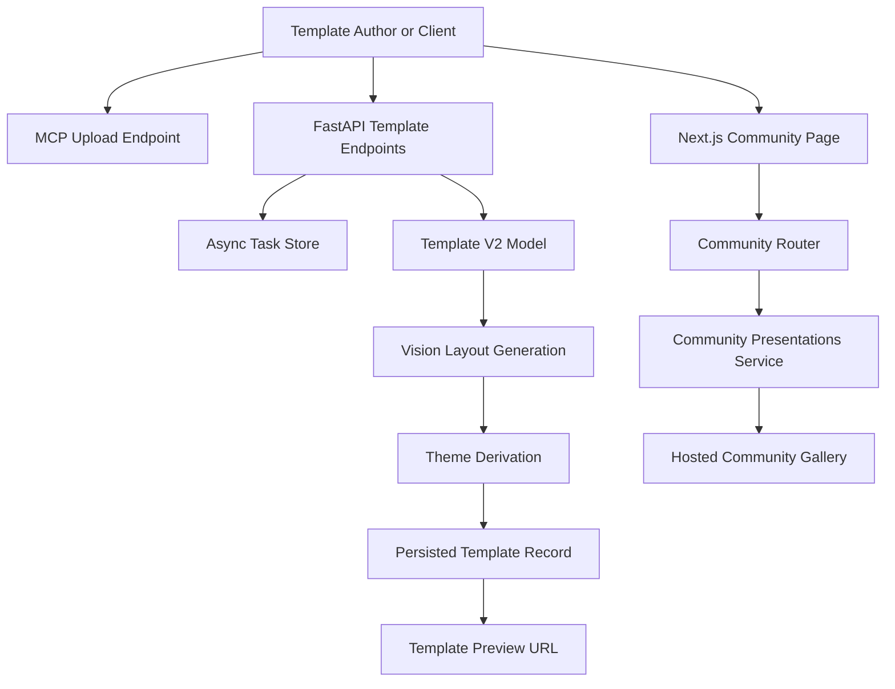
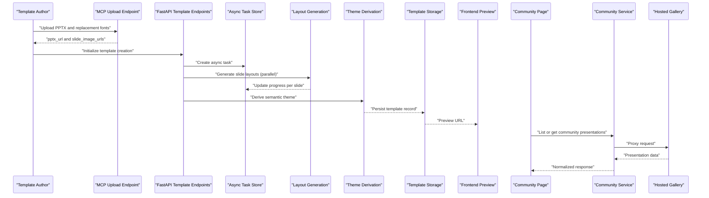
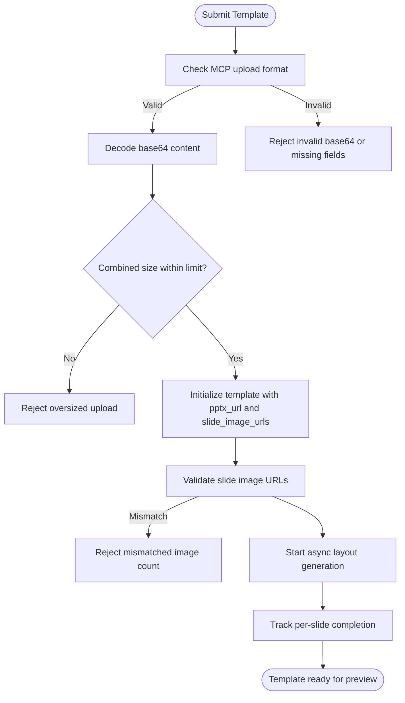
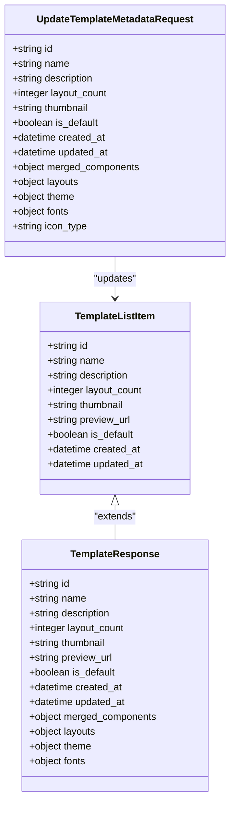
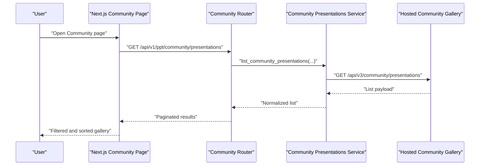
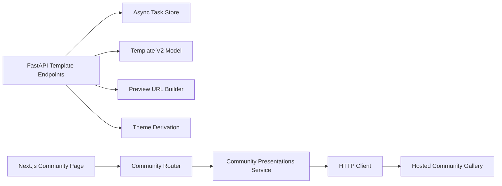

# Template Distribution & Publishing

<cite>
**Referenced Files in This Document**
- [README.md](file://README.md)
- [template-v2.md](file://docs/template-v2.md)
- [template.py](file://servers/fastapi/api/v1/ppt/endpoints/template.py)
- [community_presentations.py](file://servers/fastapi/services/community_presentations.py)
- [community.ts](file://servers/nex tjs/utils/community.ts)
- [community page](file://servers/nextjs/app/(presentation-generator)/(dashboard)/community/page.tsx)
- [CommunityPage component](file://servers/nextjs/app/(presentation-generator)/(dashboard)/community/components/CommunityPage.tsx)
- [community API client](file://servers/nextjs/app/(presentation-generator)/services/api/community.ts)
- [community router](file://servers/fastapi/api/v1/ppt/endpoints/community.py)
- [test_template_api.py](file://servers/fastapi/tests/unit/test_template_api.py)
</cite>

## Table of Contents
1. [Introduction](#introduction)
2. [Project Structure](#project-structure)
3. [Core Components](#core-components)
4. [Architecture Overview](#architecture-overview)
5. [Detailed Component Analysis](#detailed-component-analysis)
6. [Dependency Analysis](#dependency-analysis)
7. [Performance Considerations](#performance-considerations)
8. [Troubleshooting Guide](#troubleshooting-guide)
9. [Conclusion](#conclusion)
10. [Appendices](#appendices)

## Introduction
This document explains how custom templates are distributed and published in Presenton, focusing on the Template V2 workflow, template submission and validation, metadata handling, community gallery integration, versioning behavior, update mechanisms, packaging requirements, discovery and analytics, and user support workflows. It is intended for template authors, platform operators, and contributors who need to understand both the technical pipeline and operational expectations.

Presenton supports:
- Built-in templates that ship with the application.
- Custom Template V2 templates created from PowerPoint files through a vision-capable model pipeline.
- A Community gallery for browsing shared presentation designs and references.
- Optional monetization and attribution through external funding links and community channels.

## Project Structure
The template distribution system spans several layers:
- Backend FastAPI endpoints handle template upload, validation, asynchronous creation, layout generation, theme derivation, and metadata updates.
- The Template V2 documentation describes the end-to-end flow from PPTX to certified layouts and presentation generation.
- The Community service layer proxies requests to the hosted community gallery and normalizes errors.
- The Next.js frontend provides the Community UI, filtering, pagination, preview, and analytics tracking.
- Tests validate template metadata updates and error conditions.

**Diagram sources**
- [template.py:95-104](file://servers/fastapi/api/v1/ppt/endpoints/template.py#L95-L104)
- [template.py:127-149](file://servers/fastapi/api/v1/ppt/endpoints/template.py#L127-L149)
- [template.py:155-207](file://servers/fastapi/api/v1/ppt/endpoints/template.py#L155-L207)
- [template.py:343-388](file://servers/fastapi/api/v1/ppt/endpoints/template.py#L343-L388)
- [template.py:439-460](file://servers/fastapi/api/v1/ppt/endpoints/template.py#L439-L460)
- [template.py:586-622](file://servers/fastapi/api/v1/ppt/endpoints/template.py#L586-L622)
- [template.py:663-682](file://servers/fastapi/api/v1/ppt/endpoints/template.py#L663-L682)
- [template.py:708-800](file://servers/fastapi/api/v1/ppt/endpoints/template.py#L708-L800)
- [template-v2.md:14-49](file://docs/template-v2.md#L14-L49)
- [community_router.py:11-49](file://servers/fastapi/api/v1/ppt/endpoints/community.py#L11-L49)
- [community_presentations.py:14-20](file://servers/fastapi/services/community_presentations.py#L14-L20)
- [community_presentations.py:204-284](file://servers/fastapi/services/community_presentations.py#L204-L284)
- [community_page.tsx:14-19](file://servers/nextjs/app/(presentation-generator)/(dashboard)/community/page.tsx#L14-L19)
- [CommunityPage.tsx:58-78](file://servers/nextjs/app/(presentation-generator)/(dashboard)/community/components/CommunityPage.tsx#L58-L78)

**Section sources**
- [README.md:222-238](file://README.md#L222-L238)
- [template-v2.md:1-13](file://docs/template-v2.md#L1-L13)

## Core Components
- Template V2 creation and generation pipeline: Converts a source PPTX into reusable slide layouts, derives semantic themes, and persists structured template data.
- Template API endpoints: Accept uploads, validate combined sizes, generate layouts asynchronously, track progress, and update template metadata.
- Community gallery integration: Lists and retrieves shared presentations, normalizes upstream errors, and enforces feature flags.
- Frontend Community experience: Provides filtering, pagination, previews, and analytics events.

Key responsibilities:
- Validation: Input shape, size limits, index uniqueness, required fields, icon type normalization, and ID consistency.
- Asynchronous processing: Per-slide parallel generation with task progress persistence.
- Metadata management: Name, description, thumbnail, layout count, default flag, merged components, theme, fonts, and icon type.
- Community access control: Environment-driven enablement and safe proxying to the hosted gallery.

**Section sources**
- [template-v2.md:51-108](file://docs/template-v2.md#L51-L108)
- [template.py:127-149](file://servers/fastapi/api/v1/ppt/endpoints/template.py#L127-L149)
- [template.py:155-207](file://servers/fastapi/api/v1/ppt/endpoints/template.py#L155-L207)
- [template.py:343-388](file://servers/fastapi/api/v1/ppt/endpoints/template.py#L343-L388)
- [community_presentations.py:149-164](file://servers/fastapi/services/community_presentations.py#L149-L164)
- [community.ts:1-5](file://servers/nextjs/utils/community.ts#L1-L5)

## Architecture Overview
The template distribution architecture connects author tools, backend services, and the community gallery.

**Diagram sources**
- [template.py:155-207](file://servers/fastapi/api/v1/ppt/endpoints/template.py#L155-L207)
- [template.py:586-622](file://servers/fastapi/api/v1/ppt/endpoints/template.py#L586-L622)
- [template.py:663-682](file://servers/fastapi/api/v1/ppt/endpoints/template.py#L663-L682)
- [template.py:708-800](file://servers/fastapi/api/v1/ppt/endpoints/template.py#L708-L800)
- [community_presentations.py:204-284](file://servers/fastapi/services/community_presentations.py#L204-L284)
- [community_router.py:14-49](file://servers/fastapi/api/v1/ppt/endpoints/community.py#L14-L49)

## Detailed Component Analysis

### Template Submission and Validation
Template submission supports two primary flows:
- MCP-based upload: Base64-encoded PPTX and optional replacement fonts are validated for base64 correctness and combined size limits.
- REST-based initialization: Requires a Presenton-hosted PPTX URL and corresponding slide image URLs returned by the upload endpoint.

Validation rules include:
- Combined upload size limit enforced at the request level.
- Slide image URLs must be non-empty and correspond one-to-one with raw layouts.
- Template name derivation from file path when not provided.
- Icon type normalization and detection from generated layouts.
- Layout index uniqueness and bounds checking during batch operations.
- ID consistency between path and body for metadata updates.

**Diagram sources**
- [template.py:155-207](file://servers/fastapi/api/v1/ppt/endpoints/template.py#L155-L207)
- [template.py:226-259](file://servers/fastapi/api/v1/ppt/endpoints/template.py#L226-L259)
- [template.py:439-460](file://servers/fastapi/api/v1/ppt/endpoints/template.py#L439-L460)
- [template.py:586-622](file://servers/fastapi/api/v1/ppt/endpoints/template.py#L586-L622)
- [template.py:708-800](file://servers/fastapi/api/v1/ppt/endpoints/template.py#L708-L800)

**Section sources**
- [template.py:155-207](file://servers/fastapi/api/v1/ppt/endpoints/template.py#L155-L207)
- [template.py:226-259](file://servers/fastapi/api/v1/ppt/endpoints/template.py#L226-L259)
- [template.py:439-460](file://servers/fastapi/api/v1/ppt/endpoints/template.py#L439-L460)
- [template.py:586-622](file://servers/fastapi/api/v1/ppt/endpoints/template.py#L586-L622)
- [template.py:708-800](file://servers/fastapi/api/v1/ppt/endpoints/template.py#L708-L800)

### Metadata Specification and Updates
Template metadata includes:
- Identification: id, name, description.
- Visual assets: thumbnail, icon_type.
- Structural data: layout_count, merged_components, layouts.
- Theming: theme object with semantic colors and typography.
- Fonts: mapping of font family names to asset paths.
- Lifecycle: is_default, created_at, updated_at.

Metadata updates:
- Blank names are rejected.
- Full layout collections can be replaced while preserving other assets.
- Text font and spacing changes are preserved during layout updates.
- Path/body ID mismatches are rejected.
- Updating only the ID does not write changes.

**Diagram sources**
- [template.py:343-388](file://servers/fastapi/api/v1/ppt/endpoints/template.py#L343-L388)

**Section sources**
- [template.py:343-388](file://servers/fastapi/api/v1/ppt/endpoints/template.py#L343-L388)
- [test_template_api.py:1677-1694](file://servers/fastapi/tests/unit/test_template_api.py#L1677-L1694)
- [test_template_api.py:1697-1730](file://servers/fastapi/tests/unit/test_template_api.py#L1697-L1730)
- [test_template_api.py:1733-1827](file://servers/fastapi/tests/unit/test_template_api.py#L1733-L1827)
- [test_template_api.py:1830-1855](file://servers/fastapi/tests/unit/test_template_api.py#L1830-L1855)

### Template Packaging Requirements
Packaging expectations:
- Source PPTX plus rendered slide previews are required for template creation; screenshots provide visual context for semantic analysis.
- Replacement fonts may be supplied via MCP upload and mapped to original font families.
- Combined upload size is limited to prevent excessive payloads.
- Icons are normalized and inferred from generated layouts when possible.
- Font mappings should be provided when the source deck uses non-standard fonts.

Operational notes:
- Template creation runs asynchronously with per-slide progress reporting.
- Parallel generation is bounded to avoid overwhelming provider rate limits.
- Invalid structured responses are retried and validated before use.

**Section sources**
- [template-v2.md:51-66](file://docs/template-v2.md#L51-L66)
- [template-v2.md:154-164](file://docs/template-v2.md#L154-L164)
- [template.py:155-207](file://servers/fastapi/api/v1/ppt/endpoints/template.py#L155-L207)
- [template.py:586-622](file://servers/fastapi/api/v1/ppt/endpoints/template.py#L586-L622)
- [template.py:708-800](file://servers/fastapi/api/v1/ppt/endpoints/template.py#L708-L800)

### Community Review Procedures and Marketplace Integration
Presenton integrates with a hosted Community gallery for discovering shared presentation designs and references. Key behaviors:
- Feature flag: The Community UI is hidden and backend calls are blocked when disabled.
- Proxy layer: Requests are proxied to the configured Community API URL with robust error normalization.
- Filtering and sorting: List endpoint supports pagination, date filters, view/like thresholds, ordering by priority, views, likes, or created_at.
- Single presentation retrieval: Returns normalized presentation data or appropriate error codes.

Review procedures:
- The repository exposes listing and retrieval endpoints but does not implement an internal review workflow.
- Authors publish to the hosted Community gallery; Presenton consumes and displays those items.
- Air-gapped deployments can disable Community entirely.

**Diagram sources**
- [community_page.tsx:14-19](file://servers/nextjs/app/(presentation-generator)/(dashboard)/community/page.tsx#L14-L19)
- [community_router.py:14-49](file://servers/fastapi/api/v1/ppt/endpoints/community.py#L14-L49)
- [community_presentations.py:286-332](file://servers/fastapi/services/community_presentations.py#L286-L332)
- [community_presentations.py:149-164](file://servers/fastapi/services/community_presentations.py#L149-L164)

**Section sources**
- [community_page.tsx:14-19](file://servers/nextjs/app/(presentation-generator)/(dashboard)/community/page.tsx#L14-L19)
- [community_router.py:14-49](file://servers/fastapi/api/v1/ppt/endpoints/community.py#L14-L49)
- [community_presentations.py:149-164](file://servers/fastapi/services/community_presentations.py#L149-L164)
- [community_presentations.py:286-332](file://servers/fastapi/services/community_presentations.py#L286-L332)

### Version Management and Update Mechanisms
Versioning behavior:
- Template records include lifecycle timestamps and an is_default flag.
- Metadata updates replace selected fields without altering unrelated assets unless explicitly provided.
- Layouts can be fully replaced while preserving other metadata such as thumbnails and fonts.
- ID consistency checks prevent accidental overwrites across path and body parameters.

Updates:
- Use metadata update endpoints to adjust name, description, thumbnail, layout_count, is_default, merged_components, layouts, theme, fonts, and icon_type.
- Ensure IDs match between path and request body to avoid rejection.

**Section sources**
- [template.py:343-388](file://servers/fastapi/api/v1/ppt/endpoints/template.py#L343-L388)
- [test_template_api.py:1677-1694](file://servers/fastapi/tests/unit/test_template_api.py#L1677-L1694)
- [test_template_api.py:1697-1730](file://servers/fastapi/tests/unit/test_template_api.py#L1697-L1730)
- [test_template_api.py:1830-1855](file://servers/fastapi/tests/unit/test_template_api.py#L1830-L1855)

### Licensing, Attribution, and Monetization
Licensing and attribution:
- Presenton itself is Apache 2.0 licensed.
- Template authors should attach their own license information and attribution details in template documentation and metadata where applicable.
- The repository includes funding configuration files for external sponsorship platforms.

Monetization possibilities:
- No built-in marketplace payment flow is implemented in this repository.
- Authors can link to external monetization channels (sponsorship platforms, personal websites, or third-party marketplaces).
- Community gallery integration focuses on discovery rather than transactions.

**Section sources**
- [README.md:236-238](file://README.md#L236-L238)
- [.github/FUNDING.yml:1-15](file://.github/FUNDING.yml#L1-L15)

### Documentation Standards and User Support Workflows
Documentation standards:
- Include clear template name, description, and usage instructions.
- Provide font mappings when using non-standard fonts.
- Document icon style preferences and any special generation options.
- Keep slide previews aligned with raw layouts to ensure accurate certification.

User support workflows:
- Track async task progress for template creation and report per-slide status.
- Surface meaningful error messages for invalid inputs, upstream failures, and disabled features.
- For Community-related issues, guide users to check environment configuration and network connectivity.

**Section sources**
- [template-v2.md:154-164](file://docs/template-v2.md#L154-L164)
- [template.py:663-682](file://servers/fastapi/api/v1/ppt/endpoints/template.py#L663-L682)
- [community_presentations.py:204-284](file://servers/fastapi/services/community_presentations.py#L204-L284)

### Template Discovery, Search Optimization, and Analytics
Discovery:
- Community listings support filtering by creation date ranges, view counts, like counts, and ordering by priority, views, likes, or created_at.
- Pagination controls allow efficient browsing of large galleries.

Search optimization:
- Use descriptive names and concise descriptions to improve discoverability.
- Choose appropriate icon types and consistent theming to align with visual search patterns.

Analytics:
- The Community page tracks page views and filter/sort interactions for insights.
- Telemetry can be enabled or disabled via environment variables.

**Section sources**
- [community_router.py:14-49](file://servers/fastapi/api/v1/ppt/endpoints/community.py#L14-L49)
- [CommunityPage.tsx:58-78](file://servers/nextjs/app/(presentation-generator)/(dashboard)/community/components/CommunityPage.tsx#L58-L78)
- [community.ts:1-5](file://servers/nextjs/utils/community.ts#L1-L5)
- [README.md:514-519](file://README.md#L514-L519)

## Dependency Analysis
The following diagram shows key dependencies among template and community components.

**Diagram sources**
- [template.py:95-104](file://servers/fastapi/api/v1/ppt/endpoints/template.py#L95-L104)
- [template.py:107-124](file://servers/fastapi/api/v1/ppt/endpoints/template.py#L107-L124)
- [template.py:586-622](file://servers/fastapi/api/v1/ppt/endpoints/template.py#L586-L622)
- [community_router.py:11-49](file://servers/fastapi/api/v1/ppt/endpoints/community.py#L11-L49)
- [community_presentations.py:204-284](file://servers/fastapi/services/community_presentations.py#L204-L284)
- [community_page.tsx:14-19](file://servers/nextjs/app/(presentation-generator)/(dashboard)/community/page.tsx#L14-L19)

**Section sources**
- [template.py:95-104](file://servers/fastapi/api/v1/ppt/endpoints/template.py#L95-L104)
- [community_router.py:11-49](file://servers/fastapi/api/v1/ppt/endpoints/community.py#L11-L49)
- [community_presentations.py:204-284](file://servers/fastapi/services/community_presentations.py#L204-L284)

## Performance Considerations
- Template creation processes slides in parallel with a bounded worker pool to balance throughput and provider rate limits.
- Each slide layout generation has a maximum token budget to constrain output size.
- Community requests have timeouts and retryable error classification to improve resilience.
- Avoid oversized combined uploads to reduce latency and memory pressure.

[No sources needed since this section provides general guidance]

## Troubleshooting Guide
Common issues and resolutions:
- Community disabled: Ensure PRESENTON_COMMUNITY_ENABLED is set appropriately; otherwise, the Community UI returns not found and backend calls raise a disabled error.
- Invalid base64 upload: Verify that MCP uploads contain valid base64 content and filenames.
- Oversized combined upload: Reduce PPTX and font payload sizes to stay within the limit.
- Mismatched slide images: Ensure the number of slide image URLs matches the number of raw layouts.
- Community upstream errors: Inspect error codes such as authentication failure, rate limiting, service unavailable, or invalid response; verify network access and API URL configuration.

**Section sources**
- [community_page.tsx:14-19](file://servers/nextjs/app/(presentation-generator)/(dashboard)/community/page.tsx#L14-L19)
- [community_presentations.py:149-164](file://servers/fastapi/services/community_presentations.py#L149-L164)
- [community_presentations.py:204-284](file://servers/fastapi/services/community_presentations.py#L204-L284)
- [template.py:155-207](file://servers/fastapi/api/v1/ppt/endpoints/template.py#L155-L207)
- [template.py:586-622](file://servers/fastapi/api/v1/ppt/endpoints/template.py#L586-L622)

## Conclusion
Presenton’s template distribution system centers on Template V2, which transforms PowerPoint decks into reusable, schema-validated layouts with derived themes and assets. Authors submit templates via MCP or REST endpoints, undergo strict validation, and benefit from asynchronous generation with detailed progress tracking. The Community gallery provides discovery and reference capabilities, controlled by environment flags and backed by a resilient proxy layer. While monetization is not built into the repository, authors can leverage external funding and sponsorship channels. Clear packaging, documentation, and error handling practices ensure reliable distribution and a smooth user experience.

[No sources needed since this section summarizes without analyzing specific files]

## Appendices

### Step-by-Step Instructions for Uploading Templates
1. Prepare your source PPTX and render one preview image per slide.
2. If using non-standard fonts, prepare replacement font files and map original family names.
3. Call the MCP upload endpoint with base64-encoded PPTX and optional fonts.
4. Receive pptx_url and slide_image_urls from the upload response.
5. Initialize template creation using the returned pptx_url and slide_image_urls.
6. Monitor async task progress until all slide layouts are completed.
7. Update template metadata as needed, ensuring ID consistency and field validity.
8. Share the template preview URL or publish to the Community gallery.

**Section sources**
- [template.py:155-207](file://servers/fastapi/api/v1/ppt/endpoints/template.py#L155-L207)
- [template.py:127-149](file://servers/fastapi/api/v1/ppt/endpoints/template.py#L127-L149)
- [template.py:663-682](file://servers/fastapi/api/v1/ppt/endpoints/template.py#L663-L682)
- [template.py:343-388](file://servers/fastapi/api/v1/ppt/endpoints/template.py#L343-L388)

### Managing Releases and Handling Feedback
- Treat metadata updates as releases: increment layout_count, update thumbnails, and adjust is_default when promoting new versions.
- Preserve backward compatibility by avoiding breaking changes to layout schemas.
- Collect user feedback through Community comments or external channels.
- Address bug reports by validating inputs, improving error messages, and refining generation constraints.

**Section sources**
- [test_template_api.py:1677-1694](file://servers/fastapi/tests/unit/test_template_api.py#L1677-L1694)
- [test_template_api.py:1697-1730](file://servers/fastapi/tests/unit/test_template_api.py#L1697-L1730)
- [community_router.py:14-49](file://servers/fastapi/api/v1/ppt/endpoints/community.py#L14-L49)