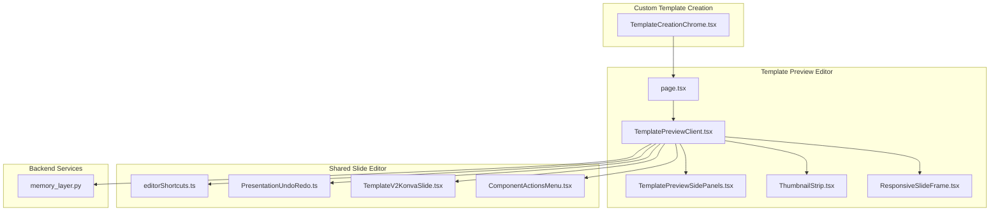
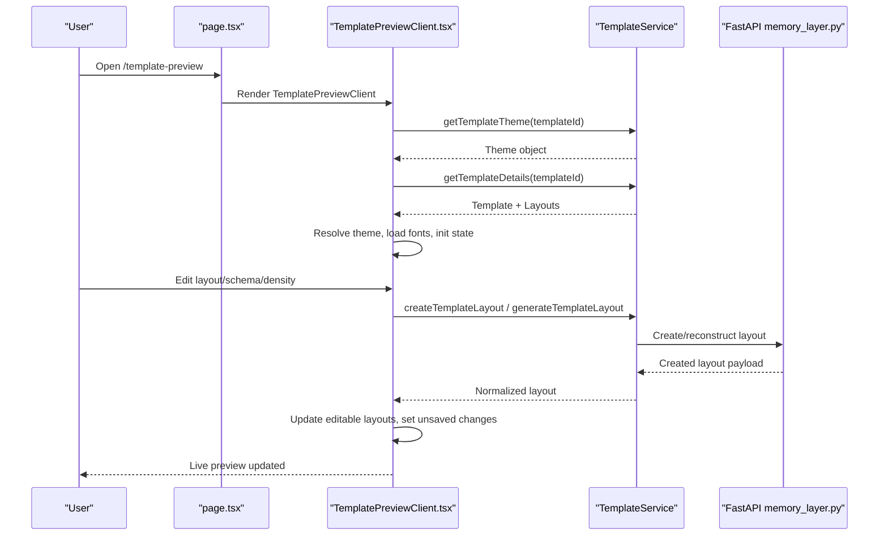
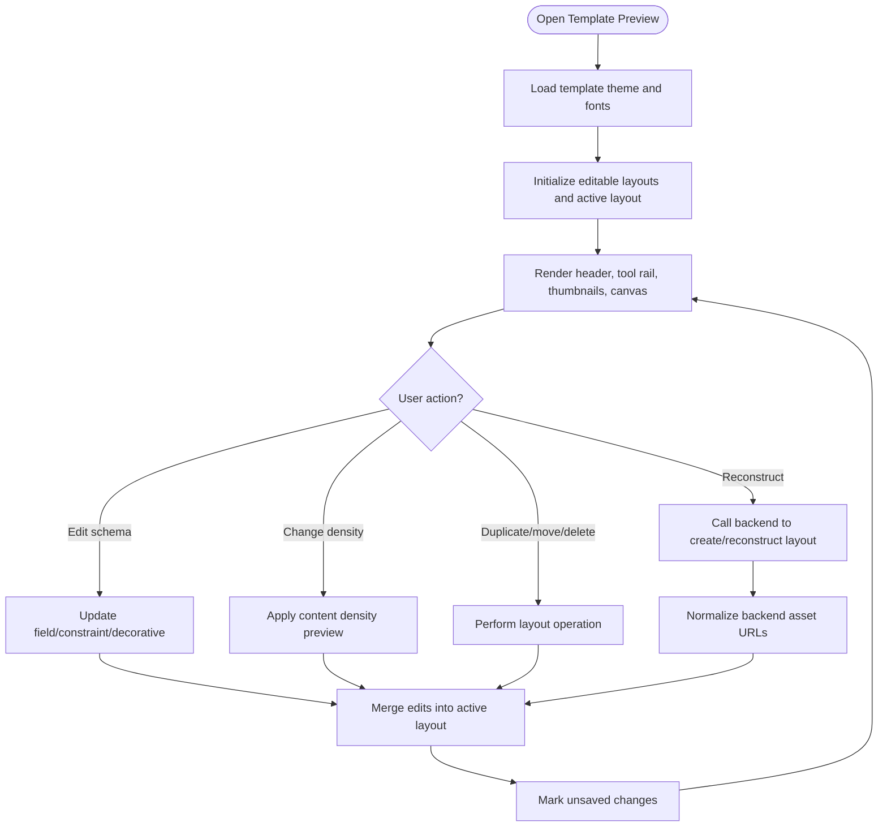
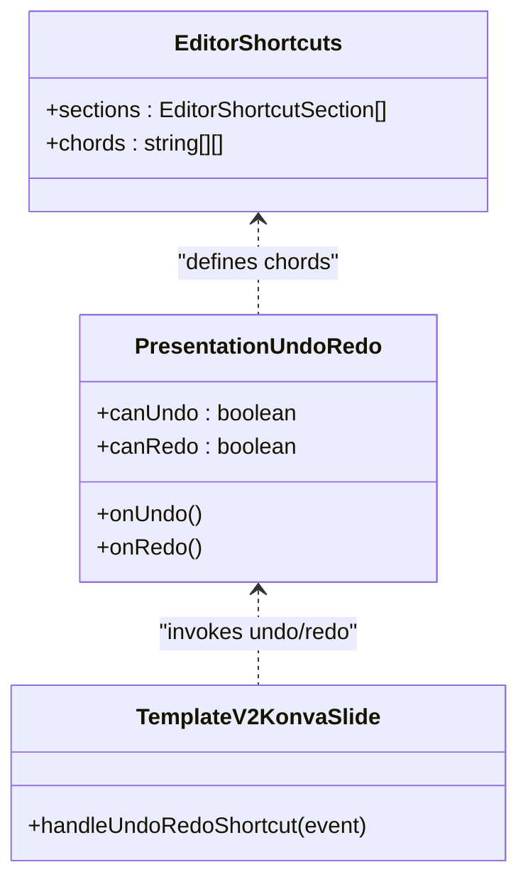
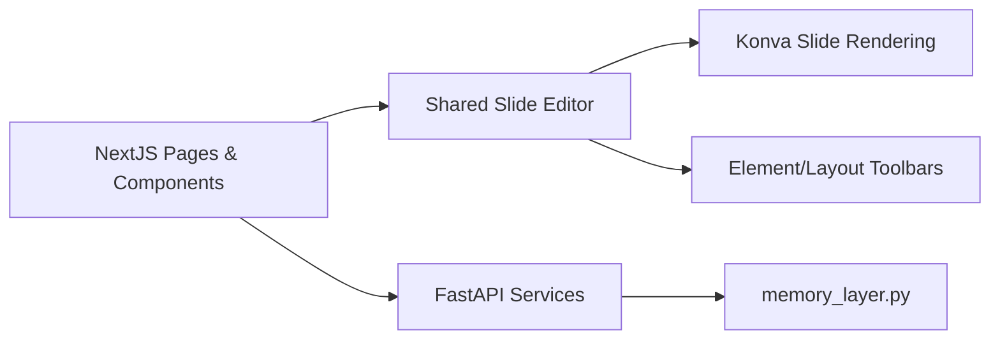

# Template Editor Interface

<cite>
**Referenced Files in This Document**
- [TemplateCreationChrome.tsx](file://servers/nextjs/app/(presentation-generator)/custom-template/components/TemplateCreationChrome.tsx)
- [page.tsx](file://servers/nextjs/app/(presentation-generator)/template-preview/page.tsx)
- [TemplatePreviewClient.tsx](file://servers/nextjs/app/(presentation-generator)/template-preview/components/TemplatePreviewClient.tsx)
- [EditorShortcuts.ts](file://servers/nextjs/components/slide-editor/shortcuts/editorShortcuts.ts)
- [PresentationUndoRedo.ts](file://servers/nextjs/app/(presentation-generator)/presentation/hooks/PresentationUndoRedo.ts)
- [TemplateV2KonvaSlide.tsx](file://servers/nextjs/components/slide-editor/surface/TemplateV2KonvaSlide.tsx)
- [ComponentActionsMenu.tsx](file://servers/nextjs/components/slide-editor/selection/ComponentActionsMenu.tsx)
- [InsertPalettePreview.tsx](file://servers/nextjs/app/(presentation-generator)/presentation/components/InsertPalettePreview.tsx)
- [SidePanel.tsx](file://servers/nextjs/app/(presentation-generator)/presentation/components/SidePanel.tsx)
- [SortableSlide.tsx](file://servers/nextjs/app/(presentation-generator)/presentation/components/SortableSlide.tsx)
- [memory_layer.py](file://servers/fastapi/services/chat/memory_layer.py)
</cite>

## Table of Contents
1. [Introduction](#introduction)
2. [Project Structure](#project-structure)
3. [Core Components](#core-components)
4. [Architecture Overview](#architecture-overview)
5. [Detailed Component Analysis](#detailed-component-analysis)
6. [Dependency Analysis](#dependency-analysis)
7. [Performance Considerations](#performance-considerations)
8. [Troubleshooting Guide](#troubleshooting-guide)
9. [Conclusion](#conclusion)

## Introduction
This document explains the template editor interface in Presenton, focusing on the TemplateCreationChrome and the Template Preview editor that enables authors to design slide layouts, add components, configure template properties, and validate templates with real-time previews. It covers the main editor layout, toolbar functionality, preview capabilities, drag-and-drop interactions, component palette, property panels, validation tools, keyboard shortcuts, undo/redo, and collaboration-related features exposed by the editor environment.

## Project Structure
The template editor spans two primary areas:
- Custom template creation chrome (onboarding UI for creating a new template from PowerPoint).
- Template preview editor (interactive canvas and side panels for designing and validating templates).

**Diagram sources**
- [TemplateCreationChrome.tsx:1-59](file://servers/nextjs/app/(presentation-generator)/custom-template/components/TemplateCreationChrome.tsx#L1-L59)
- [page.tsx:1-30](file://servers/nextjs/app/(presentation-generator)/template-preview/page.tsx#L1-L30)
- [TemplatePreviewClient.tsx:1-800](file://servers/nextjs/app/(presentation-generator)/template-preview/components/TemplatePreviewClient.tsx#L1-L800)
- [editorShortcuts.ts:1-108](file://servers/nextjs/components/slide-editor/shortcuts/editorShortcuts.ts#L1-L108)
- [PresentationUndoRedo.ts:40-99](file://servers/nextjs/app/(presentation-generator)/presentation/hooks/PresentationUndoRedo.ts#L40-L99)
- [TemplateV2KonvaSlide.tsx:2885-2929](file://servers/nextjs/components/slide-editor/surface/TemplateV2KonvaSlide.tsx#L2885-L2929)
- [ComponentActionsMenu.tsx:1-60](file://servers/nextjs/components/slide-editor/selection/ComponentActionsMenu.tsx#L1-L60)
- [memory_layer.py:1567-1604](file://servers/fastapi/services/chat/memory_layer.py#L1567-L1604)

**Section sources**
- [TemplateCreationChrome.tsx:1-59](file://servers/nextjs/app/(presentation-generator)/custom-template/components/TemplateCreationChrome.tsx#L1-L59)
- [page.tsx:1-30](file://servers/nextjs/app/(presentation-generator)/template-preview/page.tsx#L1-L30)
- [TemplatePreviewClient.tsx:1-800](file://servers/nextjs/app/(presentation-generator)/template-preview/components/TemplatePreviewClient.tsx#L1-L800)

## Core Components
- TemplateCreationChrome: Provides the initial “Create a New Template” flow with step indicators, upload illustration, attachment button, continue button, and processing status. It is the entry point for converting PowerPoint into a reusable template.
- TemplatePreviewClient: The main editor orchestrator. It loads template details and theme, manages editable layouts, active layout selection, schema fields, content density preview, history (undo/redo), saving, duplication, movement, deletion, and AI-assisted reconstruction of slides. It composes header, action bar, tool rail (schema and insert panels), thumbnail strip, and responsive slide frame.
- Shared editor utilities: Keyboard shortcuts, undo/redo hooks, Konva-based slide rendering, and component actions menu.

Key responsibilities:
- Layout management: create blank layouts, duplicate, move, delete, reconstruct via backend.
- Schema editing: update field values, constraints, and decorative flags; collect schema fields per layout.
- Real-time preview: apply content density to simulate different data lengths and render live updates.
- Theme and fonts: resolve template theme and load font assets for accurate preview.

**Section sources**
- [TemplateCreationChrome.tsx:1-59](file://servers/nextjs/app/(presentation-generator)/custom-template/components/TemplateCreationChrome.tsx#L1-L59)
- [TemplatePreviewClient.tsx:1-800](file://servers/nextjs/app/(presentation-generator)/template-preview/components/TemplatePreviewClient.tsx#L1-L800)

## Architecture Overview
The Template Preview editor is a client-side React application that:
- Loads template metadata and layouts from the backend.
- Renders an interactive slide canvas using shared slide editor components.
- Exposes side panels for schema configuration and inserting elements.
- Supports drag-and-drop reordering of layouts and slides.
- Integrates undo/redo and keyboard shortcuts.
- Calls backend services for generating or reconstructing layouts.

**Diagram sources**
- [page.tsx:1-30](file://servers/nextjs/app/(presentation-generator)/template-preview/page.tsx#L1-L30)
- [TemplatePreviewClient.tsx:232-247](file://servers/nextjs/app/(presentation-generator)/template-preview/components/TemplatePreviewClient.tsx#L232-L247)
- [TemplatePreviewClient.tsx:622-715](file://servers/nextjs/app/(presentation-generator)/template-preview/components/TemplatePreviewClient.tsx#L622-L715)
- [TemplatePreviewClient.tsx:783-800](file://servers/nextjs/app/(presentation-generator)/template-preview/components/TemplatePreviewClient.tsx#L783-L800)
- [memory_layer.py:1567-1604](file://servers/fastapi/services/chat/memory_layer.py#L1567-L1604)

## Detailed Component Analysis

### TemplateCreationChrome
Purpose:
- Guides users through uploading a PowerPoint file and starting the template creation process.
- Displays progress steps: Upload, Analyze, Preview.
- Provides UI primitives for attaching files and continuing the workflow.

Key elements:
- Step indicator with current step highlighting.
- Illustration for upload context.
- Attachment button and Continue button with disabled states.
- Processing status indicator.

Usage guidance:
- Use the attachment button to select a PowerPoint file.
- Proceed through steps; the system will analyze and prepare a previewable template.

**Section sources**
- [TemplateCreationChrome.tsx:1-59](file://servers/nextjs/app/(presentation-generator)/custom-template/components/TemplateCreationChrome.tsx#L1-L59)

### TemplatePreviewClient (Main Editor Orchestrator)
Responsibilities:
- Load template details and theme; ensure Tailwind browser runtime and fonts are available.
- Manage editable layouts and active layout index.
- Provide schema collection and field editing (values, constraints, decorative flags).
- Apply content density to simulate variable-length content and render live previews.
- Handle layout operations: copy ID, duplicate, move, delete, reconstruct via backend.
- Track analytics events for user actions and errors.

Interactive features:
- Header and action bar for saving, undo/redo, and template name editing.
- Tool rail with schema panel and insert panel for adding elements.
- Thumbnail strip for navigating between layouts.
- Responsive slide frame for accurate visual feedback across sizes.

Real-time preview system:
- Content density simulation applies transformations to schema targets to show how layouts adapt to short, medium, or long content.
- Edits made in density mode are merged back into the base layout when committed.

Validation tools:
- Schema field decorators and constraints allow marking fields as decorative and setting min/max limits.
- Notifications guide users when no variable content exists for density testing.

Collaboration hints:
- Copying template/layout IDs facilitates sharing references among collaborators.
- Saving persists changes; unsaved change flag indicates pending edits.

**Diagram sources**
- [TemplatePreviewClient.tsx:232-247](file://servers/nextjs/app/(presentation-generator)/template-preview/components/TemplatePreviewClient.tsx#L232-L247)
- [TemplatePreviewClient.tsx:493-544](file://servers/nextjs/app/(presentation-generator)/template-preview/components/TemplatePreviewClient.tsx#L493-L544)
- [TemplatePreviewClient.tsx:417-449](file://servers/nextjs/app/(presentation-generator)/template-preview/components/TemplatePreviewClient.tsx#L417-L449)
- [TemplatePreviewClient.tsx:556-620](file://servers/nextjs/app/(presentation-generator)/template-preview/components/TemplatePreviewClient.tsx#L556-L620)
- [TemplatePreviewClient.tsx:622-715](file://servers/nextjs/app/(presentation-generator)/template-preview/components/TemplatePreviewClient.tsx#L622-L715)
- [TemplatePreviewClient.tsx:717-781](file://servers/nextjs/app/(presentation-generator)/template-preview/components/TemplatePreviewClient.tsx#L717-L781)

**Section sources**
- [TemplatePreviewClient.tsx:1-800](file://servers/nextjs/app/(presentation-generator)/template-preview/components/TemplatePreviewClient.tsx#L1-L800)

### Drag-and-Drop Interface and Slide Reordering
- The presentation side panel uses sortable lists to reorder slides within a presentation.
- SortableSlide wraps each slide thumbnail with drag handles and click handling, debouncing clicks to avoid conflicts during drag.

Guidance:
- Drag and drop slides to reorder them.
- Click to select a slide; double-click behavior is handled by debouncing logic.

**Section sources**
- [SidePanel.tsx:286-312](file://servers/nextjs/app/(presentation-generator)/presentation/components/SidePanel.tsx#L286-L312)
- [SortableSlide.tsx:1-50](file://servers/nextjs/app/(presentation-generator)/presentation/components/SortableSlide.tsx#L1-L50)

### Component Palette and Insert Previews
- InsertPalettePreview constructs preview slides for text, elements, images, charts, tables, and infographics to help users visualize what they are inserting.
- It centers elements and computes bounds to display a representative preview card.

Guidance:
- Hover over palette items to see a live preview of how inserted components will appear on slides.

**Section sources**
- [InsertPalettePreview.tsx:272-307](file://servers/nextjs/app/(presentation-generator)/presentation/components/InsertPalettePreview.tsx#L272-L307)

### Property Panels and Schema Configuration
- Schema panel allows editing field values, constraints (min/max), and marking fields as decorative.
- Collecting schema fields per layout helps surface only relevant variables for editing.

Guidance:
- Use the schema panel to define which parts of the layout are dynamic and how they behave under different content densities.

**Section sources**
- [TemplatePreviewClient.tsx:493-544](file://servers/nextjs/app/(presentation-generator)/template-preview/components/TemplatePreviewClient.tsx#L493-L544)

### Toolbar Functionality and Layering Controls
- ComponentActionsMenu provides layering commands like bring forward/backward and send to front/back, with associated keyboard shortcuts.
- These controls integrate with the slide editor’s selection model to adjust z-order of components.

Guidance:
- Use the component actions menu to manage stacking order of grouped or individual components.

**Section sources**
- [ComponentActionsMenu.tsx:1-60](file://servers/nextjs/components/slide-editor/selection/ComponentActionsMenu.tsx#L1-L60)

### Validation Tools and Error Handling
- Density preview warns if there is no variable content to test against.
- Notifications provide feedback for failed clipboard operations, generation failures, and invalid operations (e.g., deleting the last layout).

Guidance:
- Add editable text or repeatable schema arrays before testing content density.
- Review notifications for actionable error messages.

**Section sources**
- [TemplatePreviewClient.tsx:417-449](file://servers/nextjs/app/(presentation-generator)/template-preview/components/TemplatePreviewClient.tsx#L417-L449)
- [TemplatePreviewClient.tsx:749-781](file://servers/nextjs/app/(presentation-generator)/template-preview/components/TemplatePreviewClient.tsx#L749-L781)

### Keyboard Shortcuts, Undo/Redo, and Collaboration Features
Keyboard shortcuts:
- Editor shortcut definitions include selection, editing, arrangement, navigation, and help sections.
- Undo/redo chords: Ctrl/Cmd+Z for undo; Ctrl/Cmd+Shift+Z or Ctrl/Cmd+Y for redo.

Undo/redo implementation:
- PresentationUndoRedo hook wires global keyboard shortcuts to dispatch undo/redo and apply snapshots.
- TemplateV2KonvaSlide listens for keydown events to trigger undo/redo within the canvas context.

Collaboration features:
- Copying template/layout IDs supports sharing references.
- Unsaved changes flag indicates local edits not yet persisted.

**Diagram sources**
- [editorShortcuts.ts:1-108](file://servers/nextjs/components/slide-editor/shortcuts/editorShortcuts.ts#L1-L108)
- [PresentationUndoRedo.ts:40-99](file://servers/nextjs/app/(presentation-generator)/presentation/hooks/PresentationUndoRedo.ts#L40-L99)
- [TemplateV2KonvaSlide.tsx:2885-2929](file://servers/nextjs/components/slide-editor/surface/TemplateV2KonvaSlide.tsx#L2885-L2929)

**Section sources**
- [editorShortcuts.ts:1-108](file://servers/nextjs/components/slide-editor/shortcuts/editorShortcuts.ts#L1-L108)
- [PresentationUndoRedo.ts:40-99](file://servers/nextjs/app/(presentation-generator)/presentation/hooks/PresentationUndoRedo.ts#L40-L99)
- [TemplateV2KonvaSlide.tsx:2885-2929](file://servers/nextjs/components/slide-editor/surface/TemplateV2KonvaSlide.tsx#L2885-L2929)

## Dependency Analysis
The template editor integrates multiple layers:
- Next.js pages and client components orchestrate UI and state.
- Shared slide editor components provide canvas rendering, toolbars, and selection behaviors.
- Backend FastAPI services handle complex operations like grouping, duplicating, and reordering components within slide UI layouts.

**Diagram sources**
- [page.tsx:1-30](file://servers/nextjs/app/(presentation-generator)/template-preview/page.tsx#L1-L30)
- [TemplatePreviewClient.tsx:1-800](file://servers/nextjs/app/(presentation-generator)/template-preview/components/TemplatePreviewClient.tsx#L1-L800)
- [TemplateV2KonvaSlide.tsx:2885-2929](file://servers/nextjs/components/slide-editor/surface/TemplateV2KonvaSlide.tsx#L2885-L2929)
- [memory_layer.py:1567-1604](file://servers/fastapi/services/chat/memory_layer.py#L1567-L1604)

**Section sources**
- [TemplatePreviewClient.tsx:1-800](file://servers/nextjs/app/(presentation-generator)/template-preview/components/TemplatePreviewClient.tsx#L1-L800)
- [memory_layer.py:1567-1604](file://servers/fastapi/services/chat/memory_layer.py#L1567-L1604)

## Performance Considerations
- Ensure Tailwind browser script is loaded once to avoid redundant initialization.
- Debounce rapid interactions (e.g., slide thumbnail clicks) to prevent accidental triggers during drag operations.
- Avoid unnecessary re-renders by memoizing derived data such as preview layouts based on density.
- Batch layout operations (duplicate, move, delete) to minimize state churn and keep the editor responsive.

[No sources needed since this section provides general guidance]

## Troubleshooting Guide
Common issues and resolutions:
- No layouts available: If the template has no editable layouts, use the “Create blank layout” option to start designing.
- Density preview warning: Add editable text or repeatable schema arrays to enable meaningful density testing.
- Clipboard copy failures: Check browser permissions and network conditions when copying template/layout IDs.
- Generation failures: When AI-assisted layout generation fails, review error notifications and retry after ensuring the target blank slide still exists.
- Undo/redo not working: Verify focus is on the canvas and that keyboard shortcuts are not intercepted by other applications.

**Section sources**
- [TemplatePreviewClient.tsx:1227-1294](file://servers/nextjs/app/(presentation-generator)/template-preview/components/TemplatePreviewClient.tsx#L1227-L1294)
- [TemplatePreviewClient.tsx:417-449](file://servers/nextjs/app/(presentation-generator)/template-preview/components/TemplatePreviewClient.tsx#L417-L449)
- [TemplatePreviewClient.tsx:622-715](file://servers/nextjs/app/(presentation-generator)/template-preview/components/TemplatePreviewClient.tsx#L622-L715)

## Conclusion
The Template Preview editor in Presenton provides a comprehensive environment for designing and validating templates. Authors can interactively build slide layouts, insert and arrange components, configure dynamic schema fields, and preview how templates render with varying content densities. The editor integrates robust keyboard shortcuts, undo/redo, drag-and-drop reordering, and backend-powered layout generation. By leveraging these tools, teams can create high-quality, reusable templates that adapt gracefully to diverse content scenarios.

[No sources needed since this section summarizes without analyzing specific files]