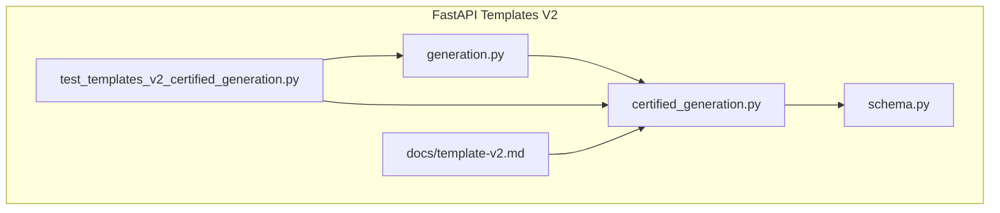
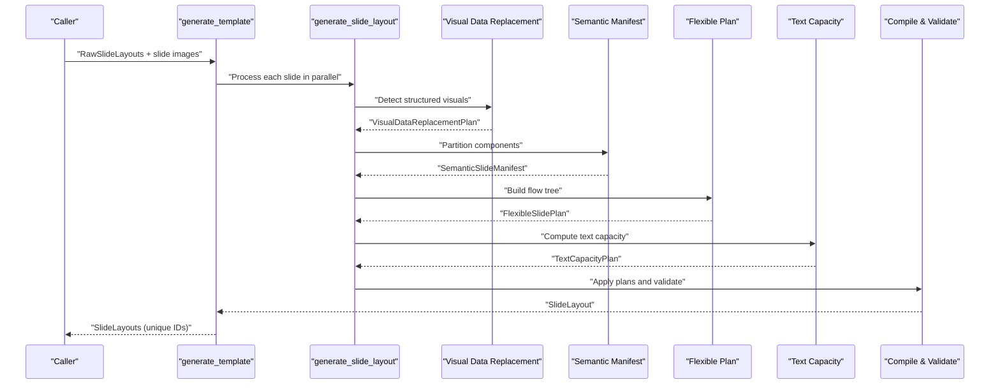
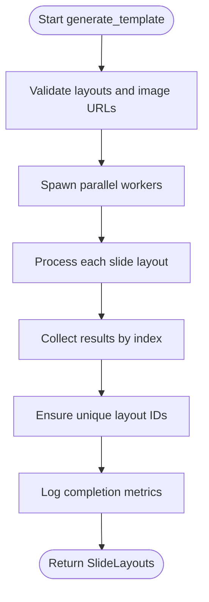
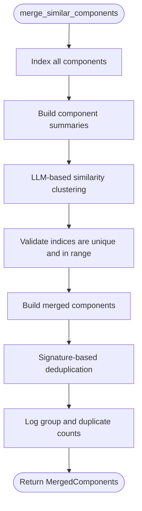
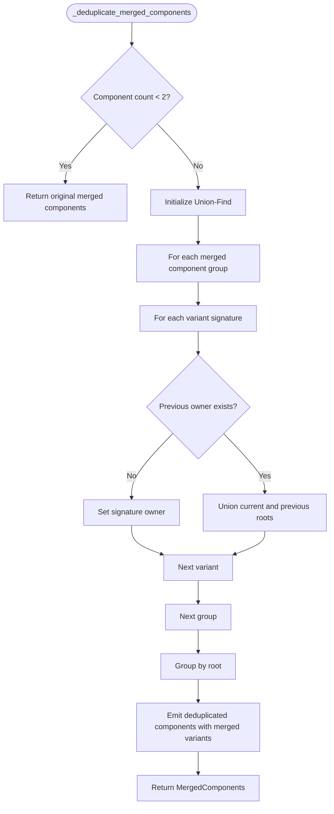
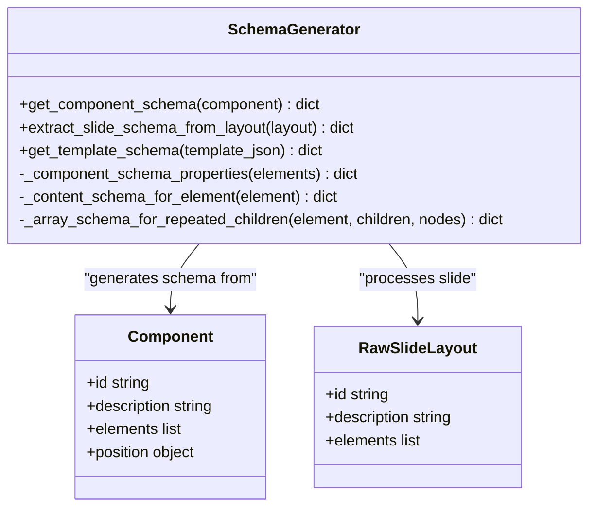
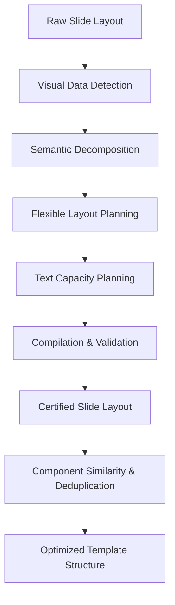
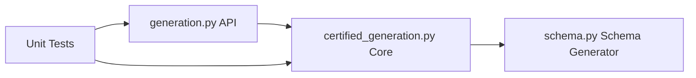

# Certified Generation System

<cite>
**Referenced Files in This Document**   
- [certified_generation.py](file://servers/fastapi/templates/v2/certified_generation.py)
- [generation.py](file://servers/fastapi/templates/v2/generation.py)
- [schema.py](file://servers/fastapi/templates/v2/schema.py)
- [test_templates_v2_certified_generation.py](file://servers/fastapi/tests/unit/test_templates_v2_certified_generation.py)
- [template-v2.md](file://docs/template-v2.md)
</cite>

## Table of Contents
1. [Introduction](#introduction)
2. [Project Structure](#project-structure)
3. [Core Components](#core-components)
4. [Architecture Overview](#architecture-overview)
5. [Detailed Component Analysis](#detailed-component-analysis)
6. [Dependency Analysis](#dependency-analysis)
7. [Performance Considerations](#performance-considerations)
8. [Troubleshooting Guide](#troubleshooting-guide)
9. [Conclusion](#conclusion)
10. [Appendices](#appendices)

## Introduction
The certified generation system transforms raw slide layouts into high-quality, reusable template components and validated slide layouts. It enforces strict quality standards through a multi-pass pipeline that combines deterministic structural analysis with structured LLM-assisted reasoning. The system ensures:

- Semantic decomposition of slides into reusable components.
- Detection and extraction of structured visual data such as charts, tables, infographics, and lists.
- Flexible layout planning for fixed regions and repeatable item collections.
- Safe text capacity expansion without breaking spacing or alignment.
- Component similarity clustering to identify interchangeable variants.
- Signature-based deduplication to eliminate structural duplicates.
- Structural integrity validation across component indices, flow trees, bounds, and editable schemas.

This documentation explains the certification process, the `merge_similar_components` function, validation algorithms, quality metrics, compliance checks, and guidance for customization and debugging.

## Project Structure
The certified generation logic is primarily implemented under the FastAPI backend templates module. Key files include:

- `certified_generation.py`: Core certification pipeline, structured prompts, parallel slide processing, component clustering, merging, and deduplication.
- `generation.py`: Public API surface, LLM-backed slide layout generation, duplicate signature computation, and helper utilities.
- `schema.py`: Editable content schema generation from generated components and layouts.
- Tests: Unit tests validating compilation, flexible plan behavior, text capacity adjustments, provider fallbacks, and retry behavior.
- Documentation: High-level overview of the V2 template system and tooling usage.

**Diagram sources**
- [certified_generation.py:491-547](file://servers/fastapi/templates/v2/certified_generation.py#L491-L547)
- [generation.py:151-210](file://servers/fastapi/templates/v2/generation.py#L151-L210)
- [schema.py:183-215](file://servers/fastapi/templates/v2/schema.py#L183-L215)
- [test_templates_v2_certified_generation.py:478-517](file://servers/fastapi/tests/unit/test_templates_v2_certified_generation.py#L478-L517)
- [template-v2.md:136-170](file://docs/template-v2.md#L136-L170)

**Section sources**
- [certified_generation.py:491-547](file://servers/fastapi/templates/v2/certified_generation.py#L491-L547)
- [generation.py:151-210](file://servers/fastapi/templates/v2/generation.py#L151-L210)
- [schema.py:183-215](file://servers/fastapi/templates/v2/schema.py#L183-L215)
- [test_templates_v2_certified_generation.py:478-517](file://servers/fastapi/tests/unit/test_templates_v2_certified_generation.py#L478-L517)
- [template-v2.md:136-170](file://docs/template-v2.md#L136-L170)

## Core Components
The certified generation system centers around these core responsibilities:

| Component | Responsibility | Key Outputs |
|---|---|---|
| Slide Layout Certification | Multi-pass semantic analysis per slide | `SlideLayout` with components, elements, and metadata |
| Visual Data Region Detection | Identify charts, tables, infographics, and lists | `VisualDataReplacementPlan` |
| Semantic Manifest Generation | Partition source elements into reusable components | `SemanticSlideManifest` |
| Flexible Region Planning | Define fixed flows and repeated item groups | `FlexibleSlidePlan` |
| Text Capacity Planning | Compute safe growth for editable text | `TextCapacityPlan` |
| Component Similarity Clustering | Group structurally interchangeable components | `SimilarComponentsList` |
| Merged Component Deduplication | Consolidate similar components and remove structural duplicates | `MergedComponents` |
| Editable Schema Generation | Derive JSON Schema for component content | Component schema objects |

**Section sources**
- [certified_generation.py:111-459](file://servers/fastapi/templates/v2/certified_generation.py#L111-L459)
- [certified_generation.py:491-547](file://servers/fastapi/templates/v2/certified_generation.py#L491-L547)
- [certified_generation.py:550-597](file://servers/fastapi/templates/v2/certified_generation.py#L550-L597)
- [generation.py:612-628](file://servers/fastapi/templates/v2/generation.py#L612-L628)
- [schema.py:183-215](file://servers/fastapi/templates/v2/schema.py#L183-L215)

## Architecture Overview
The certification pipeline processes each slide layout independently and in parallel, then normalizes IDs and aggregates results. Each slide goes through four focused passes:

1. **Visual Data Replacement Plan**: Detect structured visuals and replace image-rendered regions with typed data structures.
2. **Semantic Slide Manifest**: Partition source elements into reusable components and annotate editable fields.
3. **Flexible Slide Plan**: Build a flow tree with fixed regions and repeated items.
4. **Text Capacity Plan**: Compute safe horizontal and vertical growth for editable text.

After compilation, the system ensures unique layout IDs and logs performance metrics.

**Diagram sources**
- [certified_generation.py:491-547](file://servers/fastapi/templates/v2/certified_generation.py#L491-L547)
- [test_templates_v2_certified_generation.py:478-517](file://servers/fastapi/tests/unit/test_templates_v2_certified_generation.py#L478-L517)

**Section sources**
- [certified_generation.py:491-547](file://servers/fastapi/templates/v2/certified_generation.py#L491-L547)
- [test_templates_v2_certified_generation.py:478-517](file://servers/fastapi/tests/unit/test_templates_v2_certified_generation.py#L478-L517)

## Detailed Component Analysis

### Certified Slide Layout Generation
The main entry point validates inputs, starts parallel processing, and returns normalized layouts. It uses a thread pool bounded by `MAX_PARALLEL_SLIDE_LAYOUTS`, logs progress, and repairs duplicate layout IDs before returning results.

Key behaviors:
- Input validation ensures at least one layout and matching image count.
- Parallel execution improves throughput for large slide sets.
- Post-processing guarantees unique layout IDs.
- Logging includes slide counts, component counts, and duration.

**Diagram sources**
- [certified_generation.py:491-547](file://servers/fastapi/templates/v2/certified_generation.py#L491-L547)

**Section sources**
- [certified_generation.py:491-547](file://servers/fastapi/templates/v2/certified_generation.py#L491-L547)

### Component Similarity Detection and Merging
The `merge_similar_components` function identifies structurally interchangeable components across all layouts and consolidates them into merged components. It performs:

1. Indexing all components across layouts.
2. Building summaries including position, content bounds, element hierarchy, and editable schema.
3. Using structured LLM output to cluster similar components.
4. Validating clusters for non-negative, unique, and in-range indices.
5. Building merged components with variant lists.
6. Deduplicating merged components using signature-based comparison.

**Diagram sources**
- [certified_generation.py:550-597](file://servers/fastapi/templates/v2/certified_generation.py#L550-L597)
- [certified_generation.py:623-667](file://servers/fastapi/templates/v2/certified_generation.py#L623-L667)

**Section sources**
- [certified_generation.py:550-597](file://servers/fastapi/templates/v2/certified_generation.py#L550-L597)
- [certified_generation.py:623-667](file://servers/fastapi/templates/v2/certified_generation.py#L623-L667)

### Signature-Based Duplicate Elimination
Duplicate elimination operates on merged components and their variants. It computes signatures that ignore cosmetic differences and focus on structural equivalence:

- Aspect ratio normalization.
- Element type and decorative flag.
- Position and size normalized against root bounds.
- Recursive child/children traversal.
- Ignored schema keys such as name, min/max lengths, and column/row limits.
- Content value exclusion for chart, image, infographic, text, and text-list types.
- Union-Find structure to merge equivalent component groups.

**Diagram sources**
- [certified_generation.py:670-723](file://servers/fastapi/templates/v2/certified_generation.py#L670-L723)
- [certified_generation.py:726-800](file://servers/fastapi/templates/v2/certified_generation.py#L726-L800)

**Section sources**
- [certified_generation.py:670-723](file://servers/fastapi/templates/v2/certified_generation.py#L670-L723)
- [certified_generation.py:726-800](file://servers/fastapi/templates/v2/certified_generation.py#L726-L800)

### Validation Algorithms for Layout Consistency
Validation ensures structural integrity across multiple dimensions:

| Validation Area | Rule | Failure Behavior |
|---|---|---|
| Layout ID Uniqueness | Duplicate layout IDs receive suffixes | Logs warning and repairs IDs |
| Similar Component Indices | Must be non-negative, unique, and within range | Raises `ValueError` |
| Flexible Flow Tree | Every flow has ≥2 items; every leaf has exactly one reference | Rejects invalid plans |
| Geometry Mode | Row/column/grid must match geometry; group is fallback | Downgrades to group when invalid |
| Text Capacity Growth | Horizontal/vertical growth must respect boundaries | Removes unsupported adjustments |
| Source Stack Order | Component order preserves source stacking | Maintains visual layering |

**Section sources**
- [certified_generation.py:462-488](file://servers/fastapi/templates/v2/certified_generation.py#L462-L488)
- [certified_generation.py:623-640](file://servers/fastapi/templates/v2/certified_generation.py#L623-L640)
- [test_templates_v2_certified_generation.py:117-145](file://servers/fastapi/tests/unit/test_templates_v2_certified_generation.py#L117-L145)
- [test_templates_v2_certified_generation.py:171-210](file://servers/fastapi/tests/unit/test_templates_v2_certified_generation.py#L171-L210)
- [test_templates_v2_certified_generation.py:631-670](file://servers/fastapi/tests/unit/test_templates_v2_certified_generation.py#L631-L670)

### Editable Schema Generation
Editable schema generation derives JSON Schema definitions from generated components. It handles:

- Text, image, text-list, table, chart, and infographic content types.
- Repeated top-level groups and nested containers.
- Repeated child normalization and schema merging.
- Template-level schema composition across layouts.
- Metadata stripping for public schema exposure.

**Diagram sources**
- [schema.py:183-215](file://servers/fastapi/templates/v2/schema.py#L183-L215)
- [schema.py:361-423](file://servers/fastapi/templates/v2/schema.py#L361-L423)
- [schema.py:426-452](file://servers/fastapi/templates/v2/schema.py#L426-L452)

**Section sources**
- [schema.py:183-215](file://servers/fastapi/templates/v2/schema.py#L183-L215)
- [schema.py:361-423](file://servers/fastapi/templates/v2/schema.py#L361-L423)
- [schema.py:426-452](file://servers/fastapi/templates/v2/schema.py#L426-L452)

### Conceptual Overview
The certification system can be viewed as a layered quality gate:

[No sources needed since this diagram shows conceptual workflow, not actual code structure]

## Dependency Analysis
The system exhibits clear separation between orchestration, validation, and schema generation:

- `generation.py` exposes public APIs and delegates heavy lifting to `certified_generation.py`.
- `certified_generation.py` contains structured prompts, parallel processing, and core certification logic.
- `schema.py` depends on generated component models to produce editable schemas.
- Tests verify behavior across all layers, including provider fallbacks and retry mechanisms.

**Diagram sources**
- [generation.py:26-44](file://servers/fastapi/templates/v2/generation.py#L26-L44)
- [certified_generation.py:26-53](file://servers/fastapi/templates/v2/certified_generation.py#L26-L53)
- [schema.py:10-12](file://servers/fastapi/templates/v2/schema.py#L10-L12)
- [test_templates_v2_certified_generation.py:5-6](file://servers/fastapi/tests/unit/test_templates_v2_certified_generation.py#L5-L6)

**Section sources**
- [generation.py:26-44](file://servers/fastapi/templates/v2/generation.py#L26-L44)
- [certified_generation.py:26-53](file://servers/fastapi/templates/v2/certified_generation.py#L26-L53)
- [schema.py:10-12](file://servers/fastapi/templates/v2/schema.py#L10-L12)
- [test_templates_v2_certified_generation.py:5-6](file://servers/fastapi/tests/unit/test_templates_v2_certified_generation.py#L5-L6)

## Performance Considerations
- Parallel slide processing uses a bounded thread pool to avoid resource exhaustion.
- Structured LLM calls use retries and provider fallbacks to improve reliability.
- Signature-based deduplication avoids expensive deep comparisons by normalizing positions and ignoring cosmetic schema keys.
- Logging provides visibility into component counts, group sizes, and durations.
- Text capacity calculations use proportional font assumptions and safety factors to prevent overflow.

[No sources needed since this section provides general guidance]

## Troubleshooting Guide
Common certification failures and their likely causes:

| Symptom | Likely Cause | Resolution |
|---|---|---|
| Duplicate layout IDs | Generated layouts share identical IDs | System repairs IDs automatically; check logs for repair count |
| Invalid similarity indices | LLM returned negative, duplicate, or out-of-range indices | Adjust prompt constraints or reduce component complexity |
| Flexible plan rejected | Flow has fewer than two items or invalid geometry | Review flow definitions and allow group fallback |
| Text capacity adjustment ignored | Growth direction conflicts with boundaries | Remove unsupported growth or adjust layout spacing |
| Provider unavailable | LLM service failure or timeout | Use fallback providers and increase retry limits |
| Component not deduplicated | Signature differs due to position, size, or content values | Normalize positions or exclude content-only differences |

Debugging recommendations:
- Inspect intermediate outputs: visual replacement plan, semantic manifest, flexible plan, and text capacity plan.
- Enable logging for component counts, group sizes, and duplicate elimination metrics.
- Validate component summaries before clustering to ensure accurate role, geometry, and schema representation.
- Test small slide subsets to isolate problematic layouts.
- Use unit tests as reference patterns for expected compilation behavior.

**Section sources**
- [certified_generation.py:462-488](file://servers/fastapi/templates/v2/certified_generation.py#L462-L488)
- [certified_generation.py:623-640](file://servers/fastapi/templates/v2/certified_generation.py#L623-L640)
- [test_templates_v2_certified_generation.py:735-753](file://servers/fastapi/tests/unit/test_templates_v2_certified_generation.py#L735-L753)
- [test_templates_v2_certified_generation.py:756-797](file://servers/fastapi/tests/unit/test_templates_v2_certified_generation.py#L756-L797)

## Conclusion
The certified generation system provides a robust, multi-stage pipeline for producing consistent, high-quality template layouts. It combines deterministic structural analysis with structured LLM assistance to detect visual data, decompose semantics, plan flexible layouts, and compute safe text capacity. Component similarity clustering and signature-based deduplication optimize template efficiency by consolidating interchangeable variants and eliminating structural duplicates. Validation rules enforce layout consistency, proper spacing, and visual harmony, while logging and tests provide transparency and reliability.

For best results:
- Design components with clear semantic roles and consistent editable schemas.
- Avoid excessive cosmetic variation among interchangeable components.
- Ensure flexible flows reflect true geometric relationships.
- Monitor certification logs for duplicate repairs, group sizes, and deduplication metrics.
- Customize prompts and validation rules carefully to balance flexibility with structural integrity.

[No sources needed since this section summarizes without analyzing specific files]

## Appendices

### Certification Rules Summary
- Semantic decomposition prioritizes reusable visual regions over per-item components.
- Structured visuals are replaced with typed data only when confident.
- Flexible flows prefer row/column/grid when geometry supports it; group is a fallback.
- Text capacity growth respects visible boundaries and intentional spacing.
- Similar components must share structural role, geometry, and editable schema compatibility.
- Duplicate elimination ignores cosmetic differences and focuses on structural equivalence.

**Section sources**
- [certified_generation.py:111-459](file://servers/fastapi/templates/v2/certified_generation.py#L111-L459)
- [certified_generation.py:550-597](file://servers/fastapi/templates/v2/certified_generation.py#L550-L597)
- [certified_generation.py:670-800](file://servers/fastapi/templates/v2/certified_generation.py#L670-L800)

### Customization Guidance
- Extend structured prompts to refine component classification or flexible region detection.
- Adjust `_IGNORED_DUPLICATE_SCHEMA_KEYS` to control which schema attributes affect deduplication.
- Modify `_CONTENT_VALUE_KEYS_BY_ELEMENT_TYPE` to influence content-aware signature computation.
- Tune `DEFAULT_VALIDATION_RETRIES` and `MAX_PARALLEL_SLIDE_LAYOUTS` for performance-reliability trade-offs.
- Add custom validators via `extra_validator` parameters for domain-specific compliance checks.

**Section sources**
- [certified_generation.py:78-108](file://servers/fastapi/templates/v2/certified_generation.py#L78-L108)
- [certified_generation.py:59-64](file://servers/fastapi/templates/v2/certified_generation.py#L59-L64)
- [generation.py:54-85](file://servers/fastapi/templates/v2/generation.py#L54-L85)
- [generation.py:46-50](file://servers/fastapi/templates/v2/generation.py#L46-L50)