# Content Processing System

<cite>
**Referenced Files in This Document**
- [presentation.py](file://servers/fastapi/api/v1/ppt/endpoints/presentation.py)
- [content.py](file://servers/fastapi/templates/v2/content.py)
- [schema.py](file://servers/fastapi/templates/v2/schema.py)
- [slide_ui_helpers.py](file://servers/fastapi/services/chat/slide_ui_helpers.py)
- [infographic_catalog.py](file://servers/fastapi/utils/infographic_catalog.py)
- [template-v2-json-to-html.ts](file://servers/nxtjs/lib/template-v2-json-to-html.ts)
</cite>

## Table of Contents
1. [Introduction](#introduction)
2. [Project Structure](#project-structure)
3. [Core Components](#core-components)
4. [Architecture Overview](#architecture-overview)
5. [Detailed Component Analysis](#detailed-component-analysis)
6. [Dependency Analysis](#dependency-analysis)
7. [Performance Considerations](#performance-considerations)
8. [Troubleshooting Guide](#troubleshooting-guide)
9. [Conclusion](#conclusion)
10. [Appendices](#appendices)

## Introduction
This document explains the content processing system used to generate presentations from templates. It focuses on how different element types are processed, validated, and injected into template structures during generation. The supported editable content types include text, images, text lists, tables, charts, and infographics. The system provides:

- Schema-driven validation for generated content
- Placeholder replacement strategies based on element names and occurrence keys
- Data binding pipelines that transform raw input into rendered element structures
- Element-specific transformation rules for rich text formatting, image optimization, chart data normalization, table structure validation, and infographic data normalization

The goal is to make the content injection and validation pipeline transparent so developers can extend it with custom processors and integrate external data sources safely.

## Project Structure
The content processing system spans several modules:

- Template schema generation defines editable fields and constraints per element type
- Content hydration maps generated content to template elements
- Element-specific processors handle text, images, lists, tables, charts, and infographics
- Validation utilities enforce structural and semantic constraints
- Frontend rendering normalizes chart data for visualization

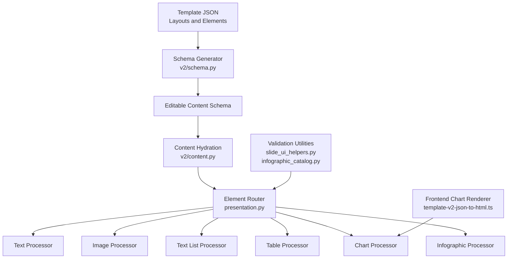

**Diagram sources**
- [schema.py:15-22](file://servers/fastapi/templates/v2/schema.py#L15-L22)
- [schema.py:183-189](file://servers/fastapi/templates/v2/schema.py#L183-L189)
- [content.py:57-87](file://servers/fastapi/templates/v2/content.py#L57-L87)
- [presentation.py:614-869](file://servers/fastapi/api/v1/ppt/endpoints/presentation.py#L614-L869)
- [slide_ui_helpers.py:116-219](file://servers/fastapi/services/chat/slide_ui_helpers.py#L116-L219)
- [infographic_catalog.py:512-640](file://servers/fastapi/utils/infographic_catalog.py#L512-L640)
- [template-v2-json-to-html.ts:2528-2565](file://servers/nxtjs/lib/template-v2-json-to-html.ts#L2528-L2565)

**Section sources**
- [schema.py:15-22](file://servers/fastapi/templates/v2/schema.py#L15-L22)
- [schema.py:183-189](file://servers/fastapi/templates/v2/schema.py#L183-L189)
- [content.py:57-87](file://servers/fastapi/templates/v2/content.py#L57-L87)
- [presentation.py:614-869](file://servers/fastapi/api/v1/ppt/endpoints/presentation.py#L614-L869)
- [slide_ui_helpers.py:116-219](file://servers/fastapi/services/chat/slide_ui_helpers.py#L116-L219)
- [infographic_catalog.py:512-640](file://servers/fastapi/utils/infographic_catalog.py#L512-L640)
- [template-v2-json-to-html.ts:2528-2565](file://servers/nxtjs/lib/template-v2-json-to-html.ts#L2528-L2565)

## Core Components
The core components responsible for content processing are:

- **Schema generator**: Converts template layouts into editable content schemas, defining allowed fields, array limits, and value constraints per element type.
- **Content hydrator**: Maps generated content objects to template elements, handling repeated groups and child arrays.
- **Element router**: Dispatches content values to element-specific processors based on element type.
- **Element processors**: Transform raw content into final element structures, applying formatting, validation, and optimization.
- **Validation utilities**: Enforce structural and semantic rules for charts, tables, and infographics.
- **Frontend renderer**: Normalizes chart data for browser-side visualization.

Key responsibilities:

| Component | Responsibility |
|---|---|
| Schema generator | Define editable field shapes and constraints |
| Content hydrator | Bind generated content to template elements |
| Element router | Route content to type-specific processors |
| Text processor | Convert markdown or plain text into styled runs |
| Image processor | Resolve URLs, set fit, and attach prompts |
| Text list processor | Map list items to styled runs |
| Table processor | Merge generated columns and rows into template cells |
| Chart processor | Normalize series, categories, colors, and axes |
| Infographic processor | Validate and normalize structured infographic data |
| Validation utilities | Enforce chart shape, table limits, and infographic semantics |
| Frontend renderer | Normalize chart points and series for rendering |

**Section sources**
- [schema.py:183-189](file://servers/fastapi/templates/v2/schema.py#L183-L189)
- [schema.py:361-423](file://servers/fastapi/templates/v2/schema.py#L361-L423)
- [content.py:57-87](file://servers/fastapi/templates/v2/content.py#L57-L87)
- [presentation.py:614-869](file://servers/fastapi/api/v1/ppt/endpoints/presentation.py#L614-L869)
- [slide_ui_helpers.py:116-219](file://servers/fastapi/services/chat/slide_ui_helpers.py#L116-L219)
- [infographic_catalog.py:512-640](file://servers/fastapi/utils/infographic_catalog.py#L512-L640)
- [template-v2-json-to-html.ts:2528-2565](file://servers/nxtjs/lib/template-v2-json-to-html.ts#L2528-L2565)

## Architecture Overview
The content processing architecture follows a layered pipeline:

1. Template layouts define elements and their metadata.
2. Schema generation produces editable content schemas.
3. Generated content is hydrated into template UI structures.
4. The element router dispatches each element to its processor.
5. Processors apply formatting, validation, and optimization.
6. Validated content is passed to rendering or export stages.

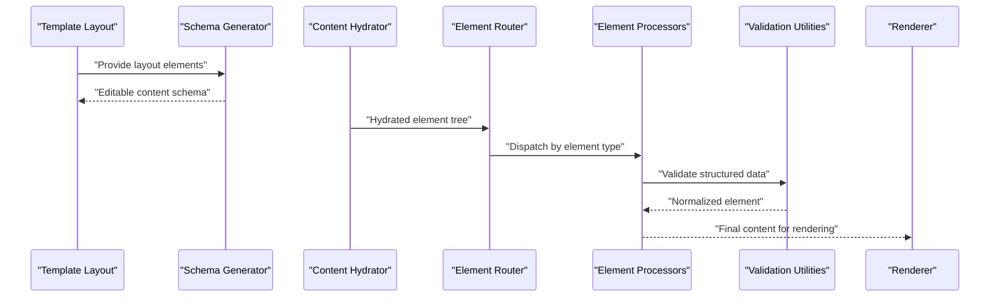

**Diagram sources**
- [schema.py:183-189](file://servers/fastapi/templates/v2/schema.py#L183-L189)
- [content.py:57-87](file://servers/fastapi/templates/v2/content.py#L57-L87)
- [presentation.py:614-869](file://servers/fastapi/api/v1/ppt/endpoints/presentation.py#L614-L869)
- [slide_ui_helpers.py:116-219](file://servers/fastapi/services/chat/slide_ui_helpers.py#L116-L219)
- [infographic_catalog.py:512-640](file://servers/fastapi/utils/infographic_catalog.py#L512-L640)

## Detailed Component Analysis

### Text Elements
Text elements accept string-like input and convert it into styled runs. The system supports:

- Plain text conversion
- Markdown-style inline emphasis
- LaTeX detection for math content
- Run-level font inheritance from template elements

Processing steps:

1. Read text from string, number, or object with a text field.
2. Detect LaTeX or bold-only patterns to choose a specialized parser.
3. Parse markdown into segments with optional style metadata.
4. Build run objects with merged font settings.
5. Replace the original text field with runs.

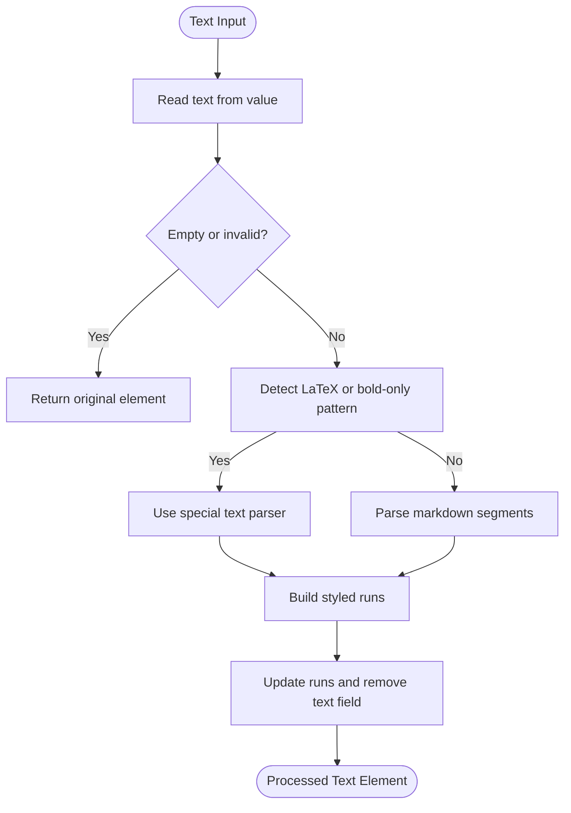

**Diagram sources**
- [presentation.py:934-950](file://servers/fastapi/api/v1/ppt/endpoints/presentation.py#L934-L950)
- [presentation.py:1145-1186](file://servers/fastapi/api/v1/ppt/endpoints/presentation.py#L1145-L1186)

Validation constraints:

- Minimum and maximum length may be defined by the template element.
- Rich text is normalized into runs rather than raw strings.
- LaTeX content is trimmed and limited to a safe length.

Extensibility guidance:

- Add new inline styles by extending the markdown parsing logic.
- Integrate external typography providers by injecting font metadata into runs.

**Section sources**
- [presentation.py:934-950](file://servers/fastapi/api/v1/ppt/endpoints/presentation.py#L934-L950)
- [presentation.py:1145-1186](file://servers/fastapi/api/v1/ppt/endpoints/presentation.py#L1145-L1186)
- [schema.py:361-371](file://servers/fastapi/templates/v2/schema.py#L361-L371)

### Images
Image elements support URL-based replacement and prompt-based generation. Supported input keys include:

- `image_url`, `icon_url`, `__image_url__`, `__icon_url__`, `url`
- `image_prompt`, `icon_query`, `prompt`, `query`

Processing steps:

1. Resolve an image URL from multiple candidate keys.
2. Set the resolved URL into the element’s data field.
3. Normalize image fit behavior based on the URL.
4. Attach a prompt if provided for asset generation.

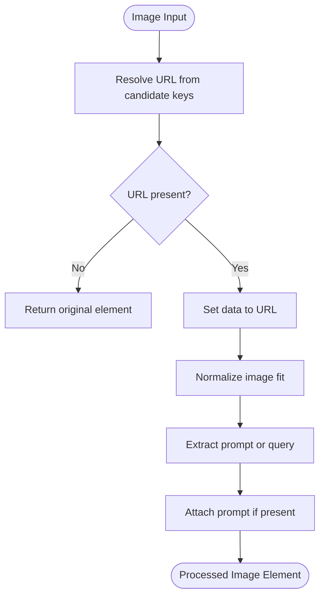

**Diagram sources**
- [presentation.py:953-992](file://servers/fastapi/api/v1/ppt/endpoints/presentation.py#L953-L992)

Validation constraints:

- Decorative images are preserved without replacement.
- Icon elements use icon-specific prompt keys.
- Missing URLs result in no modification.

Extensibility guidance:

- Add new URL resolution strategies by extending candidate key checks.
- Integrate image optimization services by hooking into the fit normalization step.

**Section sources**
- [presentation.py:953-992](file://servers/fastapi/api/v1/ppt/endpoints/presentation.py#L953-L992)
- [schema.py:373-375](file://servers/fastapi/templates/v2/schema.py#L373-L375)

### Text Lists
Text list elements map arrays of strings or simple text objects into styled item runs.

Processing steps:

1. Validate that input is an array.
2. For each item, read text from string, number, or object.
3. Preserve existing run structure when available.
4. Convert each item into styled runs using markdown parsing.
5. Replace the element’s items array with processed runs.

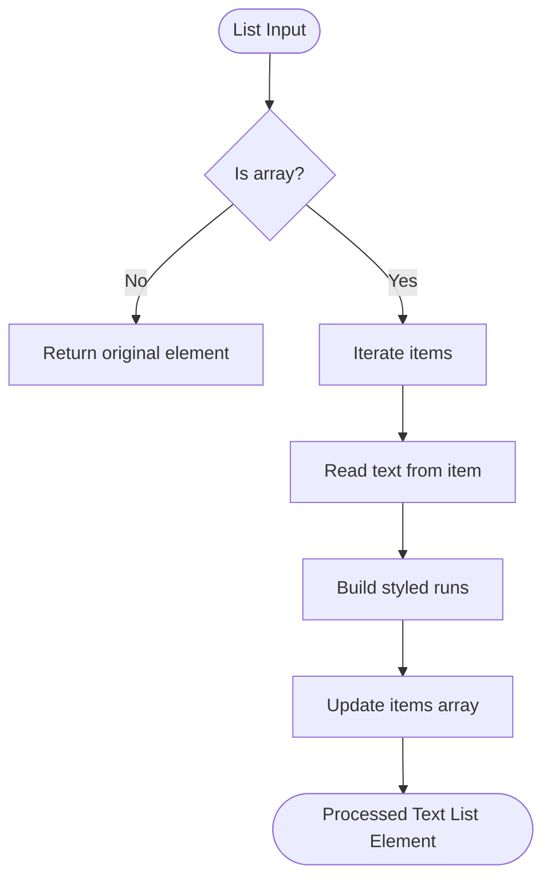

**Diagram sources**
- [presentation.py:995-1032](file://servers/fastapi/api/v1/ppt/endpoints/presentation.py#L995-L1032)

Validation constraints:

- Array length may be constrained by template schema.
- Each item must resolve to non-empty text.

Extensibility guidance:

- Extend item parsing to support nested objects or structured list entries.
- Add list-level styling options by merging base run properties.

**Section sources**
- [presentation.py:995-1032](file://servers/fastapi/api/v1/ppt/endpoints/presentation.py#L995-L1032)
- [schema.py:377-391](file://servers/fastapi/templates/v2/schema.py#L377-L391)

### Tables
Table elements merge generated column headers and row cells into template cell structures.

Processing steps:

1. Read generated columns and rows from the content object.
2. Merge generated header text into template column cells.
3. Merge generated row cells into template row structures.
4. Apply default fonts, fills, and strokes for generated cells.
5. Convert cell text into styled runs.

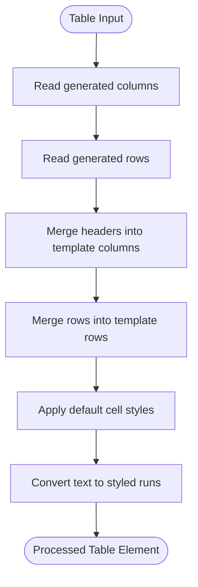

**Diagram sources**
- [presentation.py:1035-1136](file://servers/fastapi/api/v1/ppt/endpoints/presentation.py#L1035-L1136)

Validation constraints:

- Column count and row count may be constrained by template schema.
- Cell text capacity is estimated from template dimensions and typography.
- Generated cells inherit or receive fallback fonts and colors.

Extensibility guidance:

- Add advanced cell styling by extending the cell replacement logic.
- Integrate table data validation against external schemas before merging.

**Section sources**
- [presentation.py:1035-1136](file://servers/fastapi/api/v1/ppt/endpoints/presentation.py#L1035-L1136)
- [schema.py:57-125](file://servers/fastapi/templates/v2/schema.py#L57-L125)
- [schema.py:393-415](file://servers/fastapi/templates/v2/schema.py#L393-L415)
- [slide_ui_helpers.py:1966-2002](file://servers/fastapi/services/chat/slide_ui_helpers.py#L1966-L2002)

### Charts
Chart elements normalize series, categories, colors, and axis configuration.

Processing steps:

1. Normalize chart type to a supported enum.
2. Normalize legacy data formats into series and categories.
3. Ensure at least one series with default values.
4. Validate chart shape against type-specific rules.
5. Normalize colors, axes, grids, and legend visibility.

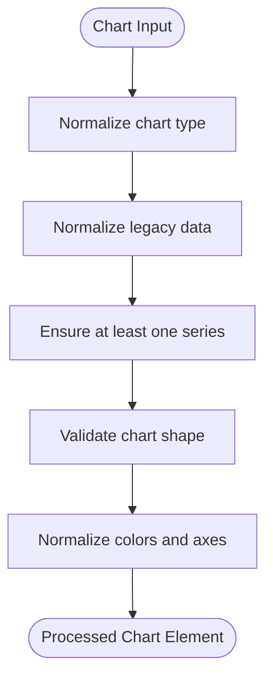

**Diagram sources**
- [slide_ui_helpers.py:116-219](file://servers/fastapi/services/chat/slide_ui_helpers.py#L116-L219)

Validation constraints:

- Chart type must be one of the supported values.
- Series values must match category counts where required.
- Colors must be valid hex or rgba strings.
- Axes and grids are enabled conditionally based on chart type.

Extensibility guidance:

- Add new chart types by extending the supported enum and validation rules.
- Integrate external chart libraries by adapting the normalization output.

Frontend rendering:

- The frontend normalizes point data, series names, and colors for visualization.
- Default series and categories are provided when missing.

**Section sources**
- [slide_ui_helpers.py:116-219](file://servers/fastapi/services/chat/slide_ui_helpers.py#L116-L219)
- [schema.py:1490-1534](file://servers/fastapi/templates/v2/schema.py#L1490-L1534)
- [template-v2-json-to-html.ts:2528-2565](file://servers/nxtjs/lib/template-v2-json-to-html.ts#L2528-L2565)

### Infographics
Infographic elements validate and normalize structured data according to infographic type.

Processing steps:

1. Determine infographic type from template or content.
2. Normalize incoming data while preserving template-defined type.
3. Strip inline Markdown from labels recursively.
4. Validate required fields, numeric ranges, and structural constraints.
5. Merge colors and data into the element.

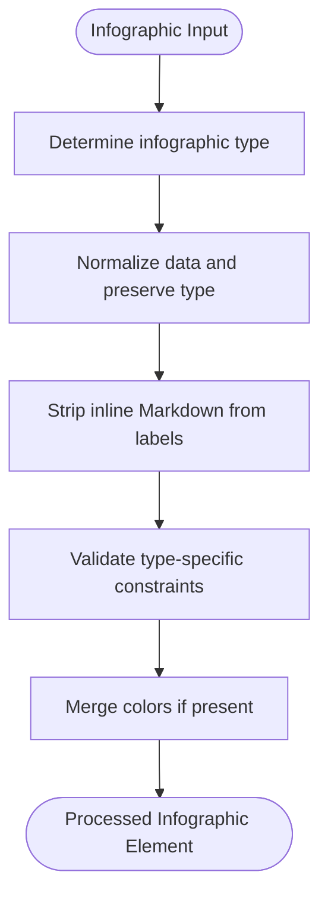

**Diagram sources**
- [presentation.py:872-898](file://servers/fastapi/api/v1/ppt/endpoints/presentation.py#L872-L898)
- [content.py:27-40](file://servers/fastapi/templates/v2/content.py#L27-L40)
- [infographic_catalog.py:512-640](file://servers/fastapi/utils/infographic_catalog.py#L512-L640)

Validation constraints:

- Numeric ranges for progress bars and gauges.
- Non-empty columns and rows for gantt charts.
- Required labels and item counts for matrix and funnel types.
- Unique IDs and parent references for hierarchical charts.

Extensibility guidance:

- Add new infographic types by extending the catalog and schema definitions.
- Integrate external data sources by pre-normalizing payloads before validation.

**Section sources**
- [presentation.py:872-898](file://servers/fastapi/api/v1/ppt/endpoints/presentation.py#L872-L898)
- [content.py:27-40](file://servers/fastapi/templates/v2/content.py#L27-L40)
- [schema.py:1448-1475](file://servers/fastapi/templates/v2/schema.py#L1448-L1475)
- [infographic_catalog.py:512-640](file://servers/fastapi/utils/infographic_catalog.py#L512-L640)

### Content Injection and Placeholder Replacement
Content injection maps generated content to template elements using name-based matching and occurrence-aware keys.

Key mechanisms:

- Name candidates include the exact name, numeric-token-stripped name, and prefix-stripped name.
- Repeated elements track occurrence indices and suffix keys like `name_1`, `name_2`.
- Repeated children select template source nodes by index, optionally centering when reduced.
- Top-level repeated groups hydrate entire positioned groups from array content.

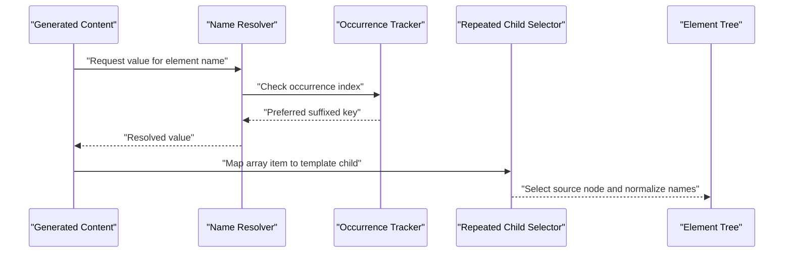

**Diagram sources**
- [presentation.py:711-743](file://servers/fastapi/api/v1/ppt/endpoints/presentation.py#L711-L743)
- [presentation.py:746-798](file://servers/fastapi/api/v1/ppt/endpoints/presentation.py#L746-L798)
- [content.py:43-54](file://servers/fastapi/templates/v2/content.py#L43-L54)
- [content.py:57-87](file://servers/fastapi/templates/v2/content.py#L57-L87)

Validation constraints:

- Only non-decorative elements receive generated values.
- Direct-value mode allows repeated flex/grid children to bind array items directly.
- Repeated names are normalized to stable indices after selection.

Extensibility guidance:

- Add custom placeholder tokens by extending the name candidate resolver.
- Implement custom repeated group strategies by overriding the source index calculation.

**Section sources**
- [presentation.py:711-743](file://servers/fastapi/api/v1/ppt/endpoints/presentation.py#L711-L743)
- [presentation.py:746-798](file://servers/fastapi/api/v1/ppt/endpoints/presentation.py#L746-L798)
- [content.py:43-54](file://servers/fastapi/templates/v2/content.py#L43-L54)
- [content.py:57-87](file://servers/fastapi/templates/v2/content.py#L57-L87)

### Data Binding Processes
Data binding connects generated content to template elements through:

- Schema-defined property names
- Occurrence-aware keys for repeated components
- Direct-value binding for repeated children
- Type-specific processors that transform raw data into element structures

Binding flow:

1. Generate content according to schema.
2. Hydrate component content into UI structure.
3. Resolve element names to content keys.
4. Dispatch to element processors.
5. Validate and normalize element data.
6. Produce final element for rendering.

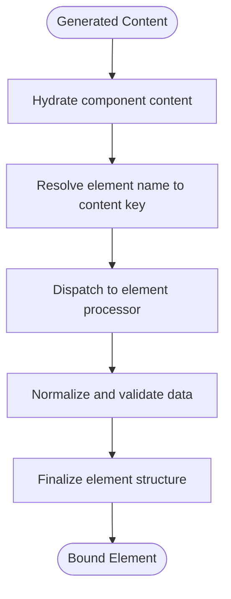

**Diagram sources**
- [presentation.py:563-611](file://servers/fastapi/api/v1/ppt/endpoints/presentation.py#L563-L611)
- [presentation.py:614-869](file://servers/fastapi/api/v1/ppt/endpoints/presentation.py#L614-L869)

**Section sources**
- [presentation.py:563-611](file://servers/fastapi/api/v1/ppt/endpoints/presentation.py#L563-L611)
- [presentation.py:614-869](file://servers/fastapi/api/v1/ppt/endpoints/presentation.py#L614-L869)

## Dependency Analysis
The content processing system has clear dependencies between schema generation, hydration, routing, and validation:

- Schema generation depends on template layout structure and infographic catalog metadata.
- Hydration depends on repeated group detection and name normalization.
- Routing depends on element type and decorative flags.
- Validation depends on chart type, table dimensions, and infographic type.
- Rendering depends on normalized chart data.

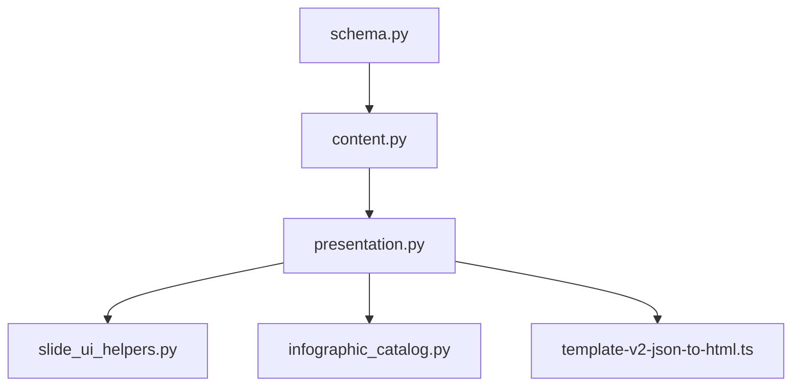

**Diagram sources**
- [schema.py:15-22](file://servers/fastapi/templates/v2/schema.py#L15-L22)
- [content.py:57-87](file://servers/fastapi/templates/v2/content.py#L57-L87)
- [presentation.py:614-869](file://servers/fastapi/api/v1/ppt/endpoints/presentation.py#L614-L869)
- [slide_ui_helpers.py:116-219](file://servers/fastapi/services/chat/slide_ui_helpers.py#L116-L219)
- [infographic_catalog.py:512-640](file://servers/fastapi/utils/infographic_catalog.py#L512-L640)
- [template-v2-json-to-html.ts:2528-2565](file://servers/nxtjs/lib/template-v2-json-to-html.ts#L2528-L2565)

**Section sources**
- [schema.py:15-22](file://servers/fastapi/templates/v2/schema.py#L15-L22)
- [content.py:57-87](file://servers/fastapi/templates/v2/content.py#L57-L87)
- [presentation.py:614-869](file://servers/fastapi/api/v1/ppt/endpoints/presentation.py#L614-L869)
- [slide_ui_helpers.py:116-219](file://servers/fastapi/services/chat/slide_ui_helpers.py#L116-L219)
- [infographic_catalog.py:512-640](file://servers/fastapi/utils/infographic_catalog.py#L512-L640)
- [template-v2-json-to-html.ts:2528-2565](file://servers/nxtjs/lib/template-v2-json-to-html.ts#L2528-L2565)

## Performance Considerations
- Avoid unnecessary deep copies by reusing template structures when safe.
- Limit markdown parsing to cases where inline styles are present.
- Cap chart series and category lengths to prevent oversized datasets.
- Pre-validate infographic data to fail fast on malformed payloads.
- Cache computed table text capacity estimates when template dimensions are stable.

[No sources needed since this section provides general guidance]

## Troubleshooting Guide
Common issues and resolutions:

| Issue | Symptom | Resolution |
|---|---|---|
| Text not rendered | Element remains unchanged | Verify text resolves to non-empty string; check LaTeX or markdown parsing path |
| Image not replaced | Original placeholder persists | Ensure URL key is present; confirm element is not decorative |
| List items missing | Items array empty | Confirm input is array and each item resolves to text |
| Table misaligned | Columns or rows mismatched | Check generated column and row counts against template limits |
| Chart error | Invalid series or categories | Normalize series and categories; validate chart type and color format |
| Infographic validation fails | Error about required fields | Provide required fields for infographic type; ensure numeric ranges and unique IDs |

Relevant validation paths:

- Table dimension validation
- Chart shape validation
- Infographic type-specific validation

**Section sources**
- [slide_ui_helpers.py:1966-2002](file://servers/fastapi/services/chat/slide_ui_helpers.py#L1966-L2002)
- [slide_ui_helpers.py:116-219](file://servers/fastapi/services/chat/slide_ui_helpers.py#L116-L219)
- [infographic_catalog.py:512-640](file://servers/fastapi/utils/infographic_catalog.py#L512-L640)

## Conclusion
The content processing system provides a robust, schema-driven pipeline for transforming generated content into rendered template elements. It supports text, images, lists, tables, charts, and infographics with clear validation and normalization rules. Developers can extend the system by adding new element processors, integrating external data sources, and expanding validation constraints while maintaining consistent placeholder replacement and data binding behavior.

[No sources needed since this section summarizes without analyzing specific files]

## Appendices

### Extending the Content Processing System
To add a custom element type:

1. Define schema properties in the schema generator.
2. Add routing logic in the element router.
3. Implement a processor that transforms raw content into element structure.
4. Add validation rules in validation utilities if needed.
5. Update frontend rendering if the element requires visualization.

Example extension points:

- Custom placeholder tokens via name candidate resolver
- Custom repeated group hydration strategy
- Custom chart type with normalized series and categories
- Custom infographic type with catalog entry and validation

**Section sources**
- [schema.py:361-423](file://servers/fastapi/templates/v2/schema.py#L361-L423)
- [presentation.py:853-869](file://servers/fastapi/api/v1/ppt/endpoints/presentation.py#L853-L869)
- [slide_ui_helpers.py:116-219](file://servers/fastapi/services/chat/slide_ui_helpers.py#L116-L219)
- [infographic_catalog.py:512-640](file://servers/fastapi/utils/infographic_catalog.py#L512-L640)