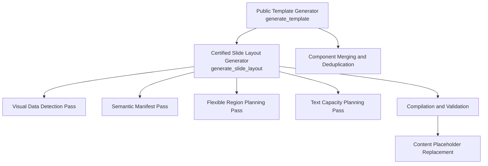
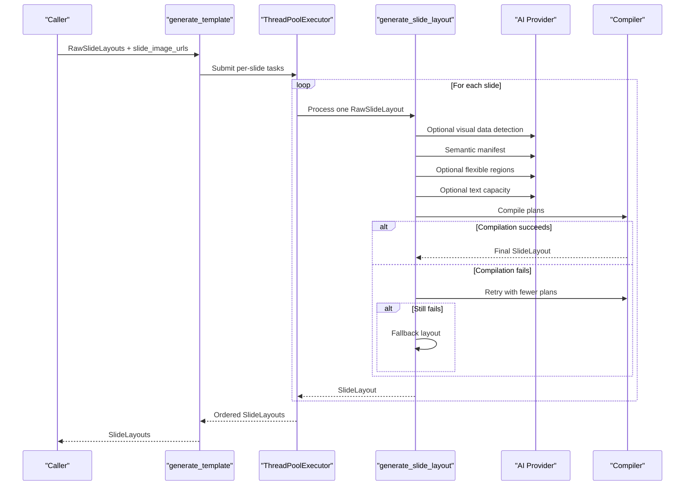
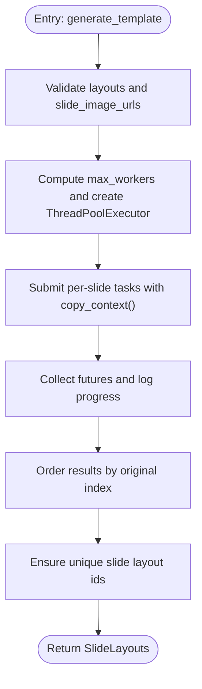
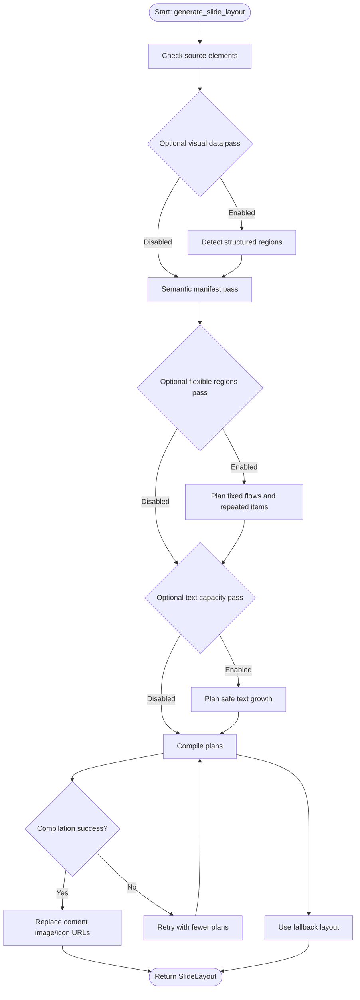
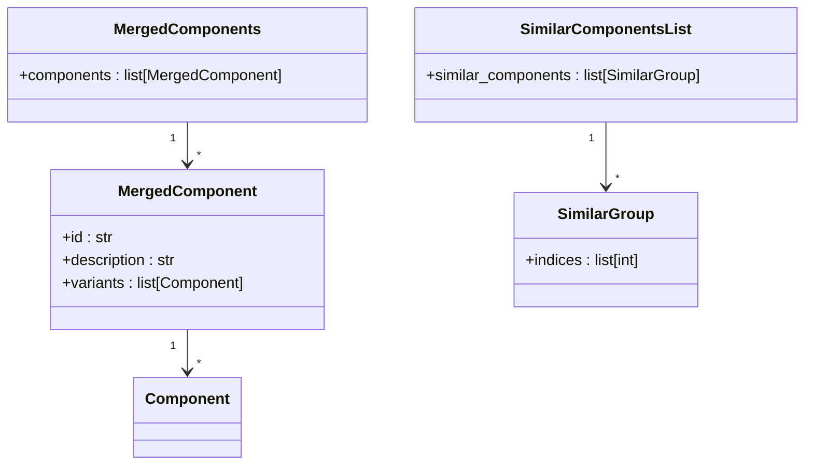
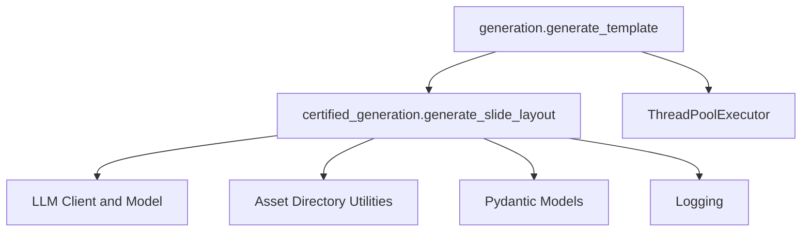

# Main Generation Pipeline

<cite>
**Referenced Files in This Document**
- [generation.py](file://servers/fastapi/templates/v2/generation.py)
- [certified_generation.py](file://servers/fastapi/templates/v2/certified_generation.py)
- [presentation_layout.py](file://servers/fastapi/templates/presentation_layout.py)
- [presentation_layout.py](file://servers/fastapi/models/presentation_layout.py)
- [template.py](file://servers/fastapi/api/v1/ppt/endpoints/template.py)
- [test_template_generation_options.py](file://servers/fastapi/tests/unit/test_template_generation_options.py)
- [llm_config.py](file://servers/fastapi/utils/llm_config.py)
</cite>

## Table of Contents
1. [Introduction](#introduction)
2. [Project Structure](#project-structure)
3. [Core Components](#core-components)
4. [Architecture Overview](#architecture-overview)
5. [Detailed Component Analysis](#detailed-component-analysis)
6. [Dependency Analysis](#dependency-analysis)
7. [Performance Considerations](#performance-considerations)
8. [Troubleshooting Guide](#troubleshooting-guide)
9. [Conclusion](#conclusion)

## Introduction
This document explains the main template generation pipeline that orchestrates the entire template processing workflow. It focuses on the primary entry point for generating slide layouts from raw template definitions, the multi-pass architecture used to produce semantic, flexible, and text-capacity-aware layouts, and the concurrent execution model that processes slides in parallel while preserving caller context. It also covers component merging, validation strategies, AI provider integration, font handling, image URL resolution, configuration options, performance tuning, progress monitoring, and troubleshooting guidance.

## Project Structure
The template generation pipeline is implemented under the FastAPI backend:

- The public generation API surface exposes `generate_template`, which accepts raw slide layouts and produces validated slide layouts with parallel processing.
- The certified generation module implements the detailed multi-pass pipeline: visual data detection, semantic manifest creation, flexible region planning, text capacity planning, compilation, fallback behavior, and content placeholder replacement.
- Legacy layout models are re-exported through a compatibility layer.
- Async endpoints wrap synchronous generation into an executor to preserve context across threads.
- Tests validate generation options and default behavior.

**Diagram sources**
- [generation.py:151-210](file://servers/fastapi/templates/v2/generation.py#L151-L210)
- [certified_generation.py:3651-3871](file://servers/fastapi/templates/v2/certified_generation.py#L3651-L3871)

**Section sources**
- [generation.py:1-52](file://servers/fastapi/templates/v2/generation.py#L1-L52)
- [certified_generation.py:1-66](file://servers/fastapi/templates/v2/certified_generation.py#L1-L66)

## Core Components
- Public generator: `generate_template` converts `RawSlideLayouts` into `SlideLayouts`, validates inputs, runs parallel slide generation, orders results, ensures unique layout IDs, and logs duration and component counts.
- Certified slide generator: `generate_slide_layout` performs optional visual data replacement, semantic analysis, flexible grouping, text capacity planning, compilation attempts, and fallback when needed.
- Component merger: `merge_similar_components` clusters interchangeable components and deduplicates structurally identical variants.
- Legacy layout models: `SlideLayoutModel` and `PresentationLayoutModel` provide schema and helper utilities for older presentation structures.
- Async endpoint wrapper: template creation endpoints run synchronous generation inside a single-thread executor while copying context variables.

Key responsibilities:
- Input validation and error handling at the top level.
- Parallel slide processing with bounded concurrency.
- Multi-pass structured LLM calls with retries and provider fallback.
- Deterministic post-processing and fallback paths.
- Content placeholder normalization for generated templates.

**Section sources**
- [generation.py:151-210](file://servers/fastapi/templates/v2/generation.py#L151-L210)
- [certified_generation.py:491-547](file://servers/fastapi/templates/v2/certified_generation.py#L491-L547)
- [certified_generation.py:550-597](file://servers/fastapi/templates/v2/certified_generation.py#L550-L597)
- [presentation_layout.py:11-47](file://servers/fastapi/templates/presentation_layout.py#L11-L47)
- [presentation_layout.py:1-6](file://servers/fastapi/models/presentation_layout.py#L1-L6)
- [template.py:808-815](file://servers/fastapi/api/v1/ppt/endpoints/template.py#L808-L815)

## Architecture Overview
The pipeline uses a multi-pass approach:

1. Visual data detection pass (optional): identifies charts, infographics, tables, or text lists that should become structured elements.
2. Semantic manifest pass: partitions source elements into reusable components and classifies editable candidates.
3. Flexible region planning pass (optional): groups fixed flow regions and repeatable items.
4. Text capacity planning pass (optional): decides safe growth for editable text boxes.
5. Compilation and validation: compiles plans into a final layout; retries with reduced decisions if compilation fails.
6. Fallback path: preserves fidelity by using a deterministic fallback when passes fail.
7. Post-processing: replaces replaceable image/icon URLs with stable placeholders and normalizes fit.

**Diagram sources**
- [generation.py:151-210](file://servers/fastapi/templates/v2/generation.py#L151-L210)
- [certified_generation.py:3651-3871](file://servers/fastapi/templates/v2/certified_generation.py#L3651-L3871)

## Detailed Component Analysis

### Public Entry Point: generate_template
Responsibilities:
- Validate that layouts contain at least one slide and that slide image URLs match the number of layouts.
- Compute maximum parallel workers based on a constant cap and slide count.
- Submit per-slide tasks to a thread pool executor, wrapping each call with context preservation.
- Collect results by index, log completion progress, order results, ensure unique layout IDs, and return `SlideLayouts`.

Concurrency and context:
- Uses `ThreadPoolExecutor` with bounded workers.
- Wraps worker function invocation with `copy_context().run` to preserve async context variables across threads.

Progress and diagnostics:
- Logs start, per-slide completion, total component count, and elapsed time.

Error handling:
- Raises `ValueError` for invalid input sizes.
- Propagates exceptions from individual slide generation.

Configuration:
- Accepts optional fonts and generation options.
- Uses constants for max parallelism and validation retries.

**Diagram sources**
- [generation.py:151-210](file://servers/fastapi/templates/v2/generation.py#L151-L210)

**Section sources**
- [generation.py:151-210](file://servers/fastapi/templates/v2/generation.py#L151-L210)

### Certified Slide Layout Generation: generate_slide_layout
Responsibilities:
- Validate that the source layout contains at least one element.
- Build optional visual data replacement payload and execute the visual pass.
- Execute the semantic manifest pass.
- Optionally execute flexible region planning and text capacity planning.
- Attempt compilation with multiple plan combinations; retry with reduced decisions if needed.
- Replace replaceable content image/icon URLs with stable placeholders.
- Provide deterministic fallback when any pass fails.

Multi-pass details:
- Visual data detection: detects structured regions like charts, infographics, tables, and text lists.
- Semantic manifest: partitions elements into reusable components and annotates editable fields.
- Flexible regions: builds fixed flow groups and repeated item structures.
- Text capacity: computes safe horizontal and vertical growth for text boxes.
- Compilation: applies plans to build a final layout; includes geometry checks and reflow logic.

Fallback strategy:
- If semantic pass fails, returns a fidelity-preserving fallback layout.
- If compilation fails across all plan combinations, returns a fallback layout.

Image and icon handling:
- Replaces non-decorative image/icon data with placeholder URLs.
- Normalizes image fit to cover when replacing content images.

**Diagram sources**
- [certified_generation.py:3651-3871](file://servers/fastapi/templates/v2/certified_generation.py#L3651-L3871)

**Section sources**
- [certified_generation.py:3651-3871](file://servers/fastapi/templates/v2/certified_generation.py#L3651-L3871)

### Component Merging and Deduplication
Responsibilities:
- Cluster similar components using AI-assisted clustering summaries.
- Build merged components with variant indices.
- Deduplicate structurally identical merged components using signature-based union-find.
- Preserve descriptions and normalize IDs.

Validation:
- Ensures similarity group indices are within bounds and not duplicated.

Output:
- Returns `MergedComponents` suitable for reuse across templates.

**Diagram sources**
- [certified_generation.py:550-597](file://servers/fastapi/templates/v2/certified_generation.py#L550-L597)
- [certified_generation.py:642-723](file://servers/fastapi/templates/v2/certified_generation.py#L642-L723)

**Section sources**
- [certified_generation.py:550-597](file://servers/fastapi/templates/v2/certified_generation.py#L550-L597)
- [certified_generation.py:642-723](file://servers/fastapi/templates/v2/certified_generation.py#L642-L723)

### Legacy Layout Models
Responsibilities:
- Define `SlideLayoutModel` and `PresentationLayoutModel`.
- Normalize icon type and weight from settings.
- Provide helpers to locate slide layout indices and convert to presentation structure.

Usage:
- Re-exported via a compatibility module for legacy APIs.

**Section sources**
- [presentation_layout.py:11-47](file://servers/fastapi/templates/presentation_layout.py#L11-L47)
- [presentation_layout.py:1-6](file://servers/fastapi/models/presentation_layout.py#L1-L6)

### Async Endpoint Integration
Responsibilities:
- Wrap synchronous template generation in a single-thread executor.
- Copy context before running the synchronous function to preserve async context variables.
- Coerce generated layouts into `SlideLayouts`.

Behavior:
- Prevents blocking the event loop while maintaining context isolation.

**Section sources**
- [template.py:808-815](file://servers/fastapi/api/v1/ppt/endpoints/template.py#L808-L815)

## Dependency Analysis
The pipeline depends on:
- Structured LLM clients and models configured through environment and provider settings.
- Image path resolution utilities for local files and remote URLs.
- Pydantic models for strict validation of generated outputs.
- Logging for progress tracking and diagnostics.

External integrations:
- AI providers are selected via configuration; Gemini receives special handling for certain response schemas.
- Fonts are passed into the generation pipeline to inform semantic classification and text capacity planning.
- Image URLs are resolved to filesystem paths when possible; otherwise they are sent as remote references.

**Diagram sources**
- [generation.py:151-210](file://servers/fastapi/templates/v2/generation.py#L151-L210)
- [certified_generation.py:3651-3871](file://servers/fastapi/templates/v2/certified_generation.py#L3651-L3871)

**Section sources**
- [llm_config.py:258-290](file://servers/fastapi/utils/llm_config.py#L258-L290)

## Performance Considerations
- Parallelism: Maximum parallel slide layouts is capped by a constant; actual workers equal the minimum of the cap and slide count.
- Token limits: Completion token limits are applied to structured LLM calls; optional overrides can be provided where supported.
- Retries: Validation retries reduce transient failures and improve robustness.
- Fallbacks: Deterministic fallback paths avoid complete failure when AI passes are unstable.
- Preview tool usage: When previewing candidate layouts, the system limits preview calls to control cost and latency.

Tuning recommendations:
- Adjust `MAX_PARALLEL_SLIDE_LAYOUTS` based on CPU cores and LLM rate limits.
- Tune `DEFAULT_VALIDATION_RETRIES` to balance resilience and latency.
- Enable only required passes (`visual_replacement`, `flexible_grouping`, `text_growth`) to reduce overhead.
- Monitor logs for duration metrics and component counts to identify bottlenecks.

**Section sources**
- [generation.py:46-52](file://servers/fastapi/templates/v2/generation.py#L46-L52)
- [generation.py:151-210](file://servers/fastapi/templates/v2/generation.py#L151-L210)
- [certified_generation.py:59-66](file://servers/fastapi/templates/v2/certified_generation.py#L59-L66)
- [certified_generation.py:3651-3871](file://servers/fastapi/templates/v2/certified_generation.py#L3651-L3871)

## Troubleshooting Guide
Common issues and resolutions:
- Invalid input sizes: Ensure `layouts` contains at least one slide and `slide_image_urls` matches the number of layouts.
- Missing source elements: Each source layout must include at least one element; otherwise generation raises an error.
- LLM response errors: The pipeline retries JSON parsing, model validation, and provider calls; check logs for attempt counts and errors.
- Compilation failures: The system retries compilation with fewer optional decisions; review logs for failed plan combinations.
- Fallback activation: If semantic or compilation passes fail, a fallback layout is returned; inspect logs indicating fallback usage.
- Image URL resolution: Local image paths are read as bytes; remote URLs are sent directly; verify asset availability.
- Font handling: Fonts are passed into semantic and capacity passes; ensure fonts are available and correctly named.
- Generation options: Use explicit `LayoutGenerationOptions` to enable or disable passes; tests confirm defaults and override behavior.

Monitoring and debugging:
- Inspect logs prefixed with `[templates.v2.generate]` and `[templates.v2.llm]` for progress, durations, and errors.
- Track component counts and completed slide ratios to assess throughput.
- Validate generated layouts against expected schemas and constraints.
- Use test cases for generation options to reproduce behavior locally.

**Section sources**
- [generation.py:151-210](file://servers/fastapi/templates/v2/generation.py#L151-L210)
- [certified_generation.py:3651-3871](file://servers/fastapi/templates/v2/certified_generation.py#L3651-L3871)
- [test_template_generation_options.py:81-201](file://servers/fastapi/tests/unit/test_template_generation_options.py#L81-L201)

## Conclusion
The main template generation pipeline provides a robust, multi-pass architecture for converting raw slide layouts into validated, reusable slide layouts. It balances AI-driven intelligence with deterministic fallbacks, supports parallel processing with context preservation, and offers configurable passes for visual data, flexible grouping, and text capacity. By tuning concurrency, retries, and generation options, operators can optimize performance and reliability while maintaining high-quality template generation outcomes.