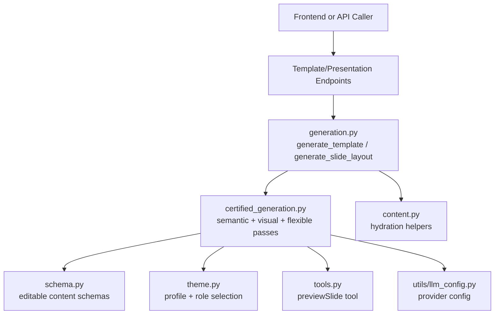
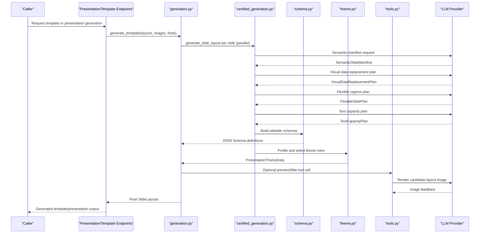
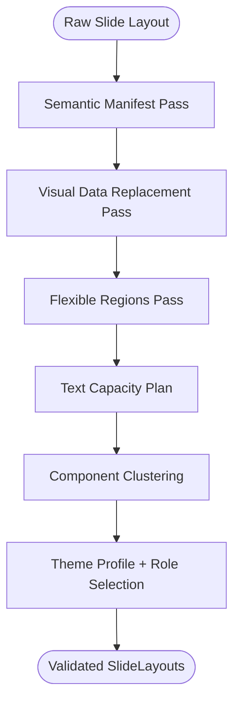
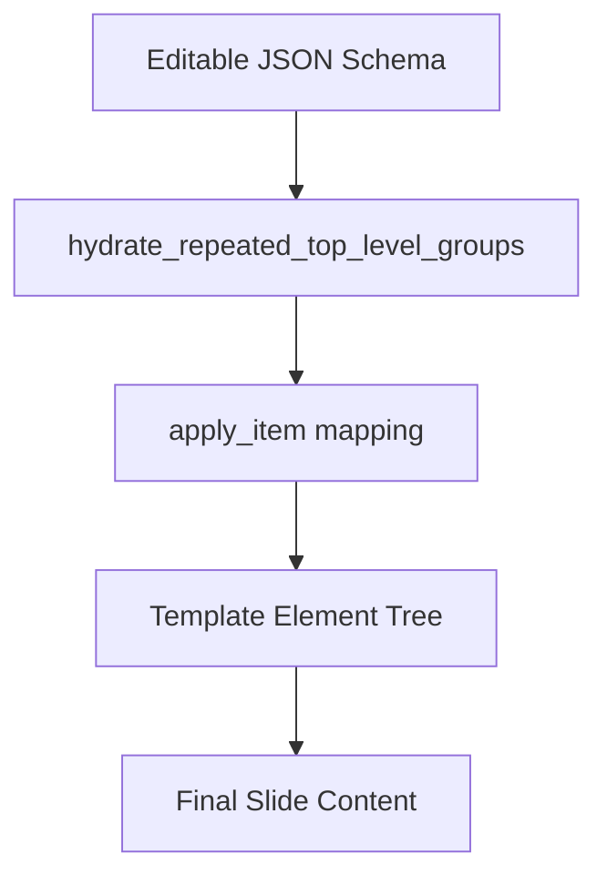
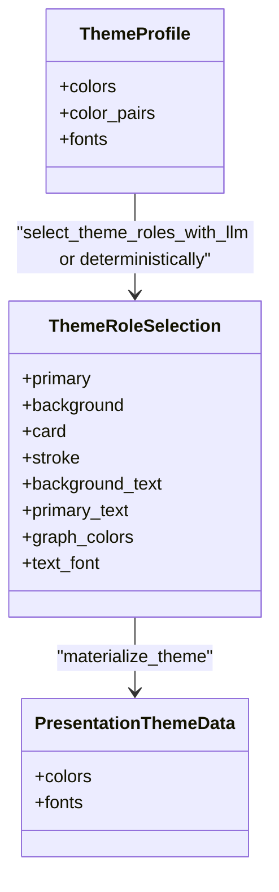
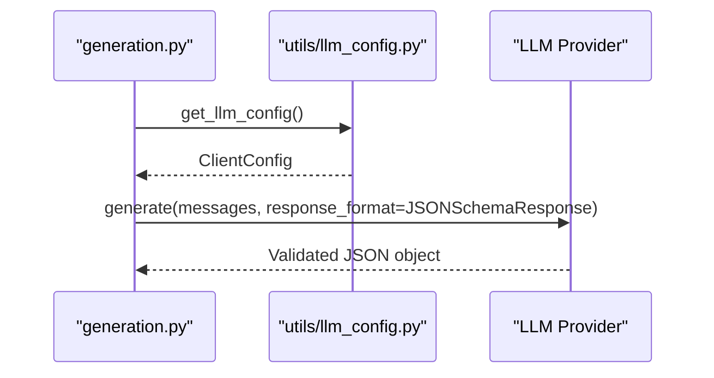
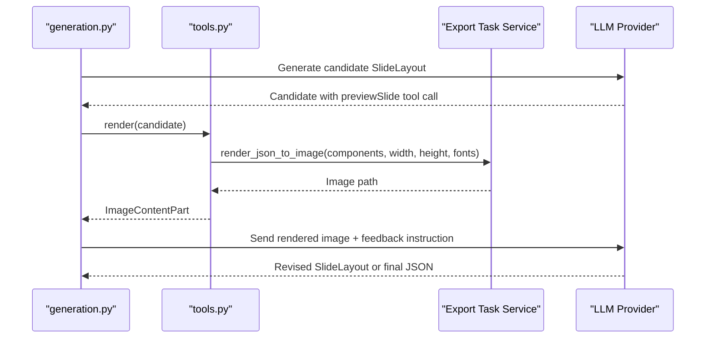
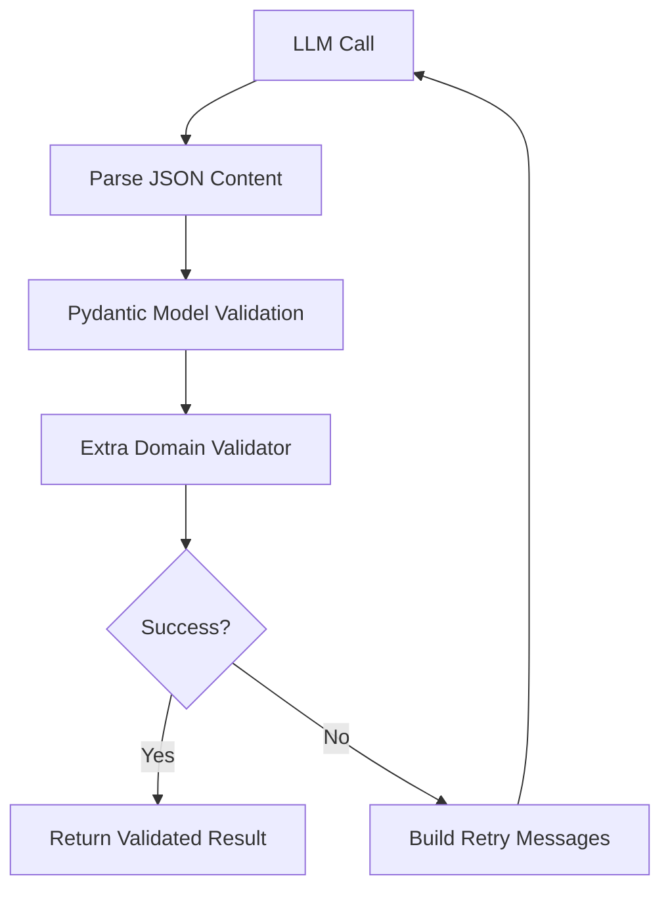
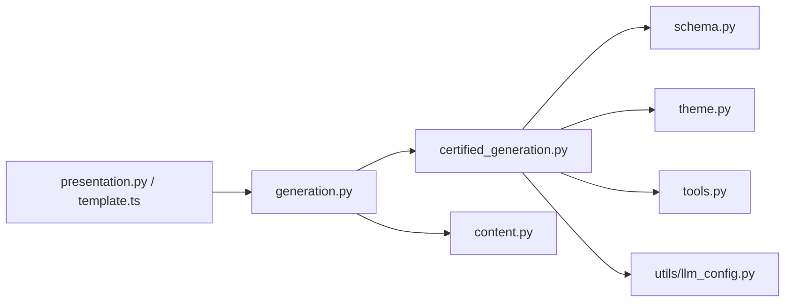

# Template Generation Engine

<cite>
**Referenced Files in This Document**
- [generation.py](file://servers/fastapi/templates/v2/generation.py)
- [certified_generation.py](file://servers/fastapi/templates/v2/certified_generation.py)
- [schema.py](file://servers/fastapi/templates/v2/schema.py)
- [content.py](file://servers/fastapi/templates/v2/content.py)
- [theme.py](file://servers/fastapi/templates/v2/theme.py)
- [tools.py](file://servers/fastapi/templates/v2/tools.py)
- [llm_config.py](file://servers/fastapi/utils/llm_config.py)
- [presentation.py](file://servers/fastapi/api/v1/ppt/endpoints/presentation.py)
- [template.ts](file://servers/nextjs/app/(presentation-generator)/services/api/template.ts)
</cite>

## Table of Contents
1. [Introduction](#introduction)
2. [Project Structure](#project-structure)
3. [Core Components](#core-components)
4. [Architecture Overview](#architecture-overview)
5. [Detailed Component Analysis](#detailed-component-analysis)
6. [Dependency Analysis](#dependency-analysis)
7. [Performance Considerations](#performance-considerations)
8. [Troubleshooting Guide](#troubleshooting-guide)
9. [Conclusion](#conclusion)

## Introduction
This document explains the template generation engine that converts presentation templates into structured, AI-ready layouts and then injects generated content to produce final slide outputs. The system supports:

- Certified multi-pass layout generation from reference slides.
- Structured LLM calls with JSON schema validation and retry loops.
- Visual data extraction for charts, tables, infographics, and text lists.
- Flexible flow modeling for repeated regions and fixed layout groups.
- Editable content schema generation for text, images, charts, tables, and infographics.
- Theme profiling and semantic theme role selection.
- Preview-assisted layout refinement through an LLM tool.
- Parallel slide processing and robust error handling.

The engine is designed for predictable output quality while remaining extensible for specialized generation logic and provider integrations.

## Project Structure
The template generation engine lives primarily under `servers/fastapi/templates/v2`. Key responsibilities are split across focused modules:

| Module | Responsibility |
| --- | --- |
| `generation.py` | Public orchestration, parallel slide generation, preview tool integration, retry helpers, and prompt construction. |
| `certified_generation.py` | Core certified pipeline: semantic manifest, visual data replacement, flexible regions, text capacity planning, component clustering, and LLM provider wiring. |
| `schema.py` | Editable content JSON Schema derivation from template elements and components. |
| `content.py` | Content hydration helpers for repeated top-level groups and markdown normalization. |
| `theme.py` | Color/font profiling, semantic theme role selection, and theme materialization. |
| `tools.py` | LLM tool definition for rendering candidate slide previews. |
| `utils/llm_config.py` | Provider configuration resolution and model selection. |
| API and frontend layers | Expose template creation, layout generation, and async task handling. |

**Diagram sources**
- [generation.py:151-210](file://servers/fastapi/templates/v2/generation.py#L151-L210)
- [certified_generation.py:491-547](file://servers/fastapi/templates/v2/certified_generation.py#L491-L547)
- [schema.py:183-215](file://servers/fastapi/templates/v2/schema.py#L183-L215)
- [theme.py:246-258](file://servers/fastapi/templates/v2/theme.py#L246-L258)
- [tools.py:22-48](file://servers/fastapi/templates/v2/tools.py#L22-L48)
- [llm_config.py:247-290](file://servers/fastapi/utils/llm_config.py#L247-L290)

**Section sources**
- [generation.py:151-210](file://servers/fastapi/templates/v2/generation.py#L151-L210)
- [certified_generation.py:491-547](file://servers/fastapi/templates/v2/certified_generation.py#L491-L547)
- [schema.py:183-215](file://servers/fastapi/templates/v2/schema.py#L183-L215)
- [theme.py:246-258](file://servers/fastapi/templates/v2/theme.py#L246-L258)
- [tools.py:22-48](file://servers/fastapi/templates/v2/tools.py#L22-L48)
- [llm_config.py:247-290](file://servers/fastapi/utils/llm_config.py#L247-L290)

## Core Components
- Certified layout generator: Converts raw slide layouts into validated, reusable component structures using multiple LLM-driven passes.
- Visual data extractor: Detects charts, tables, infographics, and text lists inside image-rendered regions and replaces them with structured elements.
- Flexible region planner: Builds fixed-flow groups and repeatable item collections while preserving design intent.
- Text capacity planner: Estimates safe growth for editable text without breaking layout.
- Editable schema generator: Produces JSON Schemas for text, images, charts, tables, and infographics based on template element structure.
- Theme profiler and selector: Profiles colors and fonts, selects semantic roles, and materializes a presentation theme.
- Preview tool: Renders candidate layouts as images so the LLM can self-correct visual issues.
- Retry and validation layer: Enforces JSON and Pydantic validation with guided retries.

**Section sources**
- [certified_generation.py:111-459](file://servers/fastapi/templates/v2/certified_generation.py#L111-L459)
- [certified_generation.py:1076-1540](file://servers/fastapi/templates/v2/certified_generation.py#L1076-L1540)
- [schema.py:361-423](file://servers/fastapi/templates/v2/schema.py#L361-L423)
- [theme.py:145-258](file://servers/fastapi/templates/v2/theme.py#L145-L258)
- [tools.py:22-73](file://servers/fastapi/templates/v2/tools.py#L22-L73)
- [generation.py:1092-1196](file://servers/fastapi/templates/v2/generation.py#L1092-L1196)

## Architecture Overview
The end-to-end pipeline transforms a template input into a finalized presentation layout with injected content.

**Diagram sources**
- [presentation.py:230-264](file://servers/fastapi/api/v1/ppt/endpoints/presentation.py#L230-L264)
- [generation.py:151-210](file://servers/fastapi/templates/v2/generation.py#L151-L210)
- [certified_generation.py:491-547](file://servers/fastapi/templates/v2/certified_generation.py#L491-L547)
- [schema.py:183-215](file://servers/fastapi/templates/v2/schema.py#L183-L215)
- [theme.py:246-258](file://servers/fastapi/templates/v2/theme.py#L246-L258)
- [tools.py:22-73](file://servers/fastapi/templates/v2/tools.py#L22-L73)

## Detailed Component Analysis

### Certified Generation Pipeline
The certified pipeline ensures consistent, high-quality layout generation by splitting work into focused passes:

1. **Semantic manifest pass**: Identifies reusable components and classifies editable candidates.
2. **Visual data replacement pass**: Extracts charts, tables, infographics, and text lists from image-rendered regions.
3. **Flexible regions pass**: Builds fixed-flow groups and repeatable item collections.
4. **Text capacity pass**: Determines safe horizontal and vertical growth for editable text.
5. **Component clustering pass**: Groups structurally interchangeable components for deduplication.
6. **Theme profiling pass**: Profiles colors and fonts and selects semantic theme roles.

**Diagram sources**
- [certified_generation.py:111-459](file://servers/fastapi/templates/v2/certified_generation.py#L111-L459)
- [certified_generation.py:1076-1540](file://servers/fastapi/templates/v2/certified_generation.py#L1076-L1540)
- [certified_generation.py:491-547](file://servers/fastapi/templates/v2/certified_generation.py#L491-L547)
- [theme.py:145-258](file://servers/fastapi/templates/v2/theme.py#L145-L258)

**Section sources**
- [certified_generation.py:111-459](file://servers/fastapi/templates/v2/certified_generation.py#L111-L459)
- [certified_generation.py:1076-1540](file://servers/fastapi/templates/v2/certified_generation.py#L1076-L1540)
- [certified_generation.py:491-547](file://servers/fastapi/templates/v2/certified_generation.py#L491-L547)
- [theme.py:145-258](file://servers/fastapi/templates/v2/theme.py#L145-L258)

### Content Injection and Layout Application
After layout certification, generated content is injected according to the editable schema:

- **Text**: String values constrained by min/max length.
- **Images**: Prompt-based image generation or icon search queries.
- **Charts**: Chart type, categories, series, titles, and axis labels.
- **Tables**: Columns and rows with cell text and optional styling metadata.
- **Infographics**: Typed data structures such as metrics, collections, graphs, and matrices.

Hydration helpers map generated arrays to positioned template groups and normalize inline Markdown in infographic labels.

**Diagram sources**
- [schema.py:361-423](file://servers/fastapi/templates/v2/schema.py#L361-L423)
- [content.py:57-87](file://servers/fastapi/templates/v2/content.py#L57-L87)

**Section sources**
- [schema.py:361-423](file://servers/fastapi/templates/v2/schema.py#L361-L423)
- [content.py:27-40](file://servers/fastapi/templates/v2/content.py#L27-L40)
- [content.py:57-87](file://servers/fastapi/templates/v2/content.py#L57-L87)

### Styling Inheritance and Theme Materialization
The theme module profiles colors and fonts across all generated layouts, clusters similar colors, pairs foreground/background combinations, and selects semantic theme roles either via LLM or deterministic fallback. It then materializes a presentation theme with accessible text colors and graph color palettes.

**Diagram sources**
- [theme.py:34-89](file://servers/fastapi/templates/v2/theme.py#L34-L89)
- [theme.py:246-258](file://servers/fastapi/templates/v2/theme.py#L246-L258)
- [theme.py:357-402](file://servers/fastapi/templates/v2/theme.py#L357-L402)

**Section sources**
- [theme.py:145-258](file://servers/fastapi/templates/v2/theme.py#L145-L258)
- [theme.py:357-402](file://servers/fastapi/templates/v2/theme.py#L357-L402)

### Integration with AI Providers
Provider configuration is resolved centrally, and the generation engine uses structured responses with JSON schema enforcement. The public generation module exposes client and model accessors used by both orchestration and certified passes.

**Diagram sources**
- [generation.py:1092-1196](file://servers/fastapi/templates/v2/generation.py#L1092-L1196)
- [llm_config.py:247-290](file://servers/fastapi/utils/llm_config.py#L247-L290)

**Section sources**
- [generation.py:1092-1196](file://servers/fastapi/templates/v2/generation.py#L1092-L1196)
- [llm_config.py:247-290](file://servers/fastapi/utils/llm_config.py#L247-L290)

### Preview-Assisted Layout Refinement
The preview tool allows the LLM to render a candidate layout as an image and receive visual feedback. At most two preview calls are allowed per slide during validation attempts.

**Diagram sources**
- [generation.py:852-1059](file://servers/fastapi/templates/v2/generation.py#L852-L1059)
- [tools.py:22-73](file://servers/fastapi/templates/v2/tools.py#L22-L73)

**Section sources**
- [generation.py:852-1059](file://servers/fastapi/templates/v2/generation.py#L852-L1059)
- [tools.py:22-73](file://servers/fastapi/templates/v2/tools.py#L22-L73)

### Error Handling and Validation Strategy
The engine applies layered validation:

- JSON parsing and structural checks.
- Pydantic model validation against strict schemas.
- Extra validators for domain rules (e.g., unique IDs, bounds containment).
- Guided retry messages that include invalid responses and schema hints.
- Provider fallbacks and token limits.

**Diagram sources**
- [generation.py:1092-1196](file://servers/fastapi/templates/v2/generation.py#L1092-L1196)
- [generation.py:1199-1208](file://servers/fastapi/templates/v2/generation.py#L1199-L1208)
- [generation.py:1236-1343](file://servers/fastapi/templates/v2/generation.py#L1236-L1343)

**Section sources**
- [generation.py:1092-1196](file://servers/fastapi/templates/v2/generation.py#L1092-L1196)
- [generation.py:1199-1208](file://servers/fastapi/templates/v2/generation.py#L1199-L1208)
- [generation.py:1236-1343](file://servers/fastapi/templates/v2/generation.py#L1236-L1343)

## Dependency Analysis
Key dependencies and relationships:

- `generation.py` orchestrates parallel slide generation and delegates core logic to `certified_generation.py`.
- `certified_generation.py` depends on models for layouts, elements, and structured LLM responses; it also integrates with `schema.py`, `theme.py`, and `tools.py`.
- `schema.py` derives editable JSON Schemas from template elements and components.
- `content.py` provides hydration utilities for repeated groups and markdown cleanup.
- `theme.py` consumes generated layouts to build a semantic theme profile.
- `tools.py` defines the preview tool used by the generation loop.
- `utils/llm_config.py` centralizes provider configuration and model selection.
- API endpoints and Next.js services expose template and presentation generation workflows.

**Diagram sources**
- [generation.py:151-210](file://servers/fastapi/templates/v2/generation.py#L151-L210)
- [certified_generation.py:491-547](file://servers/fastapi/templates/v2/certified_generation.py#L491-L547)
- [schema.py:183-215](file://servers/fastapi/templates/v2/schema.py#L183-L215)
- [theme.py:246-258](file://servers/fastapi/templates/v2/theme.py#L246-L258)
- [tools.py:22-48](file://servers/fastapi/templates/v2/tools.py#L22-L48)
- [llm_config.py:247-290](file://servers/fastapi/utils/llm_config.py#L247-L290)
- [presentation.py:230-264](file://servers/fastapi/api/v1/ppt/endpoints/presentation.py#L230-L264)
- [template.ts:100-105](file://servers/nextjs/app/(presentation-generator)/services/api/template.ts#L100-L105)

**Section sources**
- [generation.py:151-210](file://servers/fastapi/templates/v2/generation.py#L151-L210)
- [certified_generation.py:491-547](file://servers/fastapi/templates/v2/certified_generation.py#L491-L547)
- [schema.py:183-215](file://servers/fastapi/templates/v2/schema.py#L183-L215)
- [theme.py:246-258](file://servers/fastapi/templates/v2/theme.py#L246-L258)
- [tools.py:22-48](file://servers/fastapi/templates/v2/tools.py#L22-L48)
- [llm_config.py:247-290](file://servers/fastapi/utils/llm_config.py#L247-L290)
- [presentation.py:230-264](file://servers/fastapi/api/v1/ppt/endpoints/presentation.py#L230-L264)
- [template.ts:100-105](file://servers/nextjs/app/(presentation-generator)/services/api/template.ts#L100-L105)

## Performance Considerations
- **Parallel slide processing**: Up to ten workers process slide layouts concurrently, reducing total generation time.
- **Preview call limits**: Maximum two previewSlide calls per slide prevent excessive rendering overhead.
- **Token budgeting**: Completion tokens are capped per stage to control LLM cost and latency.
- **Signature-based deduplication**: Structural signatures avoid redundant processing of identical components.
- **Bounds-aware geometry**: Element bounds and aspect calculations reduce misplacement and overflow.
- **Fallback strategies**: Deterministic theme role selection avoids expensive LLM calls when needed.

[No sources needed since this section provides general guidance]

## Troubleshooting Guide
Common issues and remedies:

- **Invalid JSON response**: The retry layer formats errors and asks the LLM to return raw JSON without fences.
- **Model validation failure**: The engine includes the invalid response and required schema in retry prompts.
- **Preview tool failures**: Errors are logged and retried with instructions to call the tool again or return final JSON.
- **Duplicate layout IDs**: Duplicate IDs are repaired automatically with suffixes.
- **Unknown candidate paths in visual replacements**: Validation rejects references outside provided candidates.
- **Chart target covered by later raster image**: Validation prevents selecting backplates beneath overlapping raster images.
- **Missing template layouts**: API endpoints raise clear errors when layouts are unavailable.

**Section sources**
- [generation.py:999-1059](file://servers/fastapi/templates/v2/generation.py#L999-L1059)
- [generation.py:1199-1208](file://servers/fastapi/templates/v2/generation.py#L1199-L1208)
- [generation.py:1236-1343](file://servers/fastapi/templates/v2/generation.py#L1236-L1343)
- [certified_generation.py:1143-1230](file://servers/fastapi/templates/v2/certified_generation.py#L1143-L1230)
- [certified_generation.py:1233-1288](file://servers/fastapi/templates/v2/certified_generation.py#L1233-L1288)
- [presentation.py:230-264](file://servers/fastapi/api/v1/ppt/endpoints/presentation.py#L230-L264)

## Conclusion
The template generation engine combines certified multi-pass analysis, structured LLM calls, and robust validation to produce reliable, visually coherent presentation layouts. It extracts structured data from image-rendered regions, plans flexible flows, estimates text capacity, generates editable schemas, profiles themes, and optionally refines layouts through preview feedback. The architecture balances performance, correctness, and extensibility, making it suitable for both standard and specialized generation requirements.

[No sources needed since this section summarizes without analyzing specific files]