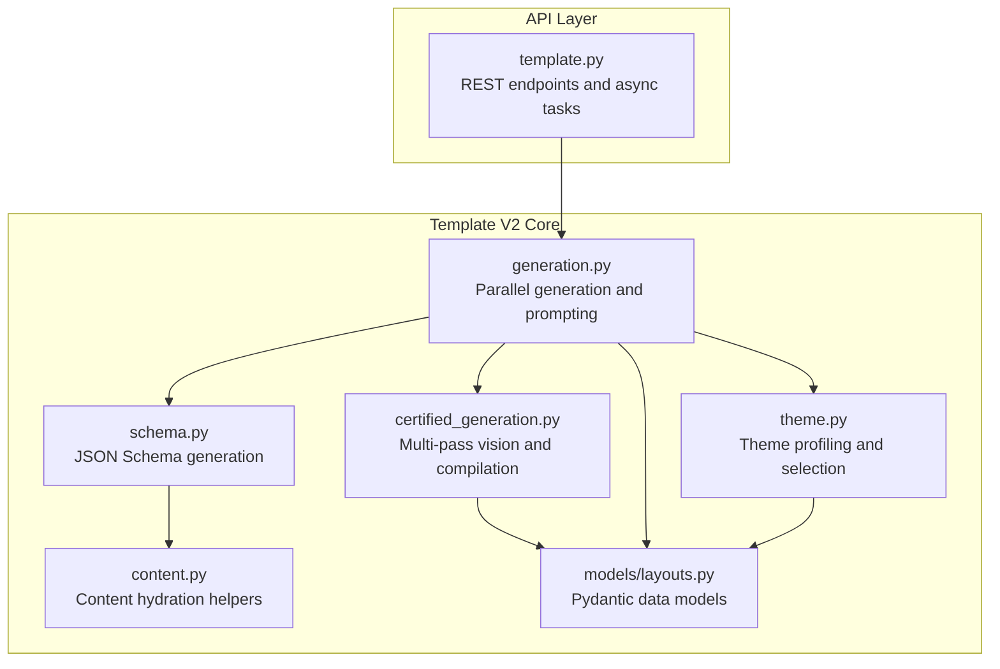
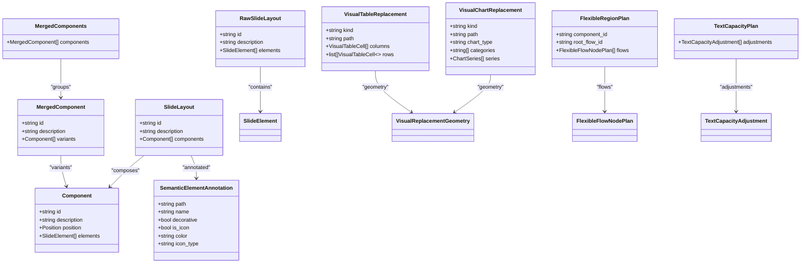
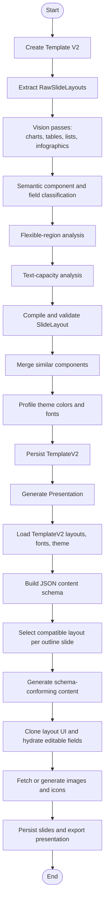
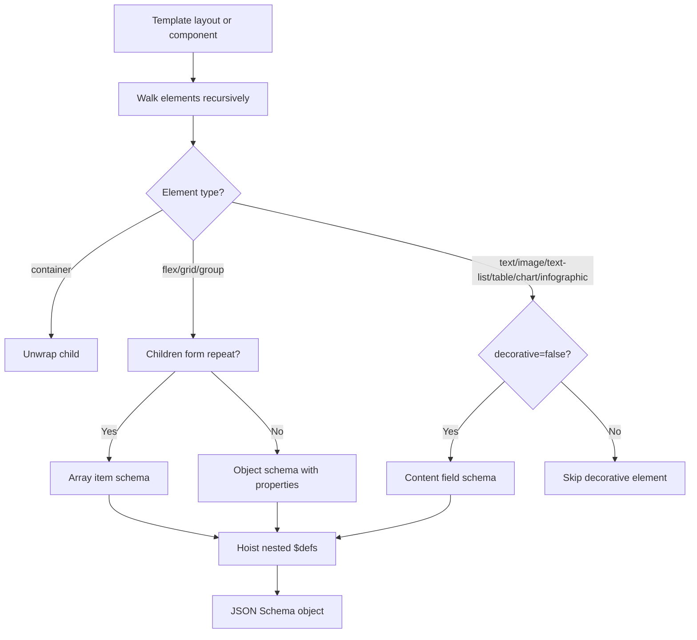
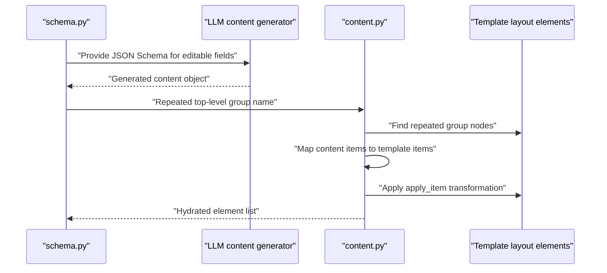
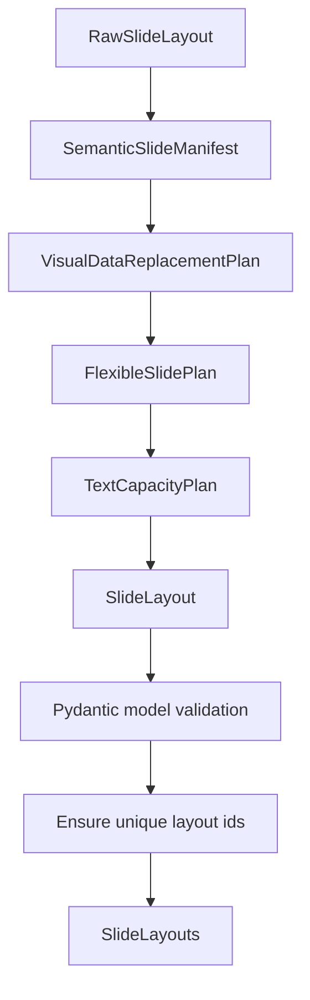
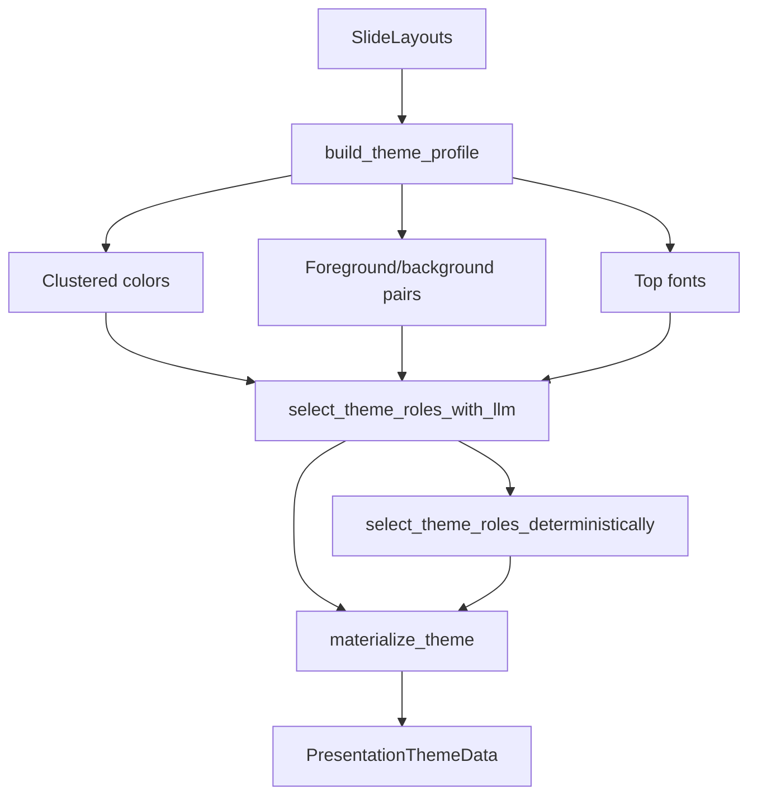
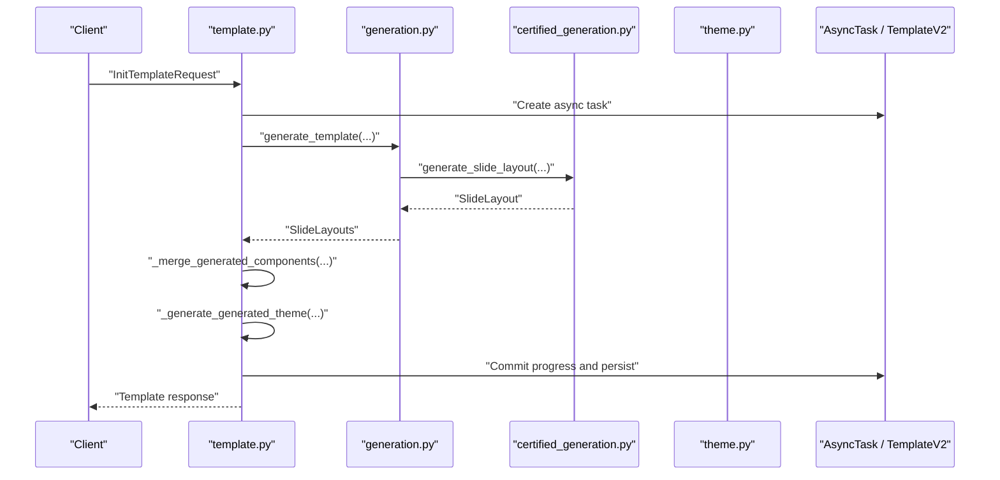
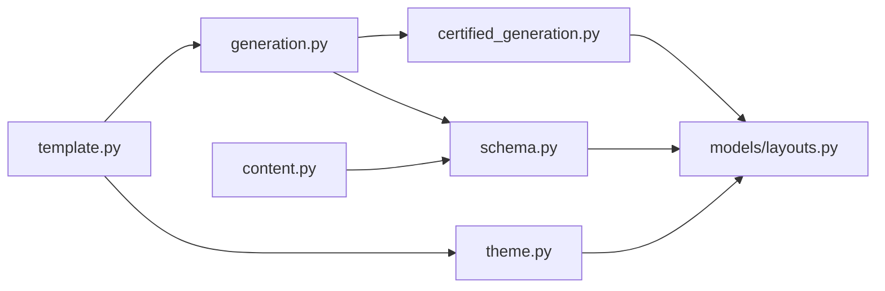

# Template Schema & Structure

<cite>
**Referenced Files in This Document**
- [template-v2.md](file://docs/template-v2.md)
- [schema.py](file://servers/fastapi/templates/v2/schema.py)
- [content.py](file://servers/fastapi/templates/v2/content.py)
- [generation.py](file://servers/fastapi/templates/v2/generation.py)
- [certified_generation.py](file://servers/fastapi/templates/v2/certified_generation.py)
- [theme.py](file://servers/fastapi/templates/v2/theme.py)
- [layouts.py](file://servers/fastapi/templates/v2/models/layouts.py)
- [template.py](file://servers/fastapi/api/v1/ppt/endpoints/template.py)
</cite>

## Table of Contents
1. [Introduction](#introduction)
2. [Project Structure](#project-structure)
3. [Core Components](#core-components)
4. [Architecture Overview](#architecture-overview)
5. [Detailed Component Analysis](#detailed-component-analysis)
6. [Dependency Analysis](#dependency-analysis)
7. [Performance Considerations](#performance-considerations)
8. [Troubleshooting Guide](#troubleshooting-guide)
9. [Conclusion](#conclusion)
10. [Appendices](#appendices)

## Introduction
This document explains Presenton’s template schema and structure system, focusing on the JSON-based template definition format used by Template V2. It covers:
- Template metadata, layout definitions, component specifications, and element properties.
- Schema validation, required fields, and optional configuration options.
- The relationship between template files and runtime processing.
- How layouts are defined, referenced, and hydrated with generated content.
- The component hierarchy, repeated groups, and flexible flow regions.
- Examples of valid structures, common patterns, and best practices.
- Versioning, backward compatibility, and migration strategies for template updates.

Template V2 converts an existing PowerPoint deck into reusable, editable slide layouts while preserving visual design. It then selects compatible layouts during presentation generation, generates schema-conforming content, hydrates the layouts, and exports the final presentation.

**Section sources**
- [template-v2.md:1-13](file://docs/template-v2.md#L1-L13)

## Project Structure
The template system is implemented primarily under `servers/fastapi/templates/v2`, with API orchestration under `servers/fastapi/api/v1/ppt/endpoints/template.py`. Key responsibilities:

| Area | Responsibility |
| --- | --- |
| `models/layouts.py` | Pydantic models for raw layouts, components, merged components, semantic annotations, visual replacements, flexible flows, and text capacity plans. |
| `schema.py` | Converts template layouts and components into JSON Schema definitions for generated content. |
| `content.py` | Applies generated content to template element structures, including repeated group hydration and Markdown cleanup. |
| `generation.py` | Orchestrates parallel certified layout generation, prompted layout creation, and component merging utilities. |
| `certified_generation.py` | Multi-pass vision analysis, structured LLM prompts, fallbacks, and compilation into validated SlideLayout objects. |
| `theme.py` | Profiles colors and fonts from layouts, selects semantic theme roles, and materializes a presentation theme. |
| `endpoints/template.py` | REST endpoints, async task orchestration, request validation, progress tracking, and persistence integration. |

**Diagram sources**
- [template.py:58-82](file://servers/fastapi/api/v1/ppt/endpoints/template.py#L58-L82)
- [generation.py:151-210](file://servers/fastapi/templates/v2/generation.py#L151-L210)
- [certified_generation.py:491-547](file://servers/fastapi/templates/v2/certified_generation.py#L491-L547)
- [schema.py:183-279](file://servers/fastapi/templates/v2/schema.py#L183-L279)
- [content.py:27-87](file://servers/fastapi/templates/v2/content.py#L27-L87)
- [theme.py:145-258](file://servers/fastapi/templates/v2/theme.py#L145-L258)
- [layouts.py:44-119](file://servers/fastapi/templates/v2/models/layouts.py#L44-L119)

**Section sources**
- [template-v2.md:166-177](file://docs/template-v2.md#L166-L177)
- [template.py:95-100](file://servers/fastapi/api/v1/ppt/endpoints/template.py#L95-L100)

## Core Components
Template V2 defines a layered structure:

- **RawSlideLayout**: Faithful extraction of source elements, positions, sizes, styles, and assets.
- **Component**: Reusable region with a unique id, description, position, and list of SlideElement children.
- **SlideLayout**: A slide composed of multiple components; component ids must be unique within a layout.
- **MergedComponents**: Groups of structurally interchangeable components across the template.
- **SemanticElementAnnotation**: Metadata marking editable vs decorative elements, icon role, color, and icon type.
- **VisualDataReplacement**: Structured recognition of charts, tables, infographics, and text lists.
- **FlexibleRegionPlan**: Nested flow trees describing repeatable or fixed grouping.
- **TextCapacityPlan**: Safe growth and alignment adjustments for editable text boxes.

**Diagram sources**
- [layouts.py:44-119](file://servers/fastapi/templates/v2/models/layouts.py#L44-L119)
- [layouts.py:122-149](file://servers/fastapi/templates/v2/models/layouts.py#L122-L149)
- [layouts.py:168-213](file://servers/fastapi/templates/v2/models/layouts.py#L168-L213)
- [layouts.py:416-441](file://servers/fastapi/templates/v2/models/layouts.py#L416-L441)
- [layouts.py:663-693](file://servers/fastapi/templates/v2/models/layouts.py#L663-L693)
- [layouts.py:716-793](file://servers/fastapi/templates/v2/models/layouts.py#L716-L793)

**Section sources**
- [layouts.py:44-119](file://servers/fastapi/templates/v2/models/layouts.py#L44-L119)
- [layouts.py:122-149](file://servers/fastapi/templates/v2/models/layouts.py#L122-L149)
- [layouts.py:168-213](file://servers/fastapi/templates/v2/models/layouts.py#L168-L213)
- [layouts.py:416-441](file://servers/fastapi/templates/v2/models/layouts.py#L416-L441)
- [layouts.py:663-693](file://servers/fastapi/templates/v2/models/layouts.py#L663-L693)
- [layouts.py:716-793](file://servers/fastapi/templates/v2/models/layouts.py#L716-L793)

## Architecture Overview
Template V2 has two main workflows:

1. **Template creation**: Converts a PPTX into certified SlideLayouts using multi-pass vision analysis, semantic annotation, flexible-region planning, and text-capacity adjustment.
2. **Presentation generation**: Loads TemplateV2 layouts, builds JSON schemas from editable elements, selects compatible layouts, generates content, hydrates layouts, fetches or generates images/icons, persists slides, and exports the presentation.

**Diagram sources**
- [template-v2.md:16-49](file://docs/template-v2.md#L16-L49)
- [template-v2.md:51-127](file://docs/template-v2.md#L51-L127)

**Section sources**
- [template-v2.md:1-13](file://docs/template-v2.md#L1-L13)
- [template-v2.md:51-127](file://docs/template-v2.md#L51-L127)

## Detailed Component Analysis

### Template JSON Schema Generation
The schema generator walks template layouts and components to produce JSON Schema definitions for generated content. Only elements marked as editable (`decorative=false`) become generated fields. Supported content types include text, image, text-list, table, chart, and infographic.

Key behaviors:
- Container elements unwrap to their child.
- Flex, grid, and group elements can become arrays when all children form one repeated pattern.
- Repeated items normalize property names by removing numeric suffixes.
- Component schemas strip internal metadata keys such as `$schema`, `title`, `description`, `x-element-type`, and `x-element-path`.
- Top-level repeated groups are detected so generated arrays map directly to positioned groups.

**Diagram sources**
- [schema.py:183-279](file://servers/fastapi/templates/v2/schema.py#L183-L279)
- [schema.py:310-358](file://servers/fastapi/templates/v2/schema.py#L310-L358)
- [schema.py:426-452](file://servers/fastapi/templates/v2/schema.py#L426-L452)
- [schema.py:647-668](file://servers/fastapi/templates/v2/schema.py#L647-L668)
- [schema.py:738-800](file://servers/fastapi/templates/v2/schema.py#L738-L800)

**Section sources**
- [schema.py:15-50](file://servers/fastapi/templates/v2/schema.py#L15-L50)
- [schema.py:183-279](file://servers/fastapi/templates/v2/schema.py#L183-L279)
- [schema.py:310-423](file://servers/fastapi/templates/v2/schema.py#L310-L423)
- [schema.py:426-558](file://servers/fastapi/templates/v2/schema.py#L426-L558)
- [schema.py:585-688](file://servers/fastapi/templates/v2/schema.py#L585-L688)
- [schema.py:691-729](file://servers/fastapi/templates/v2/schema.py#L691-L729)
- [schema.py:731-800](file://servers/fastapi/templates/v2/schema.py#L731-L800)

### Content Hydration and Repeated Groups
After content is generated, Presenton applies it to the template’s element tree. Hydration supports:
- Removing inline Markdown from infographic labels.
- Mapping generated array items to complete positioned groups.
- Centering repeated items when the generated count is smaller than the template count.

**Diagram sources**
- [schema.py:251-254](file://servers/fastapi/templates/v2/schema.py#L251-L254)
- [content.py:27-40](file://servers/fastapi/templates/v2/content.py#L27-L40)
- [content.py:43-87](file://servers/fastapi/templates/v2/content.py#L43-L87)

**Section sources**
- [content.py:1-87](file://servers/fastapi/templates/v2/content.py#L1-L87)

### Certified Layout Generation
Certified generation runs multiple focused passes over each slide:
1. Semantic manifest: partition elements into reusable components and annotate editable candidates.
2. Visual data replacement: detect charts, tables, infographics, and text lists.
3. Flexible region plan: build nested flow trees for fixed and repeatable regions.
4. Text capacity plan: adjust safe growth and alignment for editable text.
5. Compilation: combine decisions into validated SlideLayout objects.

**Diagram sources**
- [certified_generation.py:111-178](file://servers/fastapi/templates/v2/certified_generation.py#L111-L178)
- [certified_generation.py:180-268](file://servers/fastapi/templates/v2/certified_generation.py#L180-L268)
- [certified_generation.py:288-381](file://servers/fastapi/templates/v2/certified_generation.py#L288-L381)
- [certified_generation.py:383-443](file://servers/fastapi/templates/v2/certified_generation.py#L383-L443)
- [certified_generation.py:491-547](file://servers/fastapi/templates/v2/certified_generation.py#L491-L547)
- [layouts.py:575-598](file://servers/fastapi/templates/v2/models/layouts.py#L575-L598)
- [layouts.py:696-713](file://servers/fastapi/templates/v2/models/layouts.py#L696-L713)
- [layouts.py:776-793](file://servers/fastapi/templates/v2/models/layouts.py#L776-L793)

**Section sources**
- [certified_generation.py:491-547](file://servers/fastapi/templates/v2/certified_generation.py#L491-L547)
- [certified_generation.py:550-597](file://servers/fastapi/templates/v2/certified_generation.py#L550-L597)
- [layouts.py:575-598](file://servers/fastapi/templates/v2/models/layouts.py#L575-L598)
- [layouts.py:696-713](file://servers/fastapi/templates/v2/models/layouts.py#L696-L713)
- [layouts.py:776-793](file://servers/fastapi/templates/v2/models/layouts.py#L776-L793)

### Theme Profiling and Selection
Theme generation profiles colors and fonts from layouts, clusters similar colors, computes foreground/background pairs, and selects semantic roles. If LLM-based role selection fails, deterministic fallback logic chooses background, primary, card, stroke, text colors, graph colors, and text font.

**Diagram sources**
- [theme.py:145-243](file://servers/fastapi/templates/v2/theme.py#L145-L243)
- [theme.py:246-258](file://servers/fastapi/templates/v2/theme.py#L246-L258)
- [theme.py:261-302](file://servers/fastapi/templates/v2/theme.py#L261-L302)
- [theme.py:305-354](file://servers/fastapi/templates/v2/theme.py#L305-L354)
- [theme.py:357-402](file://servers/fastapi/templates/v2/theme.py#L357-L402)

**Section sources**
- [theme.py:145-258](file://servers/fastapi/templates/v2/theme.py#L145-L258)
- [theme.py:261-402](file://servers/fastapi/templates/v2/theme.py#L261-L402)

### API Orchestration and Validation
The template API validates requests, enforces upload limits, tracks async task progress, and coordinates layout generation, component merging, and theme generation. It also coerces generated outputs, ensures unique layout ids, and integrates with persistence.

**Diagram sources**
- [template.py:127-149](file://servers/fastapi/api/v1/ppt/endpoints/template.py#L127-L149)
- [template.py:586-622](file://servers/fastapi/api/v1/ppt/endpoints/template.py#L586-L622)
- [template.py:625-660](file://servers/fastapi/api/v1/ppt/endpoints/template.py#L625-L660)
- [template.py:663-682](file://servers/fastapi/api/v1/ppt/endpoints/template.py#L663-L682)
- [generation.py:151-210](file://servers/fastapi/templates/v2/generation.py#L151-L210)

**Section sources**
- [template.py:127-149](file://servers/fastapi/api/v1/ppt/endpoints/template.py#L127-L149)
- [template.py:586-660](file://servers/fastapi/api/v1/ppt/endpoints/template.py#L586-L660)
- [template.py:663-682](file://servers/fastapi/api/v1/ppt/endpoints/template.py#L663-L682)

## Dependency Analysis
The template system has clear layering:

- API layer depends on generation and theme services.
- Generation depends on certified generation and schema utilities.
- Schema generation depends on layout models and element definitions.
- Content hydration depends on schema-derived repeated-group information.
- Theme generation depends on layout models and presentation theme models.

**Diagram sources**
- [template.py:58-82](file://servers/fastapi/api/v1/ppt/endpoints/template.py#L58-L82)
- [generation.py:151-210](file://servers/fastapi/templates/v2/generation.py#L151-L210)
- [schema.py:183-279](file://servers/fastapi/templates/v2/schema.py#L183-L279)
- [content.py:10-10](file://servers/fastapi/templates/v2/content.py#L10-L10)
- [certified_generation.py:491-547](file://servers/fastapi/templates/v2/certified_generation.py#L491-L547)
- [theme.py:145-258](file://servers/fastapi/templates/v2/theme.py#L145-L258)
- [layouts.py:44-119](file://servers/fastapi/templates/v2/models/layouts.py#L44-L119)

**Section sources**
- [template.py:58-82](file://servers/fastapi/api/v1/ppt/endpoints/template.py#L58-L82)
- [generation.py:151-210](file://servers/fastapi/templates/v2/generation.py#L151-L210)
- [schema.py:183-279](file://servers/fastapi/templates/v2/schema.py#L183-L279)
- [content.py:10-10](file://servers/fastapi/templates/v2/content.py#L10-L10)
- [certified_generation.py:491-547](file://servers/fastapi/templates/v2/certified_generation.py#L491-L547)
- [theme.py:145-258](file://servers/fastapi/templates/v2/theme.py#L145-L258)
- [layouts.py:44-119](file://servers/fastapi/templates/v2/models/layouts.py#L44-L119)

## Performance Considerations
- Template creation processes up to ten slides concurrently.
- Provider rate limits should allow for burst usage.
- Invalid structured responses are retried and validated before use.
- Layouts use a fixed 1280 x 720 coordinate system.
- Font mappings should be supplied when the source deck uses non-standard fonts.
- Generated content schemas hoist nested definitions to avoid conflicts.
- Component merging deduplicates structurally interchangeable components.

[No sources needed since this section provides general guidance]

## Troubleshooting Guide
Common issues and where they are handled:

| Issue | Symptom | Where to inspect |
| --- | --- | --- |
| Missing slide previews | Creation rejects or caps processed slides | [template-v2.md:57-66](file://docs/template-v2.md#L57-L66) |
| Invalid base64 uploads | HTTP 400 error | [template.py:210-223](file://servers/fastapi/api/v1/ppt/endpoints/template.py#L210-L223) |
| Upload too large | HTTP 413 error | [template.py:218-223](file://servers/fastapi/api/v1/ppt/endpoints/template.py#L218-L223) |
| Duplicate layout ids | Repaired with suffixes | [generation.py:120-148](file://servers/fastapi/templates/v2/generation.py#L120-L148) |
| Invalid generated output | HTTP 500 with validation error | [template.py:605-614](file://servers/fastapi/api/v1/ppt/endpoints/template.py#L605-L614) |
| Unknown theme color/font IDs | Role selection validation failure | [theme.py:264-280](file://servers/fastapi/templates/v2/theme.py#L264-L280) |
| Conflicting JSON Schema definitions | ValueError during hoisting | [schema.py:218-248](file://servers/fastapi/templates/v2/schema.py#L218-L248) |
| Unsupported content element type | ValueError during schema generation | [schema.py:417-423](file://servers/fastapi/templates/v2/schema.py#L417-L423) |
| Chart series length mismatch | Model validation error | [layouts.py:204-213](file://servers/fastapi/templates/v2/models/layouts.py#L204-L213) |
| Table row/column mismatch | Model validation error | [layouts.py:437-441](file://servers/fastapi/templates/v2/models/layouts.py#L437-L441) |
| Non-unique component ids | Model validation error | [layouts.py:103-108](file://servers/fastapi/templates/v2/models/layouts.py#L103-L108) |
| Non-unique layout ids | Model validation error | [layouts.py:114-119](file://servers/fastapi/templates/v2/models/layouts.py#L114-L119) |

**Section sources**
- [template-v2.md:57-66](file://docs/template-v2.md#L57-L66)
- [template.py:210-223](file://servers/fastapi/api/v1/ppt/endpoints/template.py#L210-L223)
- [template.py:605-614](file://servers/fastapi/api/v1/ppt/endpoints/template.py#L605-L614)
- [generation.py:120-148](file://servers/fastapi/templates/v2/generation.py#L120-L148)
- [theme.py:264-280](file://servers/fastapi/templates/v2/theme.py#L264-L280)
- [schema.py:218-248](file://servers/fastapi/templates/v2/schema.py#L218-L248)
- [schema.py:417-423](file://servers/fastapi/templates/v2/schema.py#L417-L423)
- [layouts.py:103-119](file://servers/fastapi/templates/v2/models/layouts.py#L103-L119)
- [layouts.py:204-213](file://servers/fastapi/templates/v2/models/layouts.py#L204-L213)
- [layouts.py:437-441](file://servers/fastapi/templates/v2/models/layouts.py#L437-L441)

## Conclusion
Presenton’s Template V2 schema system turns static PowerPoint decks into dynamic, schema-driven templates. It separates visual fidelity from editable content by certifying layouts through multi-pass vision and semantic analysis. Runtime processing then selects compatible layouts, generates conformant content, hydrates repeated and flexible regions, and produces export-ready presentations. For robust templates, ensure:
- Every slide has exactly one rendered preview.
- Editable elements are clearly marked and consistently named.
- Repeated groups expose identical field hierarchies.
- Charts, tables, and infographics are recognized as atomic content.
- Theme roles are derived deterministically when LLM selection fails.
- Async task progress is tracked and invalid outputs are retried.

[No sources needed since this section summarizes without analyzing specific files]

## Appendices

### Valid Template Structures and Patterns
- **Single-content slide**: One title, one body text, one replaceable image.
- **Card grid**: Repeated cards with heading, description, and optional icon or image.
- **Metric row**: Fixed label/value pairs with aligned spacing.
- **Chart slide**: One chart element with categories, series, titles, and legend.
- **Table slide**: One table element with rectangular rows and styled cells.
- **Infographic slide**: Collection, metric, graph, or matrix infographic with ordered colors.

Best practices:
- Use generic, stable names for editable fields.
- Keep repeated items structurally identical.
- Preserve decorative scaffolding separately from content.
- Provide realistic neutral preview content.
- Replace replaceable image and icon URLs with standard placeholders.
- Avoid inventing asset URLs.

[No sources needed since this section provides conceptual guidance]

### Template Versioning and Migration
- Template V2 stores `raw_layouts`, `layouts`, `merged_components`, `theme`, and `assets`.
- Backward compatibility is enforced through Pydantic models and validators.
- Legacy text capacity expansion fields are upgraded to new alignment and growth fields.
- Duplicate layout ids are repaired automatically.
- When LLM-based theme role selection fails, deterministic selection is used.
- Migration strategy:
  - Keep `raw_layouts` for auditability.
  - Prefer `layouts` for rendering and generation.
  - Use `merged_components` for component reuse.
  - Regenerate theme when layout visuals change significantly.
  - Validate all generated JSON against the provided schemas before hydration.

**Section sources**
- [template-v2.md:99-108](file://docs/template-v2.md#L99-L108)
- [layouts.py:735-753](file://servers/fastapi/templates/v2/models/layouts.py#L735-L753)
- [generation.py:120-148](file://servers/fastapi/templates/v2/generation.py#L120-L148)
- [theme.py:246-258](file://servers/fastapi/templates/v2/theme.py#L246-L258)