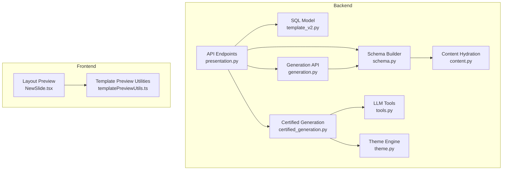
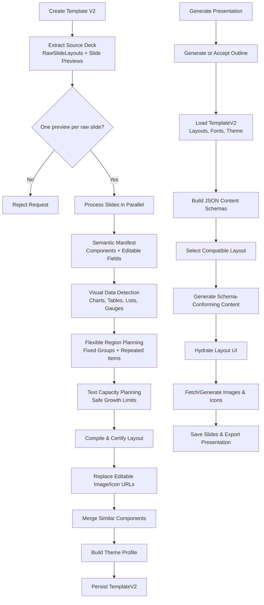
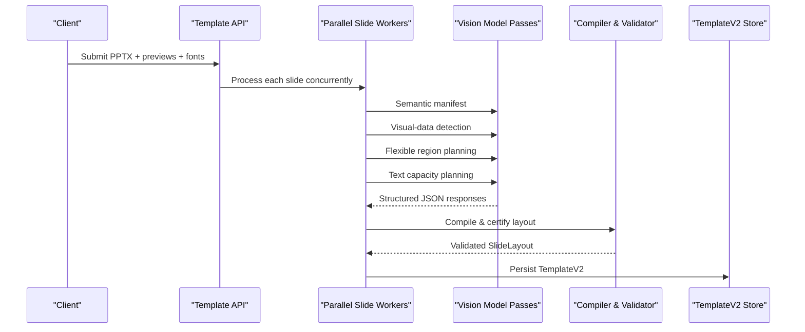
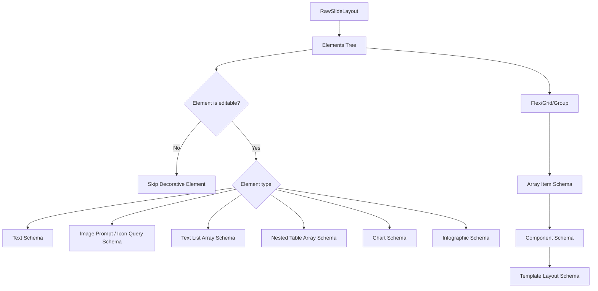
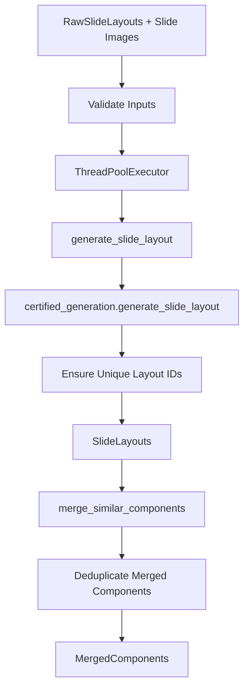
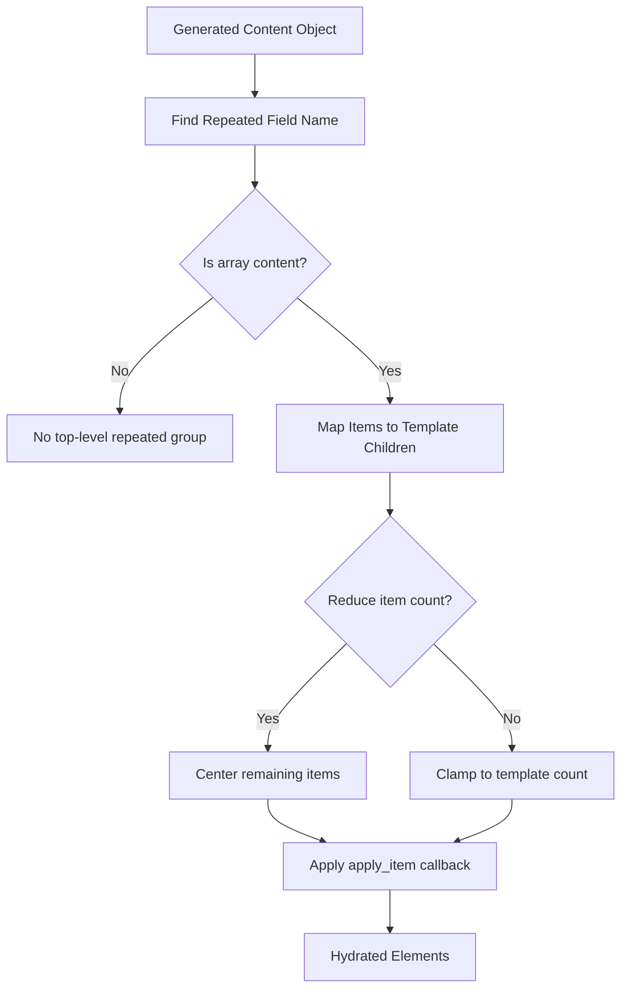
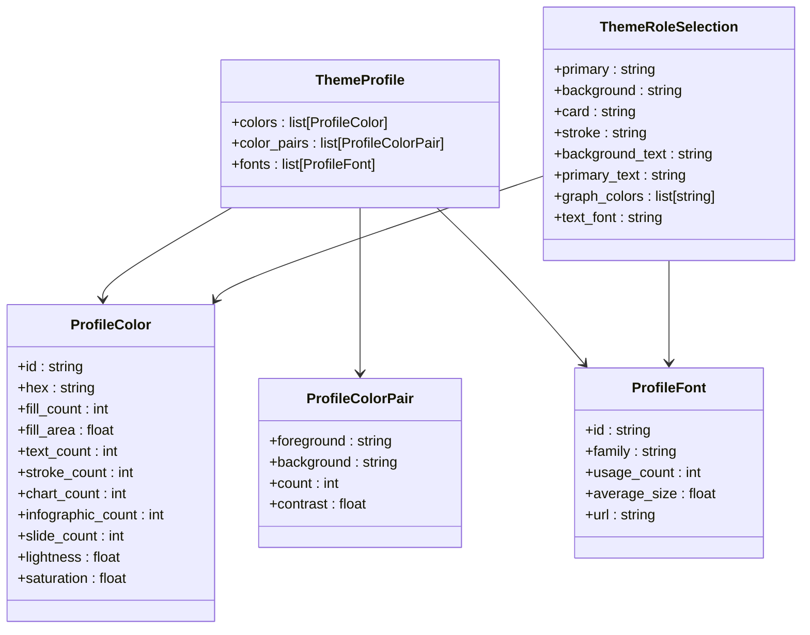
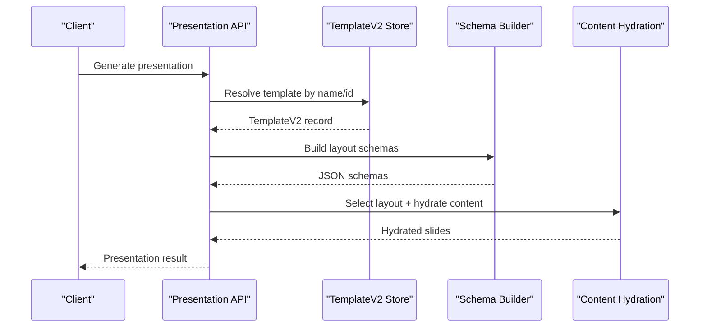
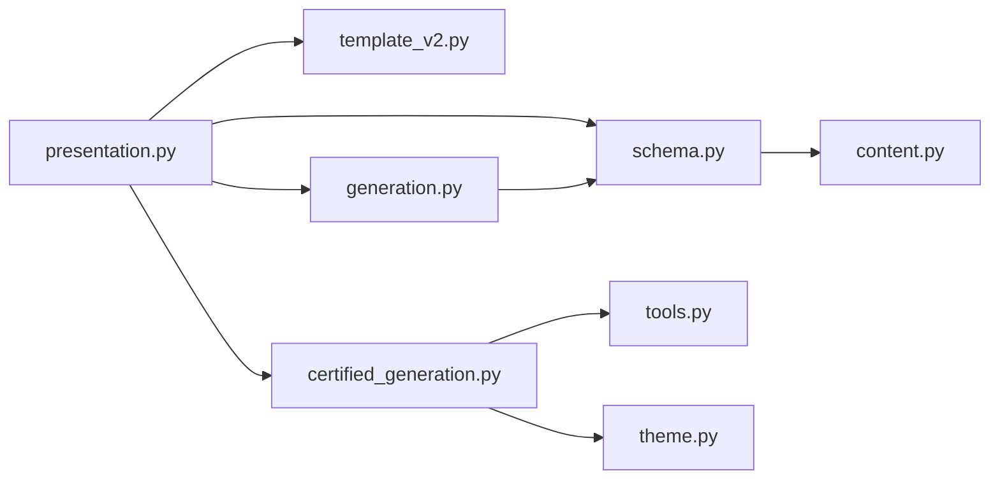

# Template System

<cite>
**Referenced Files in This Document**   
- [template-v2.md](file://docs/template-v2.md)
- [schema.py](file://servers/fastapi/templates/v2/schema.py)
- [generation.py](file://servers/fastapi/templates/v2/generation.py)
- [certified_generation.py](file://servers/fastapi/templates/v2/certified_generation.py)
- [content.py](file://servers/fastapi/templates/v2/content.py)
- [tools.py](file://servers/fastapi/templates/v2/tools.py)
- [theme.py](file://servers/fastapi/templates/v2/theme.py)
- [template_v2.py](file://servers/fastapi/models/sql/template_v2.py)
- [presentation.py](file://servers/fastapi/api/v1/ppt/endpoints/presentation.py)
- [test_presentation_generation_flow.py](file://servers/fastapi/tests/integration/test_presentation_generation_flow.py)
- [test_template_api.py](file://servers/fastapi/tests/unit/test_template_api.py)
- [NewSlide.tsx](file://servers/nexjs/app/(presentation-generator)/presentation/components/NewSlide.tsx)
- [templatePreviewUtils.ts](file://servers/nextjs/app/(presentation-generator)/template-preview/components/editor/templatePreviewUtils.ts)
</cite>

## Table of Contents
1. [Introduction](#introduction)
2. [Project Structure](#project-structure)
3. [Core Components](#core-components)
4. [Architecture Overview](#architecture-overview)
5. [Detailed Component Analysis](#detailed-component-analysis)
6. [Dependency Analysis](#dependency-analysis)
7. [Performance Considerations](#performance-considerations)
8. [Troubleshooting Guide](#troubleshooting-guide)
9. [Conclusion](#conclusion)
10. [Appendices](#appendices)

## Introduction
Presenton’s V2 template system turns a source PowerPoint deck into reusable, editable slide layouts and then uses those layouts to generate presentations with AI-produced content. The system separates two major workflows:

- **Template creation**: Converts a PPTX into certified Template V2 layouts by analyzing rendered slide previews and raw element JSON through multiple vision-capable model passes. It identifies charts, tables, lists, gauges, semantic components, flexible regions, and safe text capacity.
- **Presentation generation**: Loads an existing Template V2 record, converts its layouts into JSON content schemas, selects compatible layouts for generated outline slides, hydrates the layout UI with schema-conforming content, resolves images and icons, persists slides, and exports the final presentation.

The design is component-based: layouts are composed of reusable components, each exposing editable fields such as text, lists, tables, charts, infographics, images, and icons. A theme system derives color roles, typography, and graph palettes from the layouts.

**Section sources**
- [template-v2.md:1-13](file://docs/template-v2.md#L1-L13)
- [template-v2.md:51-126](file://docs/template-v2.md#L51-L126)

## Project Structure
The V2 template system lives primarily under the FastAPI backend, with supporting frontend logic for previewing and editing templates.

**Diagram sources**
- [presentation.py:258-296](file://servers/fastapi/api/v1/ppt/endpoints/presentation.py#L258-L296)
- [template_v2.py:16-61](file://servers/fastapi/models/sql/template_v2.py#L16-L61)
- [certified_generation.py:491-547](file://servers/fastapi/templates/v2/certified_generation.py#L491-L547)
- [generation.py:151-210](file://servers/fastapi/templates/v2/generation.py#L151-L210)
- [schema.py:183-279](file://servers/fastapi/templates/v2/schema.py#L183-L279)
- [content.py:27-87](file://servers/fastapi/templates/v2/content.py#L27-L87)
- [theme.py:145-258](file://servers/fastapi/templates/v2/theme.py#L145-L258)
- [tools.py:22-73](file://servers/fastapi/templates/v2/tools.py#L22-L73)
- [NewSlide.tsx:44-70](file://servers/nexjs/app/(presentation-generator)/presentation/components/NewSlide.tsx#L44-L70)
- [templatePreviewUtils.ts:1233-1286](file://servers/nextjs/app/(presentation-generator)/template-preview/components/editor/templatePreviewUtils.ts#L1233-L1286)

**Section sources**
- [template-v2.md:166-177](file://docs/template-v2.md#L166-L177)
- [template_v2.py:16-61](file://servers/fastapi/models/sql/template_v2.py#L16-L61)

## Core Components
The V2 template system is built around several core modules:

| Module | Responsibility | Key Behaviors |
|---|---|---|
| `certified_generation.py` | Multi-pass vision analysis and layout certification | Semantic manifest, visual-data detection, flexible-region planning, text-capacity planning, component clustering, fallbacks |
| `generation.py` | Public generation API and prompted layout creation | Parallel slide processing, validation retries, similar-component merging, LLM-backed prompted layout generation |
| `schema.py` | Editable content schema generation | Converts layouts and components into JSON Schema objects for AI content generation |
| `content.py` | Content hydration helpers | Applies generated content to repeated groups and strips Markdown from infographic labels |
| `theme.py` | Theme profiling and role selection | Profiles colors and fonts, selects semantic roles via LLM or deterministic rules, materializes presentation theme data |
| `tools.py` | LLM tooling | Renders candidate slide layouts to images for visual review during template creation |
| `template_v2.py` | Database model | Persists template metadata, raw layouts, certified layouts, merged components, theme, assets, ownership, and timestamps |

**Section sources**
- [certified_generation.py:491-597](file://servers/fastapi/templates/v2/certified_generation.py#L491-L597)
- [generation.py:151-215](file://servers/fastapi/templates/v2/generation.py#L151-L215)
- [schema.py:183-279](file://servers/fastapi/templates/v2/schema.py#L183-L279)
- [content.py:27-87](file://servers/fastapi/templates/v2/content.py#L27-L87)
- [theme.py:145-258](file://servers/fastapi/templates/v2/theme.py#L145-L258)
- [tools.py:22-73](file://servers/fastapi/templates/v2/tools.py#L22-L73)
- [template_v2.py:16-61](file://servers/fastapi/models/sql/template_v2.py#L16-L61)

## Architecture Overview
The end-to-end architecture follows two distinct flows.

**Diagram sources**
- [template-v2.md:16-48](file://docs/template-v2.md#L16-L48)
- [certified_generation.py:491-547](file://servers/fastapi/templates/v2/certified_generation.py#L491-L547)
- [generation.py:631-693](file://servers/fastapi/templates/v2/generation.py#L631-L693)
- [schema.py:257-279](file://servers/fastapi/templates/v2/schema.py#L257-L279)
- [theme.py:246-258](file://servers/fastapi/templates/v2/theme.py#L246-L258)

**Section sources**
- [template-v2.md:14-48](file://docs/template-v2.md#L14-L48)
- [template-v2.md:109-126](file://docs/template-v2.md#L109-L126)

## Detailed Component Analysis

### Template Creation Pipeline
Template creation is a multi-pass pipeline that requires a vision-capable language model. Each slide is processed independently and can run in parallel up to ten slides at a time.

Key stages:

1. **Source extraction**: Converts a PPTX into raw element JSON and requires one rendered slide preview per raw slide.
2. **Semantic manifest**: Partitions indexed elements into reusable components and classifies editable candidates.
3. **Visual-data detection**: Recognizes charts, tables, text lists, progress bars, and gauges; failed passes preserve source regions.
4. **Flexible-region analysis**: Identifies fixed flow groups and repeatable regions; failures keep the semantic layout fixed.
5. **Text-capacity analysis**: Calculates safe length and growth constraints for editable text.
6. **Compilation and certification**: Combines source elements with model decisions, validates results, and retries with fewer optional decisions when needed.
7. **Placeholder replacement**: Replaces editable image and icon URLs with standard placeholders while keeping decorative assets fixed.
8. **Component merging**: Clusters structurally interchangeable components and deduplicates them.
9. **Theme derivation**: Profiles colors and fonts and maps them to semantic theme roles.

**Diagram sources**
- [template-v2.md:51-98](file://docs/template-v2.md#L51-L98)
- [certified_generation.py:111-443](file://servers/fastapi/templates/v2/certified_generation.py#L111-L443)
- [certified_generation.py:491-547](file://servers/fastapi/templates/v2/certified_generation.py#L491-L547)

**Section sources**
- [template-v2.md:51-98](file://docs/template-v2.md#L51-L98)
- [certified_generation.py:491-597](file://servers/fastapi/templates/v2/certified_generation.py#L491-L597)

### Template Schema Definition
The schema module converts Template V2 layouts and components into JSON Schema definitions used by the content generator.

Important concepts:

- **Editable elements**: Only elements with `decorative=false` become generated content fields.
- **Supported content types**: text, image, text-list, table, chart, infographic.
- **Repeated structures**: Flex, grid, and group elements can produce array schemas with min/max children.
- **Table limits**: Cell width, height, font size, line height, and padding determine minimum and maximum text lengths.
- **Component schemas**: Each component exposes a nested object schema derived from its elements.
- **Template schemas**: A template’s layouts are converted into per-layout schemas keyed by component IDs and occurrence indices.

**Diagram sources**
- [schema.py:15-51](file://servers/fastapi/templates/v2/schema.py#L15-L51)
- [schema.py:183-215](file://servers/fastapi/templates/v2/schema.py#L183-L215)
- [schema.py:310-423](file://servers/fastapi/templates/v2/schema.py#L310-L423)
- [schema.py:585-639](file://servers/fastapi/templates/v2/schema.py#L585-L639)

**Section sources**
- [schema.py:183-279](file://servers/fastapi/templates/v2/schema.py#L183-L279)
- [schema.py:310-423](file://servers/fastapi/templates/v2/schema.py#L310-L423)
- [schema.py:585-639](file://servers/fastapi/templates/v2/schema.py#L585-L639)

### Template Generation Engine
The generation engine handles both certified template creation and prompted layout generation.

Key behaviors:

- **Parallel processing**: Uses a thread pool to process slides concurrently.
- **Validation retries**: Retries structured model responses until they pass Pydantic validation.
- **Similar component merging**: Builds merged components from similarity clusters and deduplicates identical variants.
- **Prompted layout generation**: Creates new layouts from natural-language prompts using existing layouts and reusable components as context.
- **Context capping**: Limits reference layouts, reusable components, and total context characters sent to the model.

**Diagram sources**
- [generation.py:151-210](file://servers/fastapi/templates/v2/generation.py#L151-L210)
- [generation.py:213-317](file://servers/fastapi/templates/v2/generation.py#L213-L317)
- [generation.py:631-693](file://servers/fastapi/templates/v2/generation.py#L631-L693)

**Section sources**
- [generation.py:151-215](file://servers/fastapi/templates/v2/generation.py#L151-L215)
- [generation.py:631-693](file://servers/fastapi/templates/v2/generation.py#L631-L693)

### Content Hydration and Repeated Groups
After AI-generated content conforms to the layout schema, it must be applied to the layout UI.

Key responsibilities:

- **Markdown cleanup**: Removes inline Markdown from infographic labels before rendering.
- **Repeated child mapping**: Maps generated array items to template child positions, centering when reducing item count.
- **Top-level repeated groups**: Detects when all component elements form one repeated group and hydrates them accordingly.

**Diagram sources**
- [content.py:27-40](file://servers/fastapi/templates/v2/content.py#L27-L40)
- [content.py:43-87](file://servers/fastapi/templates/v2/content.py#L43-L87)
- [schema.py:251-254](file://servers/fastapi/templates/v2/schema.py#L251-L254)

**Section sources**
- [content.py:27-87](file://servers/fastapi/templates/v2/content.py#L27-L87)

### Theme System
The theme system profiles colors and fonts from certified layouts and produces a semantic presentation theme.

Key behaviors:

- **Color profiling**: Collects fills, strokes, text colors, chart colors, infographic colors, and slide coverage.
- **Font profiling**: Tracks family usage, average size, and available font URLs.
- **Color clustering**: Groups similar colors within a distance threshold and ranks them by importance.
- **Role selection**: Uses an LLM to select semantic roles like background, primary, card, stroke, text colors, and graph palette; falls back to deterministic selection if the LLM call fails.
- **Materialization**: Produces `PresentationThemeData` with normalized colors, accessible text colors, and a selected text font.

**Diagram sources**
- [theme.py:34-88](file://servers/fastapi/templates/v2/theme.py#L34-L88)
- [theme.py:145-258](file://servers/fastapi/templates/v2/theme.py#L145-L258)
- [theme.py:357-402](file://servers/fastapi/templates/v2/theme.py#L357-L402)

**Section sources**
- [theme.py:145-258](file://servers/fastapi/templates/v2/theme.py#L145-L258)
- [theme.py:357-402](file://servers/fastapi/templates/v2/theme.py#L357-L402)

### Template Storage and Management
Templates are persisted as `TemplateV2` records with JSON columns for layouts, components, merged components, theme, and assets. Ownership is tied to users, and default templates are supported.

Stored fields include:

| Field | Purpose |
|---|---|
| `id` | Primary key |
| `owner_id` | Optional user ownership |
| `name` | Template name |
| `description` | Template description |
| `raw_layouts` | Faithful extracted element JSON |
| `components` | Certified reusable components |
| `merged_components` | Groups of structurally interchangeable components |
| `layouts` | Certified slide layouts |
| `theme` | Semantic colors and typography |
| `assets` | Source files, previews, fonts, icons, and image references |
| `is_default` | Whether the template is bundled as a default |
| `created_at` / `updated_at` | Timestamps |

**Section sources**
- [template_v2.py:16-61](file://servers/fastapi/models/sql/template_v2.py#L16-L61)
- [test_template_api.py:1011-1047](file://servers/fastapi/tests/unit/test_template_api.py#L1011-L1047)

### Relationship Between Templates and Presentation Generation
During presentation generation, the system does not re-analyze source screenshots. It loads the already-certified Template V2 record and uses its layouts, fonts, and theme.

Flow:

1. Generate or accept slide outlines.
2. Resolve the requested template, including bundled defaults.
3. Load layouts, fonts, and theme.
4. Convert layouts into JSON content schemas.
5. Select a compatible layout for each outline slide.
6. Generate schema-conforming content.
7. Hydrate the layout UI.
8. Fetch or generate images and icons.
9. Persist slides and export the presentation.

**Diagram sources**
- [presentation.py:258-296](file://servers/fastapi/api/v1/ppt/endpoints/presentation.py#L258-L296)
- [template-v2.md:109-126](file://docs/template-v2.md#L109-L126)
- [test_presentation_generation_flow.py:1066-1086](file://servers/fastapi/tests/integration/test_presentation_generation_flow.py#L1066-L1086)

**Section sources**
- [template-v2.md:109-126](file://docs/template-v2.md#L109-L126)
- [presentation.py:258-296](file://servers/fastapi/api/v1/ppt/endpoints/presentation.py#L258-L296)
- [test_presentation_generation_flow.py:1066-1086](file://servers/fastapi/tests/integration/test_presentation_generation_flow.py#L1066-L1086)

### Custom Template Creation Workflows
Custom templates are created through a guided workflow where users upload a source deck, provide slide previews, and optionally map fonts. The backend processes the request asynchronously and returns progress per slide.

Frontend behavior includes:

- Creating layout items from Template V2 layouts.
- Generating preview slides from layout UI.
- Updating layout metadata such as ID and description.
- Collecting schema fields for editor hints.

**Section sources**
- [template-v2.md:51-98](file://docs/template-v2.md#L51-L98)
- [NewSlide.tsx:44-70](file://servers/nexjs/app/(presentation-generator)/presentation/components/NewSlide.tsx#L44-L70)
- [templatePreviewUtils.ts:1233-1286](file://servers/nextjs/app/(presentation-generator)/template-preview/components/editor/templatePreviewUtils.ts#L1233-L1286)

### Template Validation and Testing
Validation occurs at multiple layers:

- **Input validation**: Ensures one slide image URL per layout and at least one layout.
- **Structured response validation**: Uses Pydantic models and JSON Schema contracts for model outputs.
- **Post-generation validation**: Checks unique layout IDs, required component counts, and editable content presence.
- **Integration tests**: Verify that presentation generation uses template schemas for content generation and returns expected theme and font data.

**Section sources**
- [generation.py:151-161](file://servers/fastapi/templates/v2/generation.py#L151-L161)
- [generation.py:653-669](file://servers/fastapi/templates/v2/generation.py#L653-L669)
- [test_presentation_generation_flow.py:1066-1086](file://servers/fastapi/tests/integration/test_presentation_generation_flow.py#L1066-L1086)

### Template Marketplace Functionality
The repository supports listing default and custom templates, retrieving template details including layouts, merged components, theme, and fonts, and handling asynchronous template creation tasks. Default templates are resolved by alias and mapped to bundled template IDs.

Observed capabilities:

- Listing templates filtered by default status.
- Getting template metadata without exposing internal raw layouts or components.
- Resolving bundled template aliases during presentation generation.
- Tracking processing template tasks and retrying failed template creation.

**Section sources**
- [test_template_api.py:974-1047](file://servers/fastapi/tests/unit/test_template_api.py#L974-L1047)
- [presentation.py:258-296](file://servers/fastapi/api/v1/ppt/endpoints/presentation.py#L258-L296)

## Dependency Analysis
The V2 template system has clear layering between API, generation, schema, hydration, theme, and storage.

**Diagram sources**
- [presentation.py:258-296](file://servers/fastapi/api/v1/ppt/endpoints/presentation.py#L258-L296)
- [schema.py:183-279](file://servers/fastapi/templates/v2/schema.py#L183-L279)
- [certified_generation.py:491-547](file://servers/fastapi/templates/v2/certified_generation.py#L491-L547)
- [generation.py:151-210](file://servers/fastapi/templates/v2/generation.py#L151-L210)
- [content.py:27-87](file://servers/fastapi/templates/v2/content.py#L27-L87)
- [theme.py:145-258](file://servers/fastapi/templates/v2/theme.py#L145-L258)
- [tools.py:22-73](file://servers/fastapi/templates/v2/tools.py#L22-L73)

**Section sources**
- [schema.py:183-279](file://servers/fastapi/templates/v2/schema.py#L183-L279)
- [certified_generation.py:491-547](file://servers/fastapi/templates/v2/certified_generation.py#L491-L547)
- [generation.py:151-210](file://servers/fastapi/templates/v2/generation.py#L151-L210)

## Performance Considerations
- **Parallel slide processing**: Template creation processes up to ten slides concurrently using a thread pool.
- **Model token budgets**: Template creation recommends 16,000 output tokens due to deeply nested components and element definitions.
- **Retry strategy**: Invalid structured responses are retried and validated before use.
- **Coordinate system**: Layouts use a fixed 1280 x 720 coordinate system, which simplifies geometry calculations but requires careful spacing.
- **Font mappings**: Supplying font mappings improves rendering fidelity and reduces fallback behavior.
- **Preview tool limits**: The preview slide tool allows at most two preview calls per slide during template creation.

**Section sources**
- [template-v2.md:128-164](file://docs/template-v2.md#L128-L164)
- [generation.py:46-50](file://servers/fastapi/templates/v2/generation.py#L46-L50)
- [tools.py:16-18](file://servers/fastapi/templates/v2/tools.py#L16-L18)

## Troubleshooting Guide
Common issues and their likely causes:

| Issue | Likely Cause | Resolution |
|---|---|---|
| Template creation rejected | Missing or extra slide preview images | Ensure exactly one rendered preview image per raw slide |
| Vision pass fails | Text-only model used for template creation | Configure a vision-capable text model |
| Layout lacks editable content | All elements marked decorative or missing semantic fields | Mark replaceable content as `decorative=false` and ensure valid editable fields |
| Duplicate layout IDs | Model-generated or imported layouts reuse IDs | System repairs duplicates, but avoid generating duplicate IDs |
| Theme role selection fails | LLM returns unknown color/font IDs | Deterministic fallback selects semantic roles automatically |
| Presentation generation cannot find template | Invalid template name or missing bundled template | Use a valid template name or ensure bundled templates are loaded |
| Generated content overflows layout | Insufficient text capacity or repeated group limits | Adjust layout geometry and schema limits during template creation |

**Section sources**
- [template-v2.md:51-98](file://docs/template-v2.md#L51-L98)
- [template-v2.md:128-164](file://docs/template-v2.md#L128-L164)
- [generation.py:151-161](file://servers/fastapi/templates/v2/generation.py#L151-L161)
- [generation.py:653-669](file://servers/fastapi/templates/v2/generation.py#L653-L669)
- [theme.py:246-258](file://servers/fastapi/templates/v2/theme.py#L246-L258)
- [presentation.py:258-296](file://servers/fastapi/api/v1/ppt/endpoints/presentation.py#L258-L296)

## Conclusion
Presenton’s V2 template system provides a robust, component-based approach to building reusable slide layouts and generating presentations with AI-produced content. Its separation of template creation and presentation generation enables reliable certification of layouts, deterministic theme derivation, and schema-driven content hydration. The system balances flexibility with safety through structured model outputs, validation retries, parallel processing, and fallback strategies. For professional templates, focus on clear component boundaries, accurate editable field classification, consistent naming, realistic content bounds, and accessible color and typography choices.

[No sources needed since this section summarizes without analyzing specific files]

## Appendices

### Best Practices for Template Design
- Keep components visually coherent and semantically meaningful.
- Mark only replaceable content as editable; keep backgrounds, logos, frames, and dividers decorative.
- Use generic, structure-based names for layouts, components, and fields.
- Provide realistic neutral preview content so the model understands intended capacity.
- Ensure repeated items share identical editable-field hierarchies.
- Preserve spacing and alignment so flexible regions do not break layout geometry.
- Supply font mappings when non-standard fonts are used.
- Test layouts with varied content lengths and repeated-item counts.

[No sources needed since this section provides general guidance]