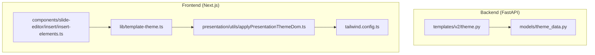
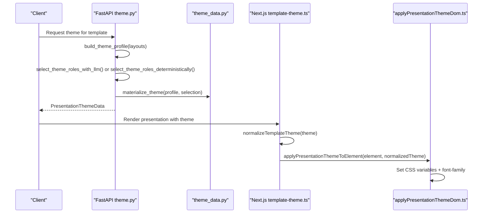
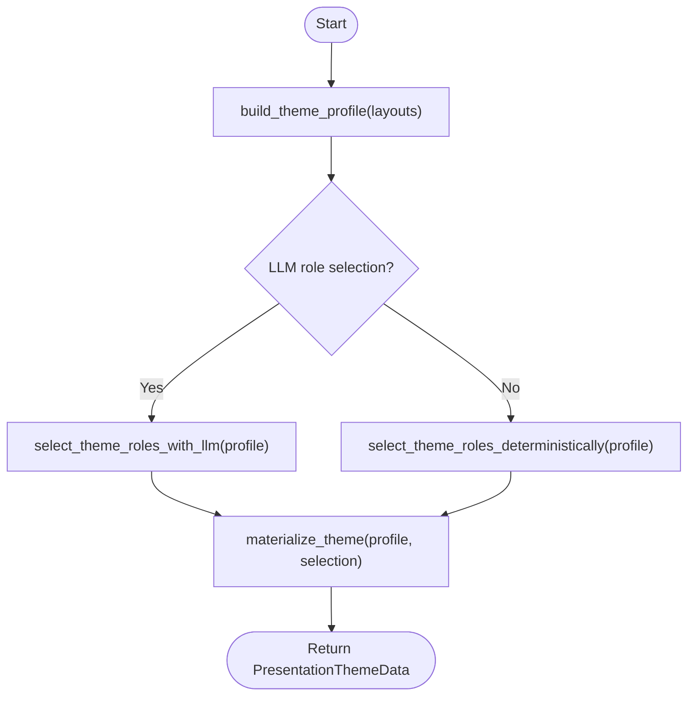
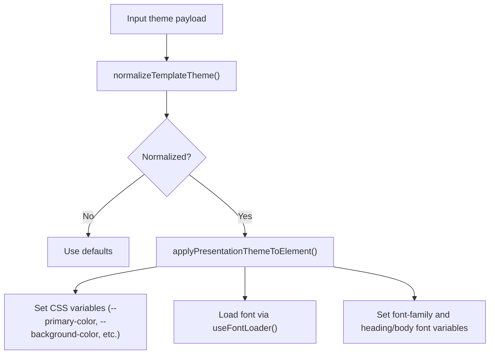
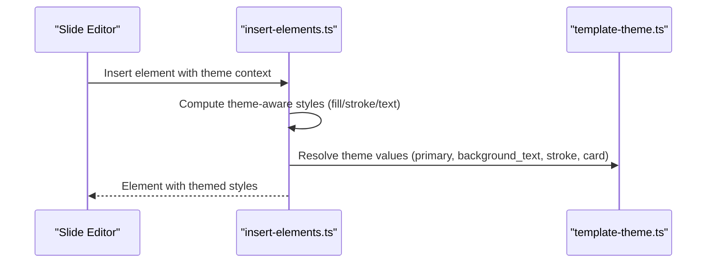
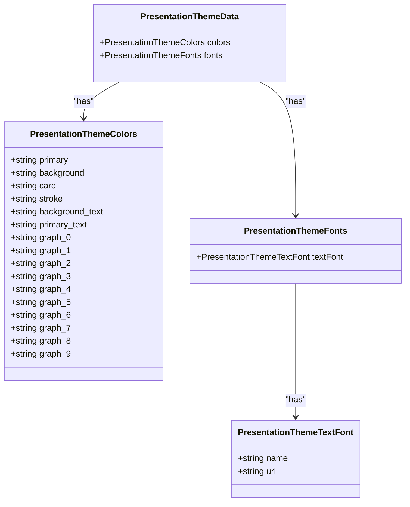
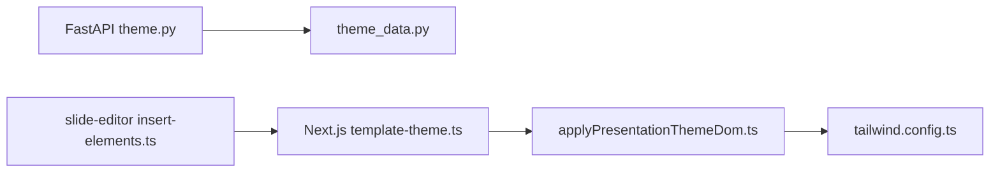

# Theme & Styling System

<cite>
**Referenced Files in This Document**
- [template-theme.ts](file://servers/nex tjs/lib/template-theme.ts)
- [applyPresentationThemeDom.ts](file://servers/nextjs/app/(presentation-generator)/presentation/utils/applyPresentationThemeDom.ts)
- [theme.py](file://servers/fastapi/templates/v2/theme.py)
- [theme_data.py](file://servers/fastapi/models/theme_data.py)
- [tailwind.config.ts](file://servers/nextjs/tailwind.config.ts)
- [insert-elements.ts](file://servers/nextjs/components/slide-editor/insert/insert-elements.ts)
- [test_template_theme.py](file://servers/fastapi/tests/unit/test_template_theme.py)
</cite>

## Table of Contents
1. [Introduction](#introduction)
2. [Project Structure](#project-structure)
3. [Core Components](#core-components)
4. [Architecture Overview](#architecture-overview)
5. [Detailed Component Analysis](#detailed-component-analysis)
6. [Dependency Analysis](#dependency-analysis)
7. [Performance Considerations](#performance-considerations)
8. [Troubleshooting Guide](#troubleshooting-guide)
9. [Conclusion](#conclusion)
10. [Appendices](#appendices)

## Introduction
This document explains Presenton’s theme and styling system that controls visual appearance across templates and presentations. It covers the theme architecture, color schemes, typography definitions, spacing rules, style inheritance, how themes are applied to templates and presentations, dynamic theme switching, CSS variables, responsive design considerations, accessibility compliance, guidelines for creating custom themes, testing approaches, troubleshooting, the programmatic theme API, and integration with the slide editor’s visual customization features.

## Project Structure
The theme system spans three layers:
- Backend (FastAPI): Builds a compact “theme profile” from template layouts, selects semantic roles (primary, background, card, stroke, text colors, graph palette, font), and materializes a final presentation theme model.
- Frontend (Next.js): Normalizes theme payloads, applies CSS variables to DOM elements, loads fonts, and integrates with Tailwind UI tokens.
- Slide Editor: Uses the resolved theme to inject consistent colors and fonts into inserted elements and charts.

**Diagram sources**
- [theme.py:145-258](file://servers/fastapi/templates/v2/theme.py#L145-L258)
- [theme_data.py:1-35](file://servers/fastapi/models/theme_data.py#L1-L35)
- [template-theme.ts:1-122](file://servers/nex tjs/lib/template-theme.ts#L1-L122)
- [applyPresentationThemeDom.ts:1-73](file://servers/nextjs/app/(presentation-generator)/presentation/utils/applyPresentationThemeDom.ts#L1-L73)
- [tailwind.config.ts:1-95](file://servers/nextjs/tailwind.config.ts#L1-L95)
- [insert-elements.ts:2569-2715](file://servers/nextjs/components/slide-editor/insert/insert-elements.ts#L2569-L2715)

**Section sources**
- [theme.py:145-258](file://servers/fastapi/templates/v2/theme.py#L145-L258)
- [theme_data.py:1-35](file://servers/fastapi/models/theme_data.py#L1-L35)
- [template-theme.ts:1-122](file://servers/nex tjs/lib/template-theme.ts#L1-L122)
- [applyPresentationThemeDom.ts:1-73](file://servers/nextjs/app/(presentation-generator)/presentation/utils/applyPresentationThemeDom.ts#L1-L73)
- [tailwind.config.ts:1-95](file://servers/nextjs/tailwind.config.ts#L1-L95)
- [insert-elements.ts:2569-2715](file://servers/nextjs/components/slide-editor/insert/insert-elements.ts#L2569-L2715)

## Core Components
- Presentation theme data model: Defines the canonical set of semantic color roles and font metadata used by both backend and frontend.
- Template theme normalization: Accepts multiple payload shapes and normalizes them into a stable shape with explicit color keys and optional font info.
- Theme profile builder and role selection: Analyzes template layout JSON to derive a compact palette and font list, then assigns semantic roles deterministically or via an LLM fallback.
- DOM theme application: Applies CSS variables and font families to presentation containers for live preview and export.
- Editor integration: Ensures newly inserted elements inherit theme colors and fonts consistently.

Key responsibilities:
- Color scheme: primary, background, card, stroke, background_text, primary_text, and a 10-color graph palette.
- Typography: textFont name and URL; font loading and CSS variable injection.
- Inheritance: Effective background propagation through nested elements; contrast repair for accessible text.
- Dynamic switching: Clearing and reapplying CSS variables on container elements.

**Section sources**
- [theme_data.py:1-35](file://servers/fastapi/models/theme_data.py#L1-L35)
- [template-theme.ts:1-122](file://servers/nex tjs/lib/template-theme.ts#L1-L122)
- [theme.py:145-258](file://servers/fastapi/templates/v2/theme.py#L145-L258)
- [applyPresentationThemeDom.ts:1-73](file://servers/nextjs/app/(presentation-generator)/presentation/utils/applyPresentationThemeDom.ts#L1-L73)
- [insert-elements.ts:2569-2715](file://servers/nextjs/components/slide-editor/insert/insert-elements.ts#L2569-L2715)

## Architecture Overview
The theme pipeline has two main flows:

1) Theme generation from templates (backend):
   - Build a compact theme profile from template layouts (colors, pairs, fonts).
   - Select semantic roles (LLM-assisted with deterministic fallback).
   - Materialize a final PresentationThemeData with repaired contrasts and complete graph palette.

2) Theme application in the browser (frontend):
   - Normalize theme payloads.
   - Apply CSS variables to presentation containers.
   - Load fonts and set font-family variables.
   - Use Tailwind tokens mapped to CSS variables for UI consistency.

**Diagram sources**
- [theme.py:246-402](file://servers/fastapi/templates/v2/theme.py#L246-L402)
- [theme_data.py:1-35](file://servers/fastapi/models/theme_data.py#L1-L35)
- [template-theme.ts:77-122](file://servers/nex tjs/lib/template-theme.ts#L77-L122)
- [applyPresentationThemeDom.ts:38-73](file://servers/nextjs/app/(presentation-generator)/presentation/utils/applyPresentationThemeDom.ts#L38-L73)

## Detailed Component Analysis

### Backend Theme Engine (FastAPI)
Responsibilities:
- Profile construction: Collects color usage statistics (fill, text, stroke, chart, infographic), builds color pairs, and aggregates fonts.
- Role selection: Chooses semantic roles using an LLM when available, otherwise falls back to deterministic heuristics.
- Materialization: Produces a validated PresentationThemeData, repairing low-contrast text and ensuring a complete 10-color graph palette.

**Diagram sources**
- [theme.py:145-258](file://servers/fastapi/templates/v2/theme.py#L145-L258)
- [theme.py:357-402](file://servers/fastapi/templates/v2/theme.py#L357-L402)

Key implementation details:
- ProfileColor and related models capture counts, areas, lightness, saturation, and slide coverage to rank importance.
- Contrast repair ensures text meets WCAG AA thresholds against surfaces.
- Graph palette completion guarantees at least 10 distinct colors derived from observed accents and primary.

**Section sources**
- [theme.py:34-88](file://servers/fastapi/templates/v2/theme.py#L34-L88)
- [theme.py:145-258](file://servers/fastapi/templates/v2/theme.py#L145-L258)
- [theme.py:357-402](file://servers/fastapi/templates/v2/theme.py#L357-L402)
- [theme.py:664-720](file://servers/fastapi/templates/v2/theme.py#L664-L720)

### Frontend Theme Normalization and Application (Next.js)
Responsibilities:
- Normalize various theme payload shapes into a stable TemplateTheme with explicit color keys and optional textFont.
- Apply CSS variables to presentation containers and load fonts.
- Provide helpers to clear and reapply theme variables for dynamic switching.

**Diagram sources**
- [template-theme.ts:77-122](file://servers/nex tjs/lib/template-theme.ts#L77-L122)
- [applyPresentationThemeDom.ts:23-73](file://servers/nextjs/app/(presentation-generator)/presentation/utils/applyPresentationThemeDom.ts#L23-L73)

Tailwind integration:
- Tailwind tokens map to CSS variables (e.g., background, foreground, primary, chart-*), enabling consistent UI theming alongside presentation themes.

**Section sources**
- [template-theme.ts:1-122](file://servers/nex tjs/lib/template-theme.ts#L1-L122)
- [applyPresentationThemeDom.ts:1-73](file://servers/nextjs/app/(presentation-generator)/presentation/utils/applyPresentationThemeDom.ts#L1-L73)
- [tailwind.config.ts:1-95](file://servers/nextjs/tailwind.config.ts#L1-L95)

### Slide Editor Integration
Responsibilities:
- When inserting elements (charts, infographics, cards), inject theme-aware colors and fonts so new content matches the active theme.
- Map theme roles to element properties such as fill, stroke, title_color, legend_color, axis_color, grid_color, and icon color.

**Diagram sources**
- [insert-elements.ts:2569-2715](file://servers/nextjs/components/slide-editor/insert/insert-elements.ts#L2569-L2715)
- [template-theme.ts:1-122](file://servers/nex tjs/lib/template-theme.ts#L1-L122)

**Section sources**
- [insert-elements.ts:2569-2715](file://servers/nextjs/components/slide-editor/insert/insert-elements.ts#L2569-L2715)

### Data Model and Contracts
The canonical theme contract includes:
- Colors: primary, background, card, stroke, background_text, primary_text, graph_0..graph_9.
- Fonts: textFont with name and url.

**Diagram sources**
- [theme_data.py:1-35](file://servers/fastapi/models/theme_data.py#L1-L35)

**Section sources**
- [theme_data.py:1-35](file://servers/fastapi/models/theme_data.py#L1-L35)

## Dependency Analysis
- Backend depends on layout analysis utilities to compute color/font profiles and uses Pydantic models for validation.
- Frontend depends on template-theme.ts for normalization and applyPresentationThemeDom.ts for runtime application.
- Tailwind config maps semantic tokens to CSS variables, decoupling UI components from concrete colors.
- Slide editor insert logic consumes theme values to ensure consistent element styling.

**Diagram sources**
- [theme.py:145-402](file://servers/fastapi/templates/v2/theme.py#L145-L402)
- [theme_data.py:1-35](file://servers/fastapi/models/theme_data.py#L1-L35)
- [template-theme.ts:1-122](file://servers/nex tjs/lib/template-theme.ts#L1-L122)
- [applyPresentationThemeDom.ts:1-73](file://servers/nextjs/app/(presentation-generator)/presentation/utils/applyPresentationThemeDom.ts#L1-L73)
- [tailwind.config.ts:1-95](file://servers/nextjs/tailwind.config.ts#L1-L95)
- [insert-elements.ts:2569-2715](file://servers/nextjs/components/slide-editor/insert/insert-elements.ts#L2569-L2715)

**Section sources**
- [theme.py:145-402](file://servers/fastapi/templates/v2/theme.py#L145-L402)
- [theme_data.py:1-35](file://servers/fastapi/models/theme_data.py#L1-L35)
- [template-theme.ts:1-122](file://servers/nex tjs/lib/template-theme.ts#L1-L122)
- [applyPresentationThemeDom.ts:1-73](file://servers/nextjs/app/(presentation-generator)/presentation/utils/applyPresentationThemeDom.ts#L1-L73)
- [tailwind.config.ts:1-95](file://servers/nextjs/tailwind.config.ts#L1-L95)
- [insert-elements.ts:2569-2715](file://servers/nextjs/components/slide-editor/insert/insert-elements.ts#L2569-L2715)

## Performance Considerations
- Profile building is O(N) over all elements and children within template layouts; clustering near colors reduces palette size to a manageable constant.
- Graph palette completion generates additional colors only when needed and caps at 10 entries.
- DOM theme application sets a fixed number of CSS variables and triggers font loading once per theme change.
- Tailwind token mapping avoids heavy recalculations by relying on CSS variables.

[No sources needed since this section provides general guidance]

## Troubleshooting Guide
Common issues and resolutions:
- Low contrast text: The backend repairs text colors to meet contrast thresholds; if still failing, verify surface vs. text color assignments and ensure proper pairing.
- Missing graph colors: Ensure graph palette completion runs; check that accent colors are detected and not filtered out due to low saturation.
- Font not loading: Confirm textFont name/url exist and that the font loader is invoked; verify network access to the font URL.
- Theme not applying: Ensure CSS variables are cleared before reapplication and that the target element exists; confirm normalizeTemplateTheme returns a valid theme.
- Editor elements mismatched: Verify insert logic uses theme values for fill, stroke, and text colors; ensure theme context is passed during insertion.

Validation references:
- Tests assert profile compactness, merging of near colors, contrast pair presence, and materialized theme correctness.

**Section sources**
- [theme.py:664-720](file://servers/fastapi/templates/v2/theme.py#L664-L720)
- [applyPresentationThemeDom.ts:23-73](file://servers/nextjs/app/(presentation-generator)/presentation/utils/applyPresentationThemeDom.ts#L23-L73)
- [test_template_theme.py:117-144](file://servers/fastapi/tests/unit/test_template_theme.py#L117-L144)

## Conclusion
Presenton’s theme system provides a robust, extensible foundation for consistent visual identity across templates and presentations. The backend derives semantic roles from template layouts with strong accessibility safeguards, while the frontend applies those roles via CSS variables and font loading. The slide editor integrates seamlessly to maintain theme consistency for user-created content. Together, these components enable dynamic theme switching, responsive design, and reliable accessibility.

[No sources needed since this section summarizes without analyzing specific files]

## Appendices

### Creating Custom Themes
Guidelines:
- Define semantic roles explicitly (primary, background, card, stroke, background_text, primary_text) and provide a coherent 10-color graph palette.
- Include a textFont with a reachable URL; ensure sufficient contrast between text and surfaces.
- Keep colors distinct and avoid near-duplicates; rely on clustering behavior but prefer intentional palettes.
- Test with real layouts to validate automatic role assignment and contrast repair.

**Section sources**
- [theme.py:145-258](file://servers/fastapi/templates/v2/theme.py#L145-L258)
- [theme.py:357-402](file://servers/fastapi/templates/v2/theme.py#L357-L402)

### Theme Testing Approaches
- Validate profile compactness and merging of near colors.
- Assert presence of accessible foreground/background pairs.
- Confirm materialized theme repairs contrast and completes graph colors.

**Section sources**
- [test_template_theme.py:117-144](file://servers/fastapi/tests/unit/test_template_theme.py#L117-L144)

### Programmatic Theme API
- Backend: Generate and materialize themes using profile builders and role selectors; return PresentationThemeData.
- Frontend: Normalize theme payloads and apply them to DOM elements; clear and reapply variables for dynamic switching.

**Section sources**
- [theme.py:246-402](file://servers/fastapi/templates/v2/theme.py#L246-L402)
- [template-theme.ts:77-122](file://servers/nex tjs/lib/template-theme.ts#L77-L122)
- [applyPresentationThemeDom.ts:23-73](file://servers/nextjs/app/(presentation-generator)/presentation/utils/applyPresentationThemeDom.ts#L23-L73)

### Responsive Design and Accessibility
- Use CSS variables for colors and fonts to support responsive scaling and dark mode via Tailwind tokens.
- Ensure text contrast ratios meet WCAG AA; leverage backend contrast repair and frontend font loading.

**Section sources**
- [tailwind.config.ts:1-95](file://servers/nextjs/tailwind.config.ts#L1-L95)
- [theme.py:664-720](file://servers/fastapi/templates/v2/theme.py#L664-L720)