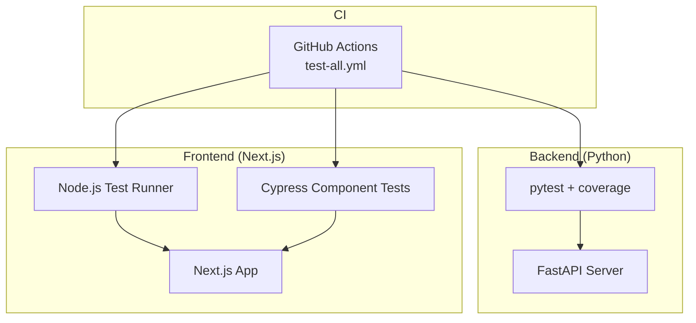
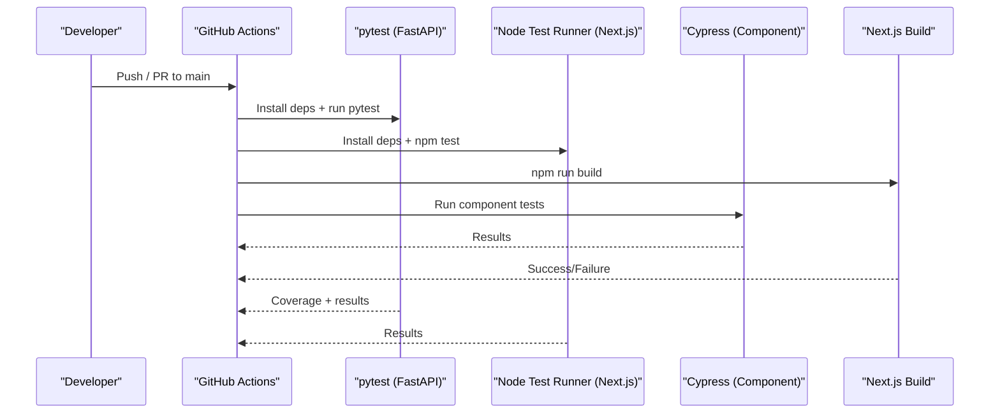
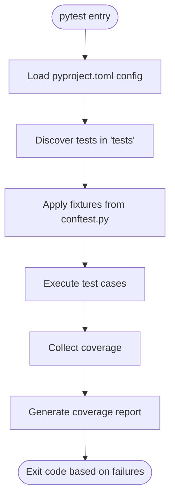
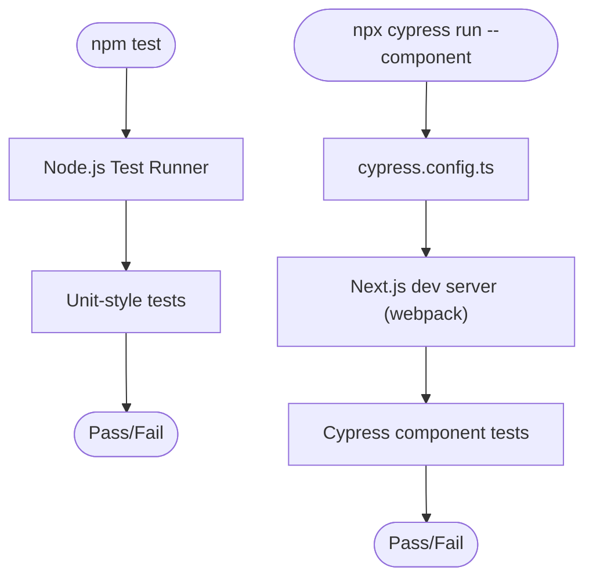
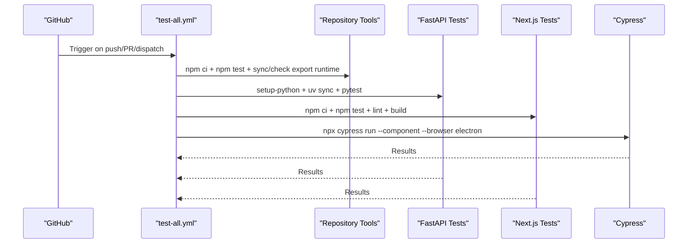
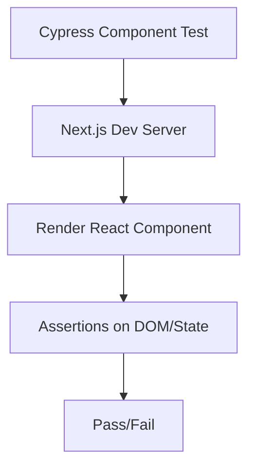
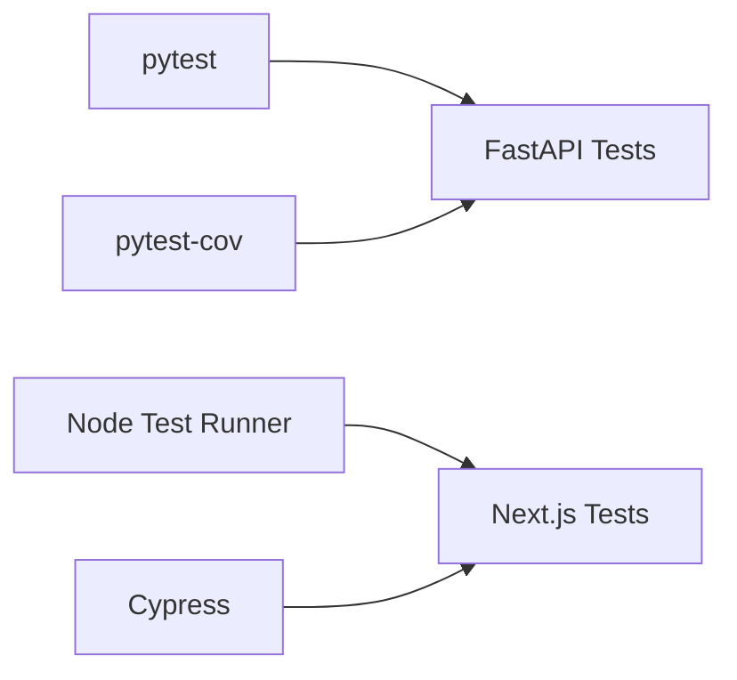

# Testing Strategy

<cite>
**Referenced Files in This Document**
- [README.md](file://README.md)
- [pyproject.toml](file://servers/fastapi/pyproject.toml)
- [package.json](file://servers/nex tjs/package.json)
- [cypress.config.ts](file://servers/nextjs/cypress.config.ts)
- [test-all.yml](file://.github/workflows/test-all.yml)
- [conftest.py](file://servers/fastapi/tests/conftest.py)
- [test_server.py](file://test_server.py)
</cite>

## Table of Contents
1. [Introduction](#introduction)
2. [Project Structure](#project-structure)
3. [Core Components](#core-components)
4. [Architecture Overview](#architecture-overview)
5. [Detailed Component Analysis](#detailed-component-analysis)
6. [Dependency Analysis](#dependency-analysis)
7. [Performance Considerations](#performance-considerations)
8. [Troubleshooting Guide](#troubleshooting-guide)
9. [Conclusion](#conclusion)

## Introduction
This document explains Presenton’s testing strategy and quality assurance practices across the Python backend, JavaScript frontend, and browser automation layers. It covers unit tests, integration tests, end-to-end tests, CI pipelines, coverage reporting, mocking strategies, test data management, and guidance for testing AI-dependent features and complex workflows.

## Project Structure
Presenton uses a multi-layered testing approach:
- Python backend (FastAPI): pytest-based unit and integration tests under servers/fastapi/tests.
- JavaScript/TypeScript frontend (Next.js): Node.js built-in test runner for unit-style tests and Cypress component tests.
- Repository tooling: top-level scripts with Node.js tests.
- Continuous Integration: GitHub Actions workflow runs all test suites and builds.

**Diagram sources**
- [test-all.yml:1-112](file://.github/workflows/test-all.yml#L1-L112)
- [pyproject.toml:59-86](file://servers/fastapi/pyproject.toml#L59-L86)
- [package.json:6-12](file://servers/nex tjs/package.json#L6-L12)
- [cypress.config.ts:1-12](file://servers/nextjs/cypress.config.ts#L1-L12)

**Section sources**
- [README.md:267-340](file://README.md#L267-L340)
- [test-all.yml:1-112](file://.github/workflows/test-all.yml#L1-L112)

## Core Components
- Backend testing stack:
  - pytest as the test runner.
  - pytest-cov for coverage collection and reporting.
  - Configuration in pyproject.toml defines test paths, coverage source, and report options.
- Frontend testing stack:
  - Node.js built-in test runner via npm test.
  - Cypress for component tests against Next.js dev server.
- CI pipeline:
  - GitHub Actions job matrix runs repository tools, FastAPI tests, and Next.js tests including lint, build, and Cypress component tests.

Key responsibilities:
- Unit tests validate business logic, utilities, and services in isolation.
- Integration tests exercise API endpoints, database interactions, and external integrations where appropriate.
- End-to-end/component tests verify UI flows and cross-cutting behavior using Cypress.

**Section sources**
- [pyproject.toml:59-86](file://servers/fastapi/pyproject.toml#L59-L86)
- [package.json:6-12](file://servers/nex tjs/package.json#L6-L12)
- [cypress.config.ts:1-12](file://servers/nextjs/cypress.config.ts#L1-L12)
- [test-all.yml:14-112](file://.github/workflows/test-all.yml#L14-L112)

## Architecture Overview
The testing architecture spans three layers orchestrated by CI:

**Diagram sources**
- [test-all.yml:40-112](file://.github/workflows/test-all.yml#L40-L112)

## Detailed Component Analysis

### Python Backend Testing (pytest)
- Test discovery and configuration:
  - Test path configured to servers/fastapi/tests.
  - Coverage enabled with relative file paths, excluding tests, venvs, alembic versions, and scripts.
- Fixtures and mocks:
  - conftest.py provides a FakeAsyncSession fixture to mock database sessions and common operations like get/add/delete/commit.
  - A snapshots_dir fixture and load_snapshot helper support regression snapshot testing.
- Typical scope:
  - Unit tests for utilities, services, and domain logic.
  - Integration tests for API routes and async task handling.

**Diagram sources**
- [pyproject.toml:59-86](file://servers/fastapi/pyproject.toml#L59-L86)
- [conftest.py:1-71](file://servers/fastapi/tests/conftest.py#L1-L71)

**Section sources**
- [pyproject.toml:59-86](file://servers/fastapi/pyproject.toml#L59-L86)
- [conftest.py:8-56](file://servers/fastapi/tests/conftest.py#L8-L56)
- [conftest.py:59-71](file://servers/fastapi/tests/conftest.py#L59-L71)

### JavaScript Frontend Testing (Node.js + Cypress)
- Node.js tests:
  - Executed via npm test using the Node.js built-in test runner.
  - Used for utility and module-level tests within the Next.js app.
- Cypress component tests:
  - Configured to use Next.js framework with webpack bundler in component mode.
  - Runs in CI after building the application.

**Diagram sources**
- [package.json:6-12](file://servers/nex tjs/package.json#L6-L12)
- [cypress.config.ts:1-12](file://servers/nextjs/cypress.config.ts#L1-L12)

**Section sources**
- [package.json:6-12](file://servers/nex tjs/package.json#L6-L12)
- [cypress.config.ts:1-12](file://servers/nextjs/cypress.config.ts#L1-L12)

### Continuous Integration Pipeline
- Triggers: push and pull_request to main, plus manual dispatch.
- Jobs:
  - Repository tools: install dependencies, run npm test, sync and verify presentation export runtime.
  - FastAPI: set up Python 3.11, uv, install locked dependencies, create temp directories, run pytest with verbose output.
  - Next.js: install dependencies, run npm test, lint, build, then run Cypress component tests.

**Diagram sources**
- [test-all.yml:1-112](file://.github/workflows/test-all.yml#L1-L112)

**Section sources**
- [test-all.yml:1-112](file://.github/workflows/test-all.yml#L1-L112)

### Test Organization and Data Management
- Backend:
  - Tests live under servers/fastapi/tests with clear separation between unit, integration, edge cases, and regression snapshots.
  - conftest.py centralizes shared fixtures such as FakeAsyncSession and snapshot helpers.
- Frontend:
  - Node.js tests co-located with modules or under servers/nextjs/tests.
  - Cypress component tests are configured via cypress.config.ts and can leverage Next.js dev server.

Best practices:
- Keep tests deterministic; avoid reliance on external state unless explicitly mocked.
- Use fixtures for shared setup and teardown.
- Prefer small, focused tests that assert one behavior at a time.

**Section sources**
- [conftest.py:1-71](file://servers/fastapi/tests/conftest.py#L1-L71)
- [cypress.config.ts:1-12](file://servers/nextjs/cypress.config.ts#L1-L12)

### Mocking Strategies
- Database/session layer:
  - FakeAsyncSession simulates SQLAlchemy-like async session methods (get, add, delete, commit, rollback, scalars).
- External services:
  - For LLM and image providers, prefer environment toggles and stubbed clients in tests to avoid real network calls.
  - Disable optional features during CI (e.g., disable anonymous tracking and image generation) to reduce flakiness.

Guidelines:
- Isolate side effects behind interfaces so they can be replaced with fakes or stubs.
- Validate error paths and timeouts explicitly.

**Section sources**
- [conftest.py:8-56](file://servers/fastapi/tests/conftest.py#L8-L56)
- [test-all.yml:46-52](file://.github/workflows/test-all.yml#L46-L52)

### Testing AI-Dependent Features
- Determinism:
  - Avoid calling production LLM/image APIs in automated tests. Use local models or mocked responses when possible.
- Prompt and schema validation:
  - Test prompt assembly, JSON schema validation, and content constraints without invoking providers.
- Provider selection:
  - Ensure provider routing logic is tested with multiple configurations while keeping network calls disabled.

Recommendations:
- Create provider-agnostic abstractions and inject test doubles.
- Snapshot outputs for stable components (e.g., slide outlines) to detect regressions.

[No sources needed since this section provides general guidance]

### End-to-End and Browser Automation
- Cypress component tests:
  - Run against the Next.js dev server using webpack bundler.
  - Suitable for validating UI components, interactions, and rendering behavior.
- Desktop/version checks:
  - A simple HTTP server stub is provided for version-check flows used by the Electron app during development/testing.

**Diagram sources**
- [cypress.config.ts:1-12](file://servers/nextjs/cypress.config.ts#L1-L12)
- [test_server.py:1-79](file://test_server.py#L1-L79)

**Section sources**
- [cypress.config.ts:1-12](file://servers/nextjs/cypress.config.ts#L1-L12)
- [test_server.py:1-79](file://test_server.py#L1-L79)

## Dependency Analysis
Testing dependencies are declared per project:
- Backend: pytest and pytest-cov in dev dependencies.
- Frontend: Cypress as a dev dependency; Node.js built-in test runner used via npm test.

**Diagram sources**
- [pyproject.toml:59-63](file://servers/fastapi/pyproject.toml#L59-L63)
- [package.json:72-85](file://servers/nex tjs/package.json#L72-L85)

**Section sources**
- [pyproject.toml:59-63](file://servers/fastapi/pyproject.toml#L59-L63)
- [package.json:72-85](file://servers/nex tjs/package.json#L72-L85)

## Performance Considerations
- Keep unit tests fast and isolated; avoid heavy I/O or network calls.
- Use in-memory or lightweight databases for integration tests.
- Limit parallel image generation and external calls in tests to reduce flakiness and resource usage.
- Profile slow tests locally before adding them to CI.

[No sources needed since this section provides general guidance]

## Troubleshooting Guide
Common issues and resolutions:
- Flaky external calls:
  - Disable non-essential features in CI (e.g., anonymous tracking, image generation) to stabilize tests.
- Database-related failures:
  - Ensure temporary directories exist and are writable; use the FakeAsyncSession fixture for pure unit tests.
- Cypress component tests:
  - Verify Next.js dev server starts correctly and webpack bundling succeeds.
  - Use headless execution in CI; switch to Electron browser if needed.

Operational tips:
- Run pytest with verbose output and short tracebacks for faster debugging.
- Inspect coverage reports to identify untested branches and adjust tests accordingly.

**Section sources**
- [test-all.yml:46-52](file://.github/workflows/test-all.yml#L46-L52)
- [test-all.yml:71-75](file://.github/workflows/test-all.yml#L71-L75)
- [test_all.yml:110-112](file://.github/workflows/test-all.yml#L110-L112)

## Conclusion
Presenton’s testing strategy combines pytest for backend logic, Node.js tests for frontend utilities, and Cypress for component-level UI verification, all orchestrated by GitHub Actions. The approach emphasizes determinism, isolation, and clear reporting through coverage. By following the guidelines here—mocking external services, organizing tests effectively, and leveraging CI—you can maintain high confidence in AI-driven features and complex workflows.